<div align="center">

# The Opening Playbook

**A chess opening trainer built from my own games, with no notation anywhere.**

A White repertoire, a Black repertoire, spaced-repetition drills, a sparring sandbox whose opponent plays like real club players, and engine-checked reviews of the games that got away. It all ships as a single self-contained HTML page.

[**Open the app →**](https://vladapl21.github.io/chess-opening-playbook/)

[Tour](#a-tour) · [The repertoires](#the-repertoires) · [How it was made](#how-it-was-made) · [Under the hood](#under-the-hood) · [Build it yourself](#build-it-yourself)


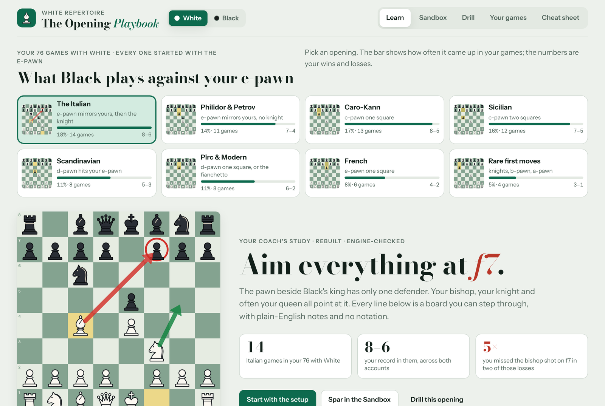

</div>

## Why it exists

Most opening courses are written for everyone. They give long lines in algebraic notation, chosen because they are theoretically best and taught in an order that has nothing to do with what you will actually face. This project goes the other way. It starts from **149 of my blitz games** on two chess.com accounts, played between July and October 2026, and builds the openings around them.

- **The chapters come from the games.** Each book is split by what the opponent actually played, ordered by how often it happened, with the win–loss record next to it.
- **The opponent plays like a real opponent.** Every opponent move in the book carries the odds that a club player at this level would choose it. The first move's odds come from the games themselves. After that they come from [Maia](https://maiachess.com), a neural network trained to predict human moves at a given rating. The drills, the sandbox and every "how often" figure use these odds, so preparation goes where the games actually go.
- **Words instead of notation.** Moves are described the way you would explain them over a board: *Bishop aims at f7*, *Knight takes back*, *Queen breaks the pin*. Positions that matter get a short note explaining why.
- **Checked by an engine, built for a human.** Every move in both books was checked with Stockfish 17.1. Lines were chosen to be easy to remember, such as one setup against a whole family of move orders, rather than to squeeze out the last hundredth of a pawn.
- **The games feed back in.** Missed tactics become puzzles. Habits that cost games become "insights" with a button that drills the real positions. Notes point back to the games they came from: *"Against ZhoskaStreezh in July you pushed the d-pawn first and the e-pawn took your knight. Knight first, every time."*

## At a glance

|                                   | White book                | Black book                       |
| --------------------------------- | ------------------------: | -------------------------------: |
| Games it is built from            | 76, all opened with 1.e4  | 73: 44 against 1.e4, 24 against 1.d4 |
| Record in those games             | 48–28                     | 37–35–1                          |
| Chapters (openings)               | 8                         | 9                                |
| Lessons                           | 79                        | 63                               |
| Lines you can drill               | 274                       | 418                              |
| Positions in the tree             | 2,233                     | 2,081                            |
| Positions with a written note     | 826                       | 602                              |
| Game reviews                      | 10                        | 11                               |
| Missed-shot puzzles               | 12                        | 13                               |
| Patterns across games             | 4                         | 4                                |
| Cheat-sheet cards                 | 47                        | 48                               |

## A tour

### Learn: two books, one switch

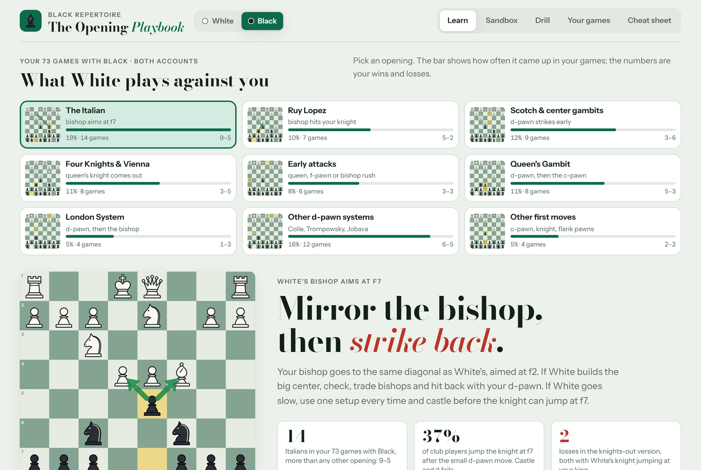

The **White | Black** switch swaps the whole app: board orientation, chapters, drills, games and progress. Each book remembers its own place and its own count of lines due for review. Every chapter opens with a board showing the key idea, the plan in one sentence, and three facts from the games. One example: *"37% of club players jump the knight at f7 after the small d-pawn move. Castle and it fails."* Lessons are grouped into parts and tagged **core**, **common** or **rare**, so the most frequent lines come first.

### Study: step through any line

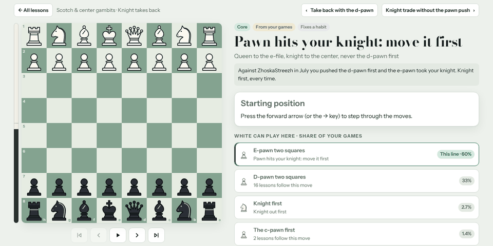

Each lesson is a board you step through with the buttons or the arrow keys. Every move has its label, an optional note, arrows and circles where they help, and the engine's verdict in words (*Equal*, *Better for White*) with the number beside it. Wherever the opponent has a choice, the alternatives are listed with how often players at this level pick them, and one click jumps into that branch.

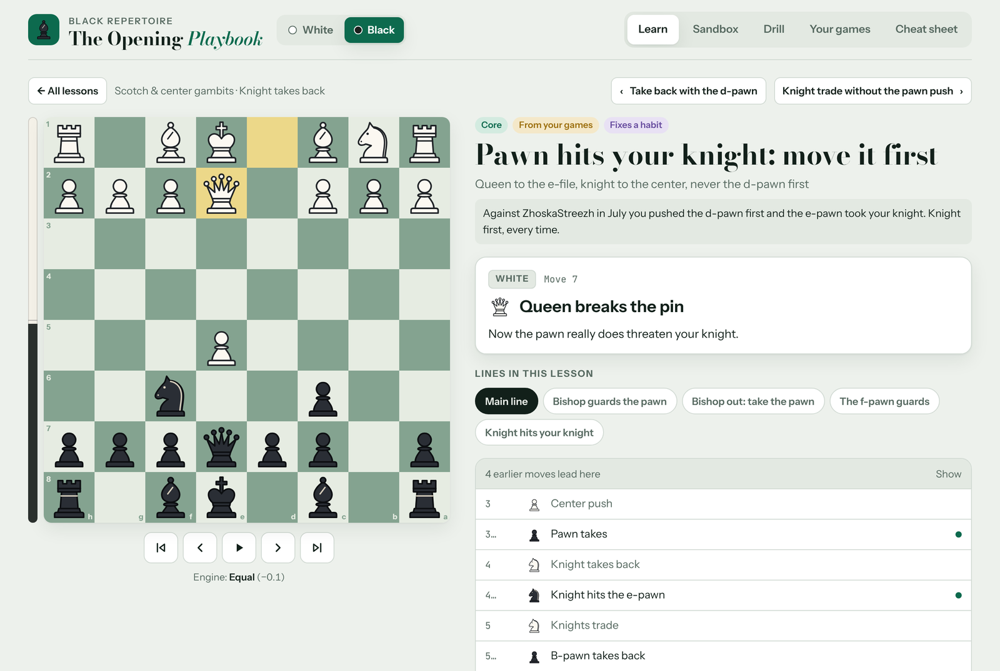

### Drill: spaced repetition, with the opponent's moves played for you

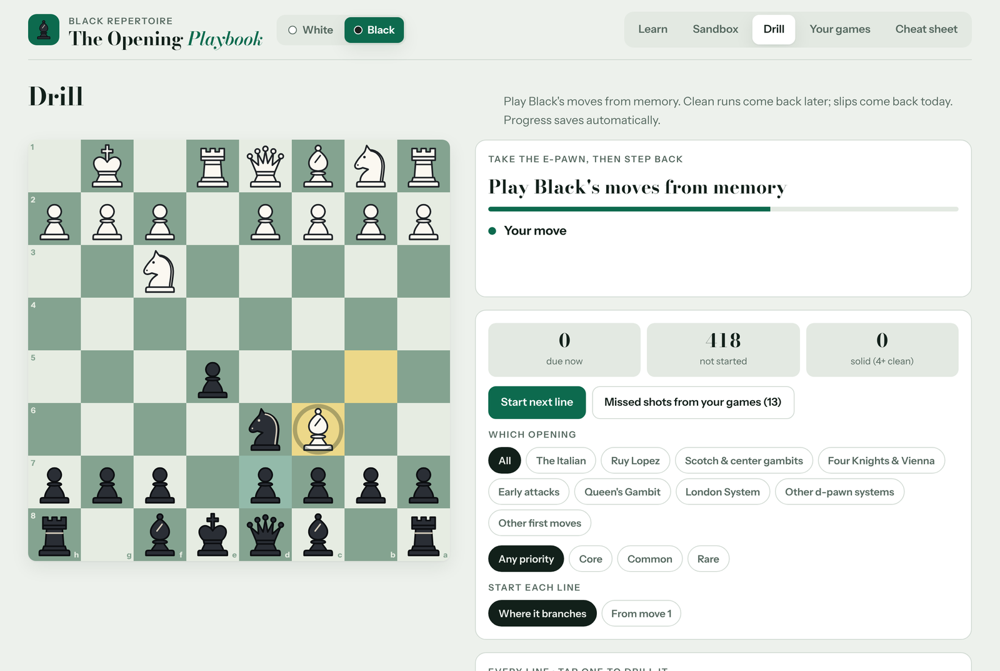

You play your side's moves from memory and the opponent's moves play themselves. You can drag or tap, and you castle by moving the king two squares or onto its rook. A wrong move gets a second try and then an arrow. Lines are scheduled in Leitner boxes: a clean run sends a line further out (1, 2, 4, 8, then 16 days), and a slip brings it back today. You can filter by opening and by priority, and start each line either from move one or from the point where it branches off lines you already know.

### Sandbox: play your prep against a realistic opponent

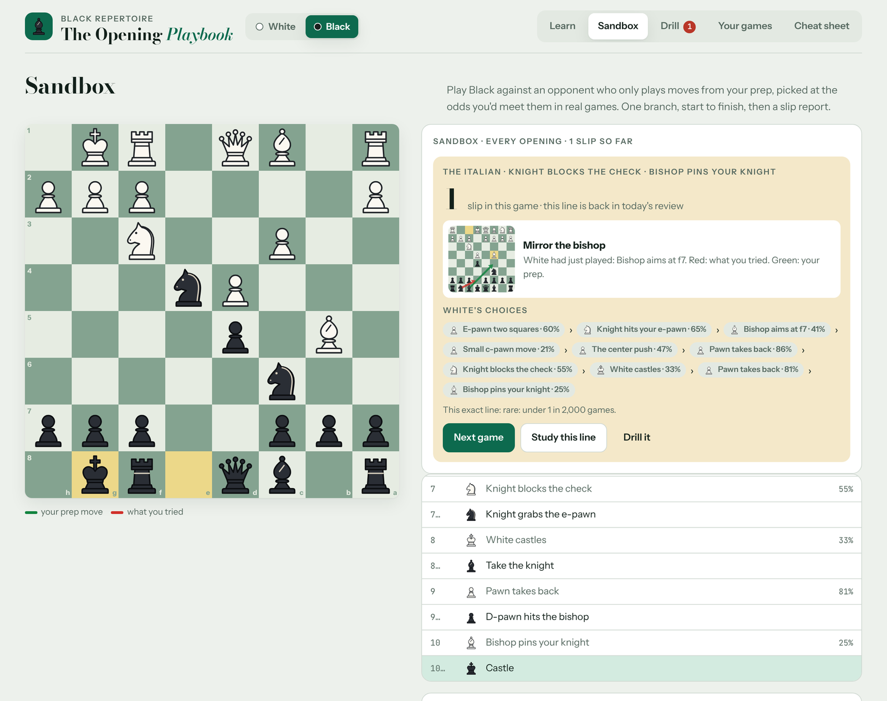

The sandbox plays one branch of the book as a full game. The opponent only plays moves that are in your book, picked with one of three settings:

- **Like real games.** Each reply is weighted by how often club players choose it.
- **Even spread.** Every line in the book is equally likely.
- **My weak spots.** Lines you have never played or that are due count more, and solid ones count less.

At the end you get a slip report. Each mistake is shown on a mini board (red for what you tried, green for your prep), along with the chain of the opponent's choices and their odds and how rare the exact line was (*"under 1 in 2,000 games"*). Any line you slipped on goes straight back into today's drill. Changing the opening or the odds mid-game applies to the next game, with a button to start it right away, so the current game is never cut off.

### Your games: what actually happened

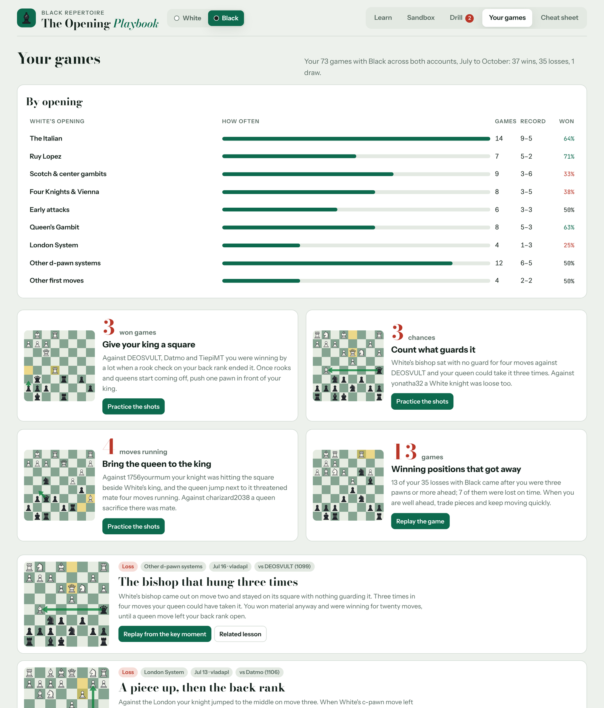

This page shows results by opening and four patterns that cost games, each with a practice button that drills the real positions. It also has reviews of the most instructive games. Each review has a title, the story in plain words, a replay that starts at the key moment, the better continuation, and a link to the lesson that fixes the problem.

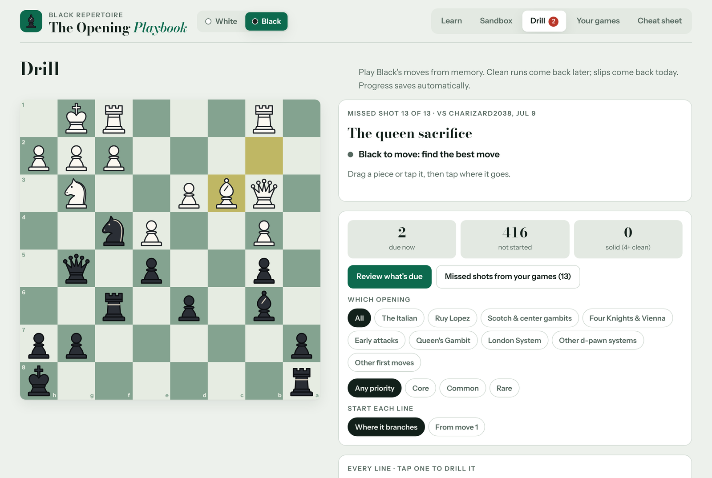

**Missed shots** are positions from the games where one move won and a different one was played. They were found by scanning every game with Stockfish and then picked by hand.

### Cheat sheet

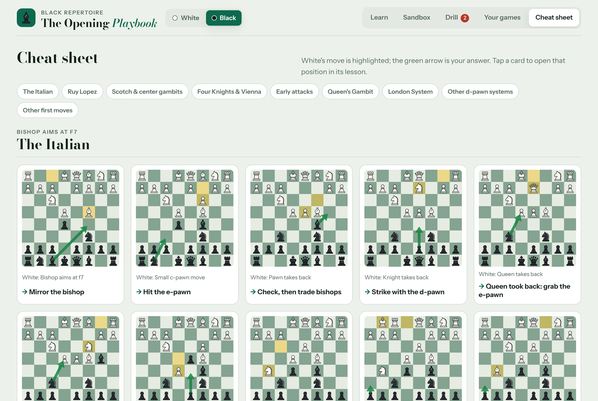

The cheat sheet has one card per decision. The opponent's move is highlighted and the green arrow is your answer. Tap a card to open that position in its lesson.

### On a phone, in light or dark

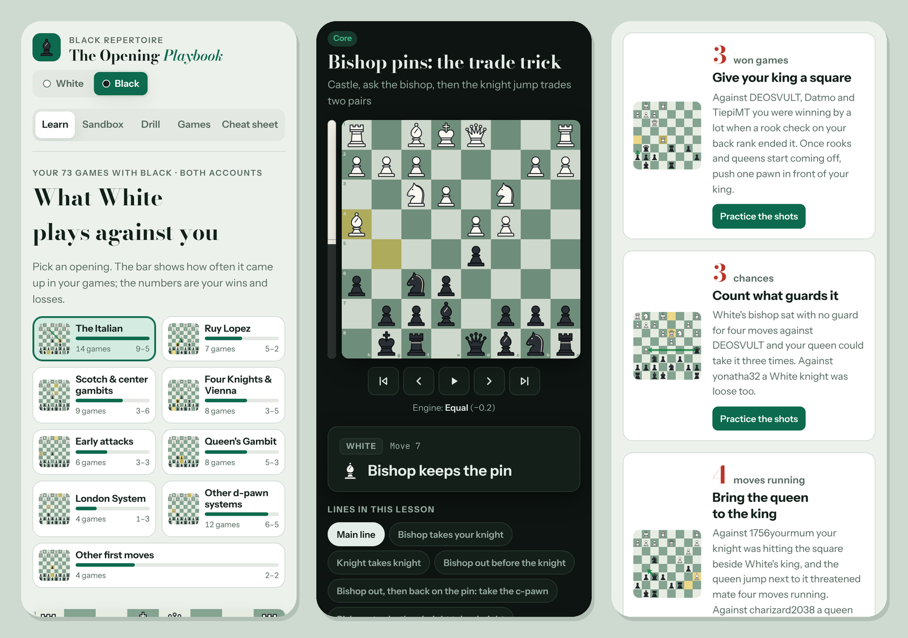

The layout collapses to one column on phones and follows the system's light or dark setting. The board, menus and drills all work by touch.

## The repertoires

### White: 1.e4, built around the Italian

| Chapter | When Black plays | Games | Record | The plan in one line |
| --- | --- | ---: | :---: | --- |
| **The Italian** | 1…e5 2…Nc6 | 14 | 8–6 | Bishop aimed at f7. Against …Bc5, play c3 and d4 (the Møller attack and four traps). Against the Two Knights, Ng5 (the Fried Liver and the main line). Rebuilt from my coach's study. |
| **Philidor & Petrov** | 1…e5 without …Nc6 | 11 | 7–4 | Take the center, then look at f7. Covers the copycat trap in the Petrov and the queen fork against the Philidor. |
| **Caro-Kann** | 1…c6 | 13 | 8–5 | Chase the bishop with the h-pawn, trade it off, castle long. If Black offers a knight trade, take it. |
| **Sicilian** | 1…c5 | 12 | 7–5 | The small c-pawn move, then d4. Whenever Black's knight is in reach of your d-pawn, push the pawn at it. |
| **Scandinavian** | 1…d5 | 8 | 5–3 | Develop with tempo against the queen. Every queen move is another move ahead. |
| **Pirc & Modern** | 1…d6, 1…g6 | 8 | 6–2 | Line up queen and bishop, castle long, trade the fianchetto bishop, push the h-pawn. |
| **French** | 1…e6 | 6 | 4–2 | Advance: lock the center and support the pawn chain from behind. |
| **Rare first moves** | 1…Nc6, 1…Nf6, 1…b6 | 4 | 3–1 | Take the whole center, develop and castle, with the one trick to know for each. |

### Black: 1…e5 against the e-pawn, the Queen's Gambit Declined against the d-pawn

| Chapter | When White plays | Games | Record | The plan in one line |
| --- | --- | ---: | :---: | --- |
| **The Italian** | 1.e4 e5 2.Nf3 Nc6 3.Bc4 | 14 | 9–5 | Giuoco Piano. Against c3 and d4: take, check, trade bishops, strike with …d5. Against the slow Italian, one setup every time, castling before the knight can jump at f7. |
| **Ruy Lopez** | 3.Bb5 | 7 | 5–2 | Berlin: the knight hits the e-pawn at once. Against the exchange, take back toward the center. |
| **Scotch & center gambits** | 2.d4 or 3.d4 | 9 | 3–6 | Knight first, then the pawns. Against the gambits (Scotch Gambit, Danish, Center Game), develop and hit back with …d5. |
| **Four Knights & Vienna** | 2.Nc3 or 3.Nc3 | 8 | 3–5 | Copy the bishop or slide into the Italian setup. Against the Vienna bishop, the knight jumps to the edge to trade it off. |
| **Early attacks** | 2.Qh5, 2.Qf3, 2.f4, 2.Bc4 | 6 | 3–3 | Block f7, tuck the bishop beside the king, then castle or jump into the center. Take the King's Gambit pawn and strike with …d5. |
| **Queen's Gambit** | 1.d4 d5 2.c4 | 8 | 5–3 | Declined. When the bishop pins, play …h6 and …Ne4 to trade two pairs. In the Exchange, take back with the e-pawn. |
| **London System** | 1.d4 d5 2.Bf4 | 4 | 1–3 | …d5, …c5, knight, …e6, then offer the dark bishop for White's. |
| **Other d-pawn systems** | Colle, Trompowsky, Torre, Jobava | 12 | 6–5–1 | The same setup every time: …d5, …e6, …c5. If the knight is taken early, recapture toward the center. |
| **Other first moves** | 1.c4, 1.Nf3, 1.g3, 1.e3 | 4 | 2–2 | …e5 against the flank openings, and the Queen's Gambit setup against 1.Nf3. |

72 of the 73 Black games fall into a chapter. The remaining one, an experiment with 1…b6, sits outside the book.

## How it was made

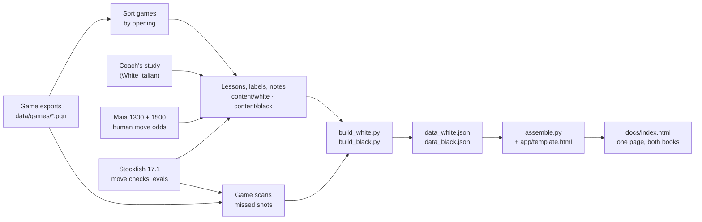

1. **The games.** PGN exports of both accounts live in [`data/games`](data/games). `black_games.py` collects the Black games and `black_chapters.py` sorts them by White's setup. The White build does the same by Black's reply.
2. **Your moves.** The White Italian chapter started from my coach's Lichess study and was rebuilt line by line. The other seven White chapters and the whole Black book were written from my games. The aim was sound lines that are easy to remember (one setup against many move orders, the same idea showing up across chapters), with every move checked by Stockfish.
3. **The opponent's moves.** The Maia 1300 and 1500 models are averaged to give the probability of every legal move in every position. [`pipeline/maia.py`](pipeline/maia.py) is a short NumPy implementation of the Leela Chess Zero network forward pass. It reads the Maia weight files directly, so it needs no lc0 binary, TensorFlow or GPU. While the books were being written, [`expand.py`](pipeline/expand.py) walked the tree and listed every opponent reply with at least a 10% chance whose line is reached in at least 0.4% of games, flagging any position the book had no answer for yet. [`check_black.py`](pipeline/check_black.py) checks every Black line for legality, the quality of your moves (Stockfish multi-PV), how realistic the opponent's moves are, and which common replies a line leaves uncovered.
4. **Words, not notation.** Hand-written labels and notes live in [`content/`](content), keyed by the move sequence that reaches each position: `n(path, label, text, tags, arrows, circles)`. Moves without a hand-written label get one from [`label2.py`](pipeline/label2.py), which describes what the move does in context: captures and recaptures, checks, pins, attacks on a bigger or loose piece, castling, pawn pushes. [`lint_notes.py`](pipeline/lint_notes.py) checks claims in the notes, such as pins or "a piece up", against the real positions.
5. **Game reviews.** [`scan_games.py`](pipeline/scan_games.py) evaluates every move of every game. [`find_shots.py`](pipeline/find_shots.py) keeps positions where the move played lost at least 1.8 pawns and a deeper multi-PV search shows one clearly best move, at least 1.5 pawns ahead of the next. The cleanest of these became the puzzles. The game stories and the cross-game patterns were written from the same scans.
6. **Build.** [`build_white.py`](pipeline/build_white.py) and [`build_black.py`](pipeline/build_black.py) merge all lines into one tree per book ([`tree.py`](pipeline/tree.py)). They attach labels, notes, arrows, odds and evaluations, precompute the legal moves wherever you are to move, and write `data/build/data_*.json`. [`assemble.py`](pipeline/assemble.py) injects both books and the piece set into [`app/template.html`](app/template.html) and writes [`docs/index.html`](docs/index.html).
7. **Caches.** Every Stockfish and Maia result is cached in [`data/cache`](data/cache) and committed. That makes the build reproducible byte for byte with nothing but python-chess, in a few seconds and without any engine.

## Under the hood

- **One file.** The app is one HTML file of about 1.4 MB with both books inline: plain HTML, CSS and JavaScript, with no framework, bundler or third-party script. The only network requests are for three Google Fonts (Bodoni Moda, Instrument Sans, JetBrains Mono). Offline, it falls back to system fonts.
- **Board.** The board is SVG, drawn with an original piece set ([`app/pieces.py`](app/pieces.py)). It supports drag and tap input, legal-move hints, arrows, circles and a flipped view for Black. Legal moves are precomputed for every position where you move, so the page needs no chess library.
- **Two books, one engine.** `loadBook()` swaps every index (nodes, lines, lessons, chapters, whose move is whose, board orientation) when you flip the switch. Line ids never collide between the books (the build checks this), so one progress store holds both.
- **Progress.** Progress is saved in `localStorage`. When the page runs as a Claude artifact, it also syncs to the artifact's per-user storage, so it follows you between devices.
- **Deep links.** `#learn`, `#sandbox`, `#drill`, `#games`, `#cheat`, `#learn.<chapter>` and `#line.<line-id>` open the matching view. Add a `b.` prefix for the Black book, for example [`#b.learn.london`](https://vladapl21.github.io/chess-opening-playbook/#b.learn.london) or [`#b.line.bs-mieses`](https://vladapl21.github.io/chess-opening-playbook/#b.line.bs-mieses).

<details>
<summary><b>Data model</b></summary>

Each book is one JSON object. Its `nodes` form a tree of positions, and everything else points into it by index.

| Key | What it holds |
| --- | --- |
| `nodes` | The move tree (fields below) |
| `lines` | A named path through the tree: `{id, lesson, title, main, n: [node indexes]}` |
| `lessons` | `{id, part, title, sub, why, pri: core/common/rare, outcome, lines}` |
| `parts`, `chapters` | Grouping, chapter text, hero boards, facts and per-chapter game stats |
| `games` | Reviews: opponent, ratings, result, date, story, key moments, replay lines |
| `puzzles` | Missed shots: game, position, accepted answers, title, note |
| `cheat` | Cheat-sheet cards: the position, your move, the rule in a few words, the lesson |
| `insights` | Patterns across games, each linked to a puzzle or a moment in a game |
| `legal` | Legal moves (UCI) for every position where you are to move |
| `stats` | Totals behind the headings: games, wins, losses, first moves |

| Node field | Meaning |
| --- | --- |
| `p`, `k` | Parent index and children |
| `u`, `pc`, `w` | Move in UCI, the piece that moved, whether White made it |
| `f` | Position after the move (FEN board field) |
| `l`, `t` | Plain-English label and note |
| `a`, `c` | Arrows and circled squares, e.g. `c4f7r` = red arrow from c4 to f7 |
| `e` | Stockfish evaluation in centipawns, from White's side |
| `q` | Probability that the opponent plays this move at this level |
| `g` | Tags: `key`, `trap`, `warn`, `mistake`, `best`, `game`, … |
| `cap`, `chk`, `mate`, `x`, `ep` | Capture, check, mate, castling rook move, en passant |

</details>

<details>
<summary><b>Drill scheduling and sandbox odds</b></summary>

**Drill.** Each line sits in a Leitner box. A clean run moves it up one box and a slip drops it to box 0.

| Box | 0 | 1 | 2 | 3 | 4 | 5 |
| --- | :-: | :-: | :-: | :-: | :-: | :-: |
| Comes back after | same day | 1 day | 2 days | 4 days | 8 days | 16 days |

**Sandbox.** At each opponent turn, the move is drawn from the replies in your book with these weights:

| Setting | Weight of a reply |
| --- | --- |
| Like real games | its human probability `q` |
| Even spread | the number of book lines behind it |
| My weak spots | the sum of "need" over the lines behind it (never played 3, due 2.5, solid 0.35, otherwise 1), times √`q` |

The rarity line in the report is the product of `q` along the opponent's moves: *"this exact line: about 1 in N games."*

</details>

## Repository layout

```
app/
  template.html            the whole app: markup, styles and script for both books
  pieces.py                the original SVG piece set
content/
  white/                   White book: lessons, labels and notes, chapter text, game reviews
  black/                   Black book: bcontent (lessons), bnotes + bnotes2 (labels, notes, arrows),
                           bmeta (chapters, game reviews, puzzles, cheat sheet, insights)
pipeline/
  build_white.py           build the White book    -> data/build/data_white.json
  build_black.py           build the Black book    -> data/build/data_black.json
  assemble.py              inject both into the template -> docs/index.html
  tree.py, label2.py       move tree; context-aware plain-English labels
  maia.py, expand.py       human move odds (Maia, NumPy only) and the coverage walk
  human_odds.py, sf.py     command-line helpers: Maia odds and Stockfish top moves for any line
  eng.py                   Stockfish wrapper
  black_games.py, black_chapters.py, scan_games.py, find_shots.py
                           game import, sorting by opening, engine scans, missed shots
  check_black.py, lint_notes.py
                           engine and wording checks
  paths.py, common.py      paths, environment variables, shared imports
data/
  games/                   PGN exports of both accounts (July to October 2026)
  cache/                   Stockfish and Maia results, so builds need no engine
  black_*.json             Black games, per-move scans, candidate shots
  build/                   data_white.json, data_black.json, playbook.html
docs/
  index.html               the built app, served by GitHub Pages
  img/                     the images in this README
tests/
  e2e_white.py, e2e_black.py, e2e_sandbox_switch.py
                           end-to-end browser tests (Playwright)
  readme_shots.py          regenerates docs/img
```

## Build it yourself

The built app is committed, so [`docs/index.html`](docs/index.html) opens straight from disk. To rebuild it:

```bash
git clone https://github.com/vladapl21/chess-opening-playbook.git
cd chess-opening-playbook
python3 -m pip install -r requirements.txt     # python-chess (+ numpy for Maia)
make build                                     # or run the three scripts below
```

```bash
python3 pipeline/build_white.py
python3 pipeline/build_black.py
python3 pipeline/assemble.py
```

With the committed caches the rebuilt files are byte-identical to the ones in the repo.

### Changing the books

Edit the files in [`content/`](content) and rebuild. Positions that are not in the cache yet need the engines, which are not part of this repository:

| Variable | Points to | Default |
| --- | --- | --- |
| `STOCKFISH` | a [Stockfish](https://stockfishchess.org/download/) binary (17.1 was used) | `stockfish` on your `PATH` |
| `MAIA_WEIGHTS` | a folder with `maia-1300.pb.gz` and `maia-1500.pb.gz` from [CSSLab/maia-chess](https://github.com/CSSLab/maia-chess) | `vendor/maia` |
| `LCZERO_TRAINING` | a checkout of [LeelaChessZero/lczero-training](https://github.com/LeelaChessZero/lczero-training) (for `tf/policy_index.py`) | `vendor/lczero-training` |

Some useful commands while writing:

```bash
python3 pipeline/human_odds.py "e4 e5 Nf3 Nc6 Bc4"     # what club players play here, with odds
python3 pipeline/sf.py -d 18 "e4 e5 Nf3 Nc6 Bc4 Bc5"   # Stockfish's top three moves
python3 pipeline/check_black.py 16 bi-main,bs-mieses   # check lessons (or all, without ids)
python3 pipeline/lint_notes.py                         # notes that contradict their position
```

### Tests

```bash
python3 -m pip install -r requirements-dev.txt
python3 -m playwright install chromium
make test
```

The tests drive the real page in Chromium. They visit every chapter in both books, step through lessons, and play drills by dragging and tapping (correct moves, slips, castling). They solve every puzzle and play sandbox games across every opening and odds setting, including a regression test for changing the opening mid-game. They also follow deep links, switch books back and forth with state kept, and check that the phone layout never scrolls sideways, in light and dark mode. Screenshots land in `tests/out/`. To regenerate the images in this README, run `make shots`.

## Credits

- **[Stockfish](https://stockfishchess.org)** 17.1 produced every evaluation and move check (GPL-3.0; not included).
- **[Maia Chess](https://maiachess.com)** by the University of Toronto's Computational Social Science Lab supplied the human move odds. See McIlroy-Young, Sen, Kleinberg and Anderson, *Aligning Superhuman AI with Human Behavior: Chess as a Model System*, KDD 2020. Weights are not included.
- **[lczero-training](https://github.com/LeelaChessZero/lczero-training)** provided the policy index used to read Maia's output.
- **[python-chess](https://github.com/niklasf/python-chess)** by Niklas Fiekas handles move generation, PGN parsing and engine communication in the pipeline (GPL-3.0).
- **The Italian chapter** of the White book is rebuilt from a Lichess study by my coach, Aleks_Ra (2022).
- **Fonts:** Bodoni Moda, Instrument Sans and JetBrains Mono (SIL Open Font License), served by Google Fonts.
- **Games:** my own games on chess.com. Opponents appear under their public usernames.

## License

The code and the written content are released under the [MIT License](LICENSE). Stockfish, Maia, lczero-training and python-chess keep their own licenses.
