<div align="center">

# The Opening Playbook

**A chess opening course built from my own games, with no notation anywhere.**

One path through a White and a Black repertoire, ordered by what my games say matters most. Each unit has the idea, the lines, spaced-repetition drills, practice games against an opponent who plays like real club players, and a checkpoint that opens the next unit. Three skill units come straight from my own games: threats I walked into, wins I let slip and endings I gave away. Where a line ends, a plan says what to aim for next, and a built-in engine plays the position on. It all ships as one HTML page with Stockfish running in the browser beside it.

[**Open the app →**](https://vladapl21.github.io/chess-opening-playbook/)

[Tour](#a-tour) · [The course](#course-one-path-through-both-books) · [The repertoires](#the-repertoires) · [How it was made](#how-it-was-made) · [Under the hood](#under-the-hood) · [Build it yourself](#build-it-yourself) · [Roadmap](ROADMAP.md)


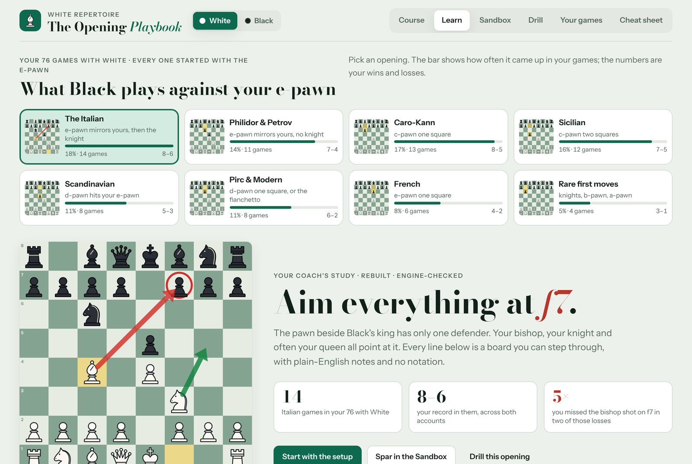

</div>

## Why it exists

Most opening courses are written for everyone. They give long lines in algebraic notation, chosen because they are theoretically best and taught in an order that has nothing to do with what you will actually face. This project goes the other way. It starts from **my own blitz games** on two chess.com accounts and builds the openings around them: 149 games from July to October 2026 shaped the two books, and all 200 up to November 2 decide the order of the course.

- **The chapters come from the games.** Each book is split by what the opponent actually played, ordered by how often it happened, with the win–loss record next to it.
- **The opponent plays like a real opponent.** Every opponent move in the book carries the odds that a club player at this level would choose it. The first move's odds come from the games themselves. After that they come from [Maia](https://maiachess.com), a neural network trained to predict human moves at a given rating. The drills, the sandbox and every "how often" figure use these odds, so preparation goes where the games actually go.
- **Words instead of notation.** Moves are described the way you would explain them over a board: *Bishop aims at f7*, *Knight takes back*, *Queen breaks the pin*. Positions that matter get a short note explaining why.
- **Checked by an engine, built for a human.** Every move in both books was checked with Stockfish 17.1. Lines were chosen to be easy to remember, such as one setup against a whole family of move orders, rather than to squeeze out the last hundredth of a pawn.
- **One position, one move.** However a position is reached, the answer is the same, and each setup brings its pieces out in one order with a stated reason wherever the order has to change. The build stops if two lines disagree about a position, or if a label speaks of a pin, a guard or an attack that is not on the board.
- **One path, unlocked as you go.** The course mixes White and Black units by how often each system comes up and how I score in it. Passing a unit's checkpoint opens the next one, so there is never everything at once.
- **A line ends, the game doesn't.** Where a lesson's main line stops, a plan takes over in a few lines: where the king goes, which pawns move, what to aim at and what the opponent wants. A built-in engine shows the best moves and the other side's threat in words, and plays the position on from there.
- **The games feed back in.** Missed tactics become puzzles. Habits that cost games become "insights" with a button that drills the real positions. Notes point back to the games they came from: *"Against ZhoskaStreezh in July you pushed the d-pawn first and the e-pawn took your knight. Knight first, every time."*

## Where it is going: a playbook for any player

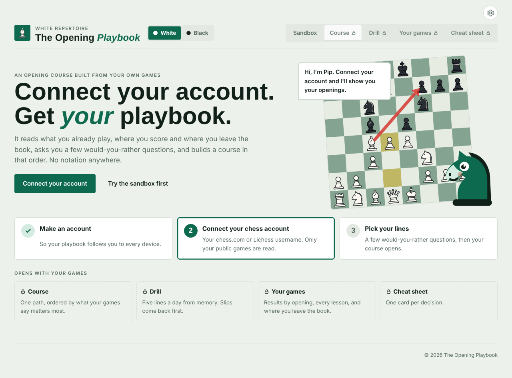

Everything above was built by hand for one player. The site now has the first version of the same thing for anyone:

1. **Welcome.** A new visitor sees the same tabs, with only the Sandbox open. The rest is locked until their games are in.
2. **Bring 150 games.** A chess.com or Lichess username is enough: the page fetches the latest games itself from the sites' public APIs. A PGN file works too. Fifty games is the least that works.
3. **The reading screen.** A script reads every game while the board plays through them: what the player opens with, what they meet, how each opening scores, which kinds of game they win (kings on the same side or opposite sides, queens on or off, short or long games), and the exact positions where they leave the playbook. It is rules and counting ([`app/analyze.js`](app/analyze.js)): no language model and no engine.
4. **Would you rather.** Where the player's own habit differs from what the library teaches, a card puts the two side by side with their record in each. Two more cards set the order of the course and how wide the drills go.
5. **Their playbook.** The course is reordered by their games, every chapter shows their own record, and Your games lists where they leave the book, each with a button into the lesson.

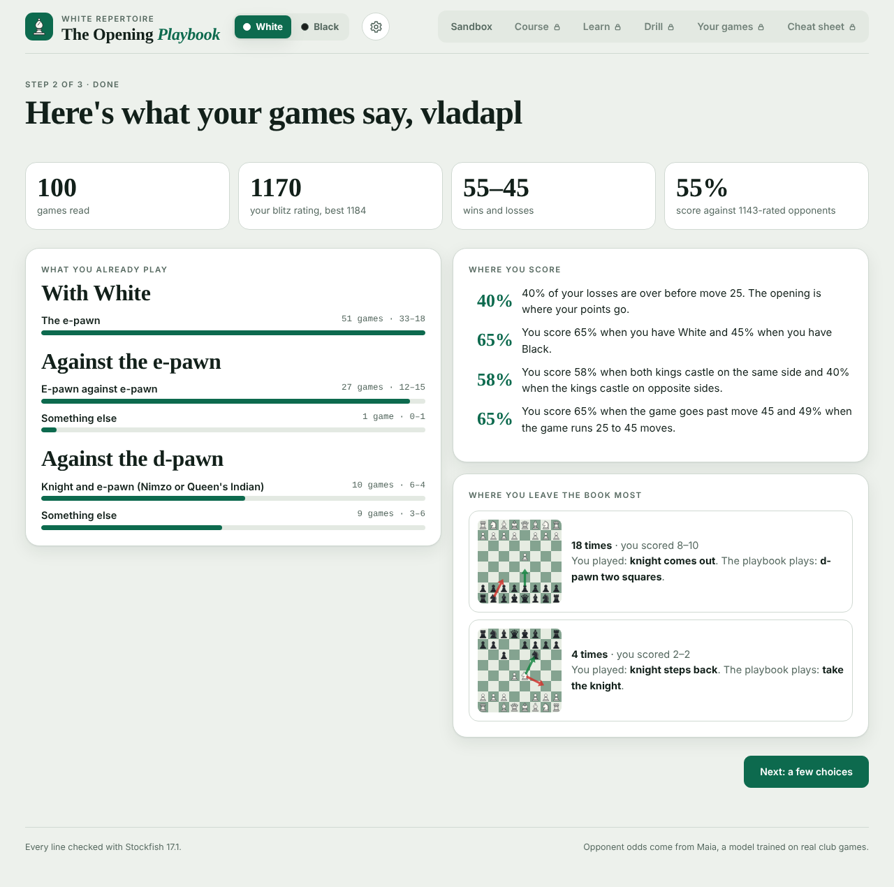

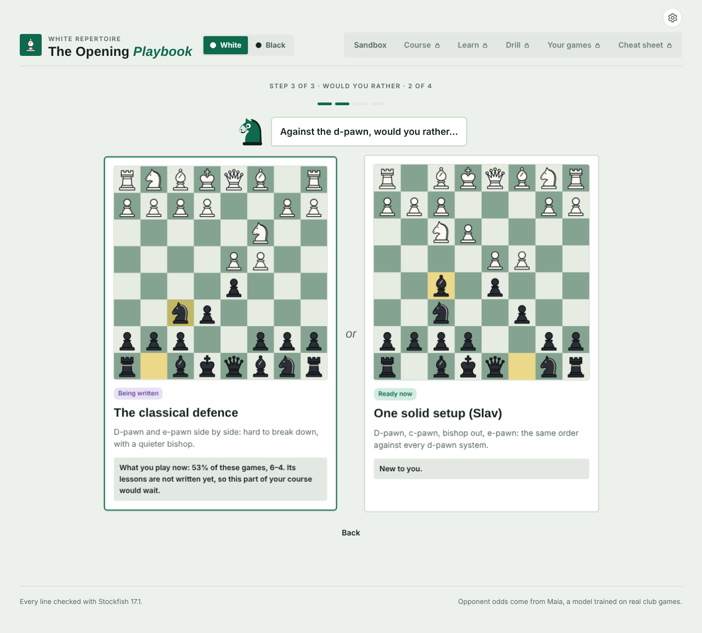

**What it cannot do yet.** The library is small: the e-pawn as White; the e-pawn reply or the Caro-Kann against the e-pawn; the Slav setup against the d-pawn. A player who prefers something else is told that their system is still being written, and that part of their course waits. The Sicilian, a d-pawn system for White and the English are next. Puzzles from a player's own mistakes need the engine run over their games, which is not built yet.

A **coach**, one of three characters to pick from (Pip the knight, Rocco the rook, Dot the pawn), says the short things in a speech bubble at the bottom right: what a tab is for the first time it is opened, a word after a drill, why a section is locked. It never speaks during a drill or a checkpoint, and it can be switched off in **Settings**, which also has light and dark mode, text size, five board colours and the letters on the board.

## At a glance

|                                   | White book                | Black book                       |
| --------------------------------- | ------------------------: | -------------------------------: |
| Games it is built from            | 76, all opened with 1.e4  | 73: 44 against 1.e4, 24 against 1.d4 |
| Record in those games             | 48–28                     | 37–35–1                          |
| Chapters (openings)               | 8                         | 9                                |
| Lessons                           | 79                        | 62                               |
| Lines you can drill               | 274                       | 482                              |
| Positions in the tree             | 2,233                     | 2,577                            |
| Positions with a written note     | 827                       | 794                              |
| Lessons that end with a plan      | 76                        | 62                               |
| Game reviews                      | 10                        | 11                               |
| Missed-shot puzzles               | 12                        | 13                               |
| Patterns across games             | 4                         | 4                                |
| Cheat-sheet cards                 | 47                        | 71                               |

The course on top of both books has **17 units**. Fourteen are opening units: 55 core lessons, 86 optional ones and 84 checkpoint positions. Three are skill units made of positions from my own games: 26 threats I walked into, 18 winning positions I let slip and 16 endings.

## A tour

### Course: one path through both books

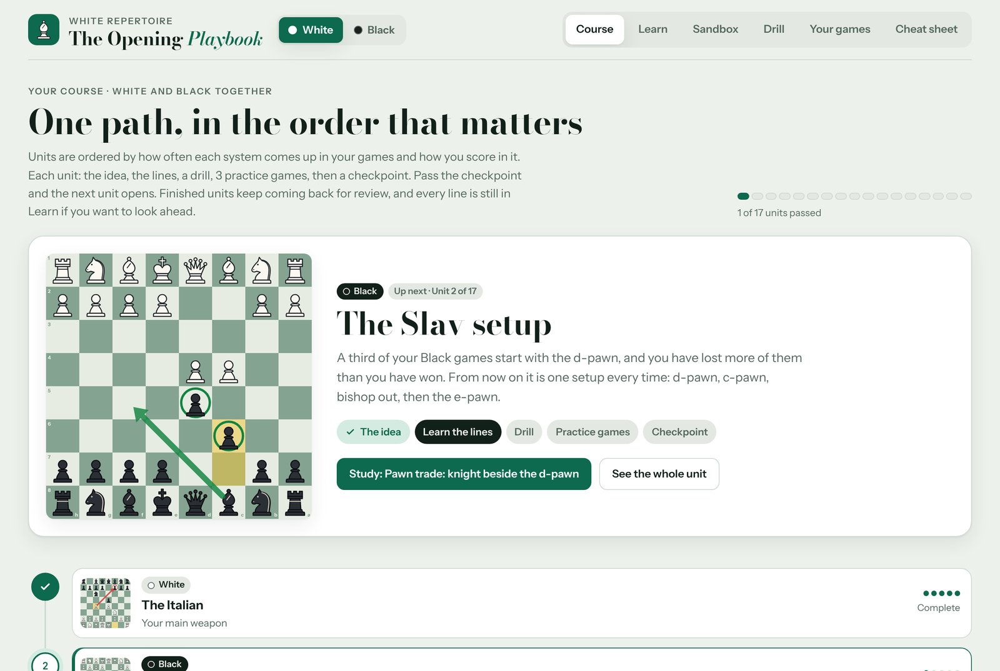

The course is the front page. Units alternate between White, Black and skills in the order that matters for my games: the Italian first (my main weapon, and only 5 wins in the last 12), then the Slav setup against the d-pawn (a third of my Black games), then threat-spotting. Every lesson unit has five steps:

1. **The idea.** A few boards with arrows and one sentence each.
2. **Learn the lines.** The core lessons, studied to their last move.
3. **Drill.** Each main line played once from memory without a slip.
4. **Practice games.** Three clean sandbox games where the opponent only plays this unit's lines and picks the ones I know least.
5. **Checkpoint.** Six positions from the unit; five right on the first try opens the next unit.

Optional "go deeper" lessons sit under each unit, finished units come back through the drill schedule, and everything stays in Learn for looking ahead.

Three skill units sit between the opening units, each built from positions in my own games at the move where it went wrong:

- **Spot the threat.** My next move lost material. Any move that loses nothing counts, not only the engine's favourite. Play a losing move and the opponent's answer is played out on the board with the reason in words: what it costs, or, when the point is a few moves deep, the line move by move with a button that plays it out. **Show me the danger** draws the threat first, at the price of the first-try point.
- **Finish the job.** I was winning by a lot and my next move let it go, which is how 21 of my 91 losses happened. Find the move that keeps the win.
- **Endings.** Endings I reached level or better and then lost: back ranks, pawn endings and active rooks. Find the move that holds the result.

In a practice set, every position opens on the explore board with the engine as soon as it is answered, right or wrong, with the move I tried already on the board. In a checkpoint the engine waits until the end, and the reasons are still given in words.

### Learn: two books, one switch

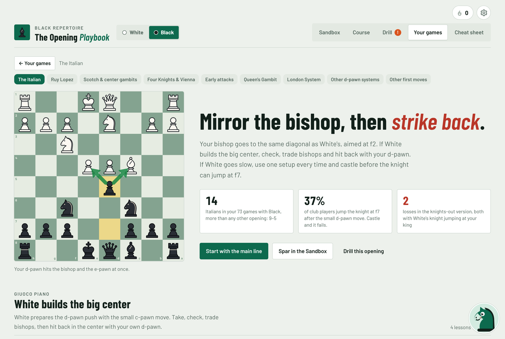

The **White | Black** switch swaps the whole app: board orientation, chapters, drills, games and progress. Each book remembers its own place and its own count of lines due for review. Every chapter opens with a board showing the key idea, the plan in one sentence, and three facts from the games. One example: *"37% of club players jump the knight at f7 after the small d-pawn move. Castle and it fails."* Lessons are grouped into parts and tagged **core**, **common** or **rare**, so the most frequent lines come first.

### Study: step through any line

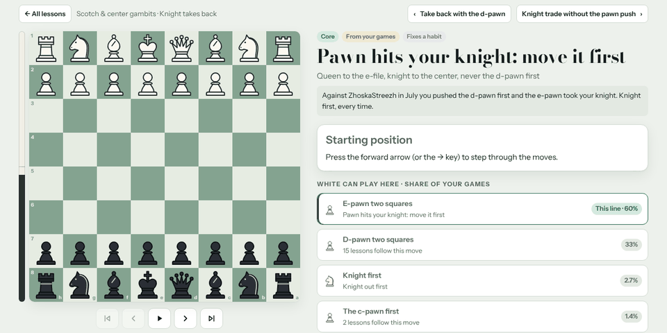

Each lesson is a board you step through with the buttons or the arrow keys. Every move has its label, an optional note, arrows and circles where they help, and the engine's verdict in words (*Equal*, *Better for White*) with the number beside it. Wherever the opponent has a choice, the alternatives are listed with how often players at this level pick them, and one click jumps into that branch.

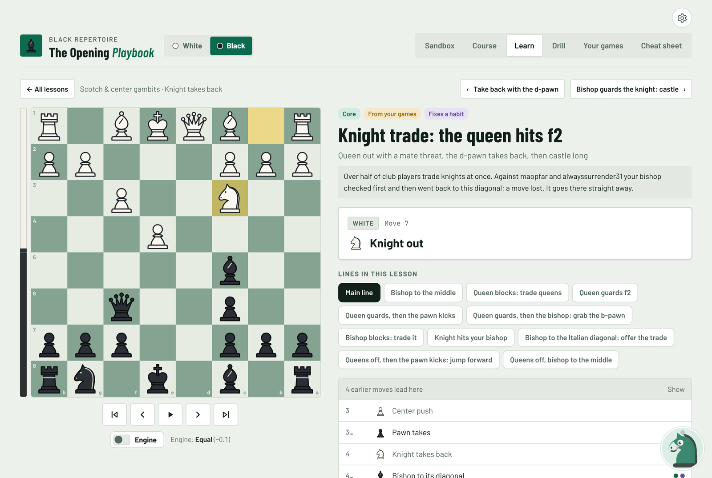

### The engine, and what to do when the line ends

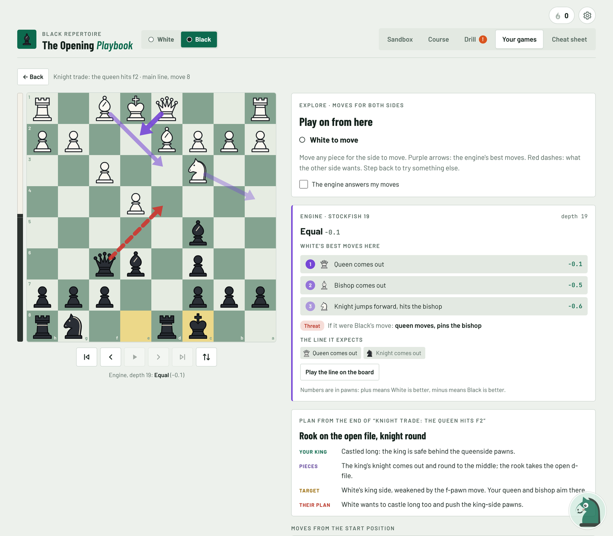

A line in a book has to stop somewhere, and the position it stops in can still look dangerous. Two things pick up from there.

**A plan.** The last position of a lesson's main line comes with a short card: where your king goes, which pawns to push, where the pieces belong, what to aim at, what the opponent wants and what to watch for. It shows in Study, after a drill and at the end of a practice game.

**The engine.** Stockfish runs in the browser. Switch it on under the board in Study, or press **Play on with the engine** when a drill, puzzle or practice game ends. It stays out of the way while you are being tested. The card shows:

- the three best moves for the side to move, in words, each with a purple arrow and its value. Numbers follow the usual convention whichever colour you play (plus: White is better, minus: Black is better); the words beside them are from your side;
- the other side's idea, found by asking the engine what they would play if it were their move again: a red dashed arrow, marked **Threat** when it wins something;
- the line it expects, as a row of plain-English moves that can be played out on the board.

**Play on from here** opens the explore board, where you move the pieces for both sides, or tick a box and the engine answers your moves. Step back at any point to try something else.

### Drill: spaced repetition, with the opponent's moves played for you

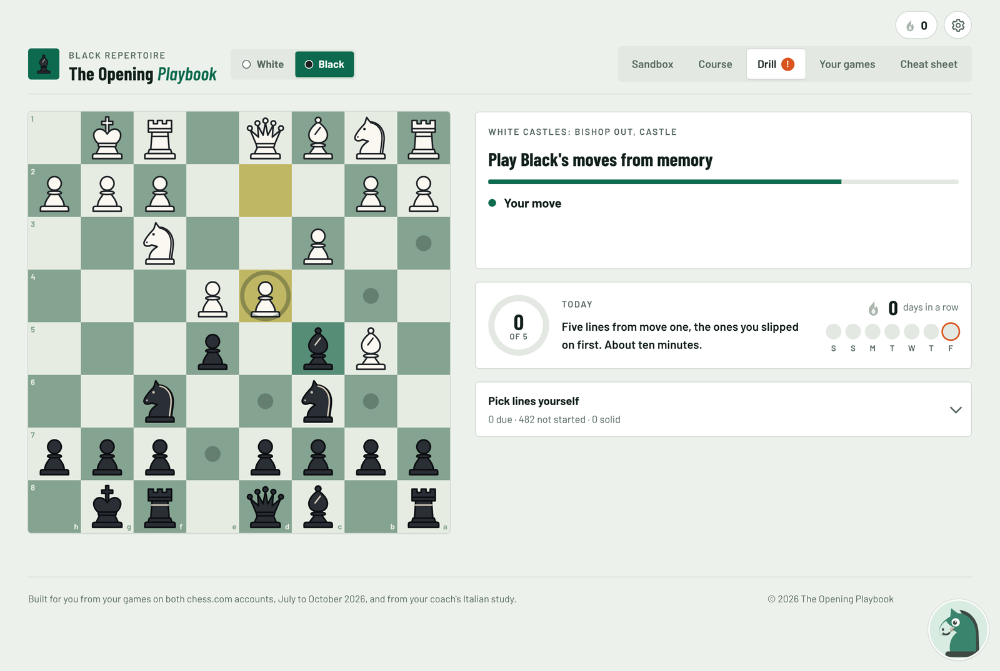

You play your side's moves from memory and the opponent's moves play themselves. You can drag or tap, and you castle by moving the king two squares or onto its rook. A wrong move gets a second try and then an arrow. Lines are scheduled in Leitner boxes: a clean run sends a line further out (1, 2, 4, 8, then 16 days), and a slip brings it back today. You can filter by opening and by priority, and start each line either from move one or from the point where it branches off lines you already know.

### Sandbox: play your prep against a realistic opponent

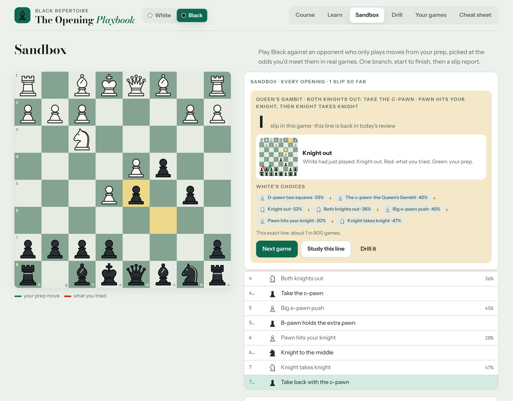

The sandbox plays one branch of the book as a full game. The opponent only plays moves that are in your book, picked with one of three settings:

- **Like real games.** Each reply is weighted by how often club players choose it.
- **Even spread.** Every line in the book is equally likely.
- **My weak spots.** Lines you have never played or that are due count more, and solid ones count less.

The opening chips are a multi-select: pick the French and the Caro-Kann and the session mixes just those two.

At the end you get a slip report. Each mistake is shown on a mini board (red for what you tried, green for your prep), along with the chain of the opponent's choices and their odds and how rare the exact line was (*"under 1 in 2,000 games"*). Any line you slipped on goes straight back into today's drill. Changing the opening or the odds mid-game applies to the next game, with a button to start it right away, so the current game is never cut off.

### Your games: what actually happened

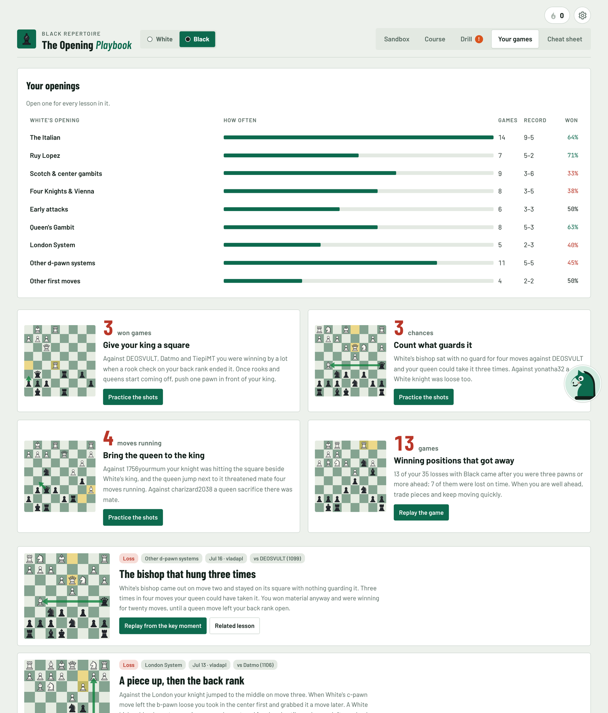

This page shows results by opening and four patterns that cost games, each with a practice button that drills the real positions. It also has reviews of the most instructive games. Each review has a title, the story in plain words, a replay that starts at the key moment, the better continuation, and a link to the lesson that fixes the problem.

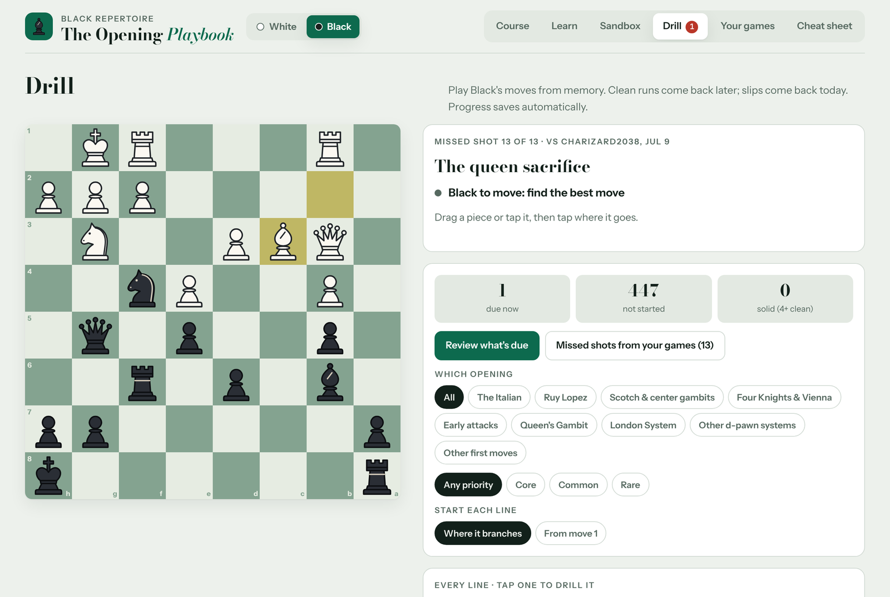

**Missed shots** are positions from the games where one move won and a different one was played. They were found by scanning every game with Stockfish and then picked by hand.

### Cheat sheet

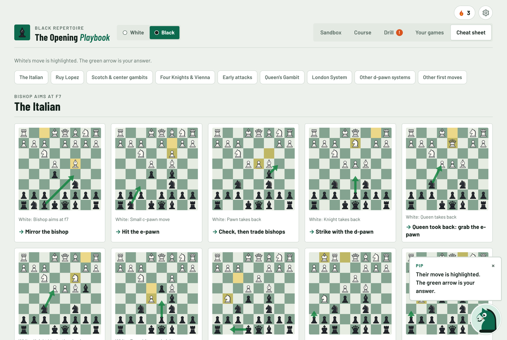

The cheat sheet has one card per decision. The opponent's move is highlighted and the green arrow is your answer. Tap a card to open that position in its lesson.

### On a phone, in light or dark

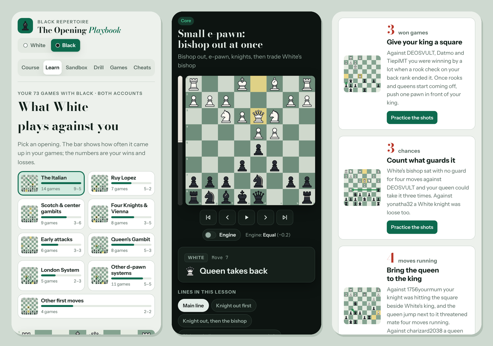

The layout collapses to one column on phones and follows the system's light or dark setting. The board, menus and drills all work by touch.

## The repertoires

### White: 1.e4, built around the Italian

| Chapter | When Black plays | Games | Record | The plan in one line |
| --- | --- | ---: | :---: | --- |
| **The Italian** | 1…e5 2…Nc6 | 14 | 8–6 | Bishop aimed at f7. Against …Bc5, play c3 and d4 (the Møller attack and four traps). Against the Two Knights, Ng5 (the Fried Liver and the main line). Rebuilt from my coach's study. |
| **Philidor & Petrov** | 1…e5 without …Nc6 | 11 | 7–4 | Take the center, then look at f7. Covers the copycat trap in the Petrov and the queen fork against the Philidor. |
| **Caro-Kann** | 1…c6 | 13 | 8–5 | Chase the bishop with the h-pawn, trade it off, castle long. If Black offers a knight trade, take it. |
| **Sicilian** | 1…c5 | 12 | 7–5 | The small c-pawn move, then d4. Whenever Black's knight is in reach of your d-pawn, push the pawn at it. |
| **Scandinavian** | 1…d5 | 8 | 5–3 | Develop with tempo against the queen. Every queen move is another move ahead. |
| **Pirc & Modern** | 1…d6, 1…g6 | 8 | 6–2 | Line up queen and bishop, castle long, trade the fianchetto bishop, push the h-pawn. |
| **French** | 1…e6 | 6 | 4–2 | Advance: lock the center and support the pawn chain from behind. |
| **Rare first moves** | 1…Nc6, 1…Nf6, 1…b6 | 4 | 3–1 | Take the whole center, develop and castle, with the one trick to know for each. |

### Black: 1…e5 against the e-pawn, one Slav setup against the d-pawn

| Chapter | When White plays | Games | Record | The plan in one line |
| --- | --- | ---: | :---: | --- |
| **The Italian** | 1.e4 e5 2.Nf3 Nc6 3.Bc4 | 14 | 9–5 | Giuoco Piano. Against c3 and d4: take, check, trade bishops, strike with …d5. Against the slow Italian, one setup every time, castling before the knight can jump at f7. |
| **Ruy Lopez** | 3.Bb5 | 7 | 5–2 | The knight hits the e-pawn, then the bishop goes to its Italian diagonal and you castle. Against the exchange, take back toward the center. |
| **Scotch & center gambits** | 2.d4 or 3.d4 | 9 | 3–6 | The bishop goes to c5 at once, as in the Italian. After a knight trade the queen comes to f6 with a threat on f2, the d-pawn takes back and you castle long. Against the Scotch Gambit the same bishop, then …d5; against the Danish and Göring, …d5 straight away; against the Center Game, kick the queen, pin and castle. |
| **Four Knights & Vienna** | 2.Nc3 or 3.Nc3 | 8 | 3–5 | Knights first, then the bishop to its usual diagonal: against the Spanish bishop that is the Ruy Lopez lesson, against the Italian bishop the Italian one. Against the Vienna bishop: knight out, …Bc5, …d6, and …h6 against the pin. Against the Vienna Gambit, leave the pawn, play …Bc5 and …d6, then the knight jumps at White's bishop. |
| **Early attacks** | 2.Qh5, 2.Qf3, 2.f4, 2.Bc4 | 6 | 3–3 | Against the queen: block f7, tuck the bishop beside the king, then castle or jump into the center. Against the King's Gambit, leave the pawn and play …Bc5, which stops White castling, then …d6, both knights out, and the knight jumps at White's bishop, the same move as against the Vienna Gambit. |
| **Queen's Gambit** | 1.d4 d5 2.c4 | 8 | 5–3 | The Slav: …c6, the light bishop out before …e6, trade it for White's, then always queen's knight, dark bishop to d6, castle. When White's bishop comes at your knight, the knight jumps to the middle and a queen check on the edge wins the bishop. |
| **London System** | 1.d4 d5 2.Bf4 | 5 | 2–3 | Copy the bishop, …e6, trade the light bishops, then offer the dark ones. The queen always takes back. |
| **Other d-pawn systems** | Colle, Torre, Veresov, Jobava, gambits | 11 | 5–5–1 | The same setup in the same order: bishop out before White's bishop and trade it. When White's queen takes back, …c6 comes before …e6, which shuts out a queen check that wins the b-pawn. When the knight is taken, take back with the e-pawn. |
| **Other first moves** | 1.c4, 1.Nf3, 1.g3, 1.e3 | 4 | 2–2 | …e5 against the c-pawn, and the Slav setup against 1.Nf3. |

72 of the 73 Black games fall into a chapter. The remaining one, an experiment with 1…b6, sits outside the book.

### Systems

The library can hold more than one answer to the same question. A **slot** is one decision in a repertoire ("what do I play against the e-pawn?") and a **pack** is one answer to it. A player has one pack per slot, chosen in the would-you-rather cards or later in Settings, and the page cuts both books down to the packs in play before anything else is built: chapters, course units, drills, the cheat sheet and the Sandbox all follow. Progress in the other pack is kept.

| Slot | Packs | |
| --- | --- | --- |
| Against the e-pawn | **Meet it head-on** (1…e5): Italian, Ruy Lopez, Scotch, Four Knights and Vienna, early attacks | the first system; 5 chapters |
| | **Caro-Kann** (1…c6): the push past, the pawn trade and the c-pawn attack, the main line, both knights, sidelines | 7 lessons, 59 lines |
| Against the d-pawn | **The Slav setup** | 3 chapters |

The Caro-Kann is written as the Slav setup's twin: c-pawn one square, d-pawn two, light bishop out before the e-pawn moves. It reuses the Slav's rules where the positions are alike (after a pawn trade, both knights come out before the bishop; in the main line the queen's knight goes first). Two of its lines win a pawn against a move a third of club players make.

Inside the packs a player can hold together, one position still gets one move. Two packs of the same slot may answer a position differently, so the repeat check runs once for every combination of one pack per slot.

### One setup, one order

The Slav setup covers the Queen's Gambit, the London, the Colle and the other d-pawn systems, so it has to come out the same way every time. A drill should never ask for two different moves in one position, and it should never ask for the same moves in a different order without saying why. The order is:

1. **d-pawn** two squares.
2. **c-pawn** one square, as soon as something asks for it (the table below). Otherwise it waits.
3. **King's knight.**
4. **Light bishop** out to f5, then the **e-pawn** one square behind it. If White offers the light bishops, trade.
5. **Queen's knight** to d7.
6. **Dark bishop** to d6.
7. **Castle.** If White's e-pawn then pushes into the middle, take it and trade knights.

The places where the order changes, each with the reason the lesson gives:

| When | What changes | Why |
| --- | --- | --- |
| White's c-pawn attacks the d-pawn | …c6 on move two | It guards the d-pawn with a pawn and keeps the bishop's diagonal open. |
| White plays the small e-pawn move with no piece out | Bishop before the king's knight; the knight comes after …Nd7 | From home the queen still guards the edge square, so White's knight can't chase the bishop, and the knight on d7 blocks the queen check. |
| White trades the c-pawn for your d-pawn | Both knights before the bishop, and the queen's knight goes to c6 | With the c-pawns gone, White's queen can hit the b-pawn the moment the bishop leaves. The knight on c6 answers that by jumping to the edge at the queen. |
| White's queen has taken back on d3 after the bishop trade | …c6 before …e6 | Without it the queen checks on the queenside and wins the b-pawn. Club players find that check about one game in six. |
| London bishop on f4 | Dark bishop to d6 straight after …e6, and the queen takes back | Trading the London bishop is the point; taking back with a pawn loses a pawn in the c-pawn lines. |
| Both White knights out in the Queen's Gambit | Take the c-pawn and hold it with the b-pawn | The bishop can't come out safely yet, and White needs several moves to win the pawn back. |
| White's bishop comes at the king's knight | The knight jumps to the middle if that square is free | It hits the bishop, and the queen check on the edge wins it if White takes the knight. |
| White fianchettoes, or the c-pawn pushes past | Dark bishop one square shorter, to e7 | On d6 it would be hit by the pawn or stare at a guarded pawn. |

Three checks keep it that way ([`pipeline/lint_claims.py`](pipeline/lint_claims.py)), and the build stops when any of them finds something:

- **Repeats.** Every position where it is your move is collected across all lines of a book. If two move orders reach the same position and the book answers with different moves, that is an error.
- **Pins.** A label or note that speaks of a pin needs a real one on the board: a piece attacked by a bishop, rook or queen with its king or a more valuable piece right behind it. A bishop that comes at a knight while the e-pawn is still at home pins nothing, and the text may not say it does.
- **Guards and hits.** A label that says the move guards a piece, or hits one, is compared with the board: after the move, that piece must have a new guard or a new attacker.

## How it was made

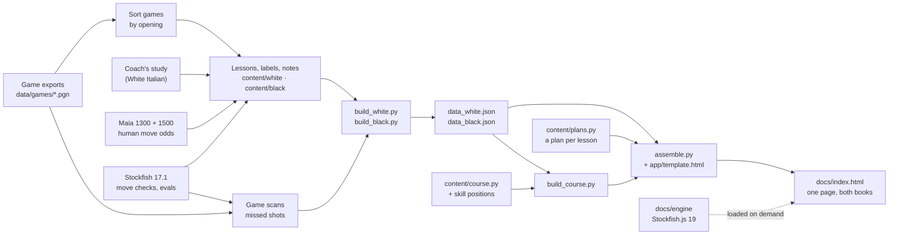

1. **The games.** PGN exports of both accounts live in [`data/games`](data/games). `black_games.py` collects the Black games and `black_chapters.py` sorts them by White's setup. The White build does the same by Black's reply.
2. **Your moves.** The White Italian chapter started from my coach's Lichess study and was rebuilt line by line. The other seven White chapters and the whole Black book were written from my games. The aim was sound lines that are easy to remember (one setup against many move orders, the same idea showing up across chapters), with every move checked by Stockfish.
3. **The opponent's moves.** The Maia 1300 and 1500 models are averaged to give the probability of every legal move in every position. [`pipeline/maia.py`](pipeline/maia.py) is a short NumPy implementation of the Leela Chess Zero network forward pass. It reads the Maia weight files directly, so it needs no lc0 binary, TensorFlow or GPU. While the books were being written, [`expand.py`](pipeline/expand.py) walked the tree and listed every opponent reply with at least a 10% chance whose line is reached in at least 0.4% of games, flagging any position the book had no answer for yet. [`check_black.py`](pipeline/check_black.py) checks every Black line for legality, the quality of your moves (Stockfish multi-PV), how realistic the opponent's moves are, and which common replies a line leaves uncovered.
4. **Words, not notation.** Hand-written labels and notes live in [`content/`](content), keyed by the move sequence that reaches each position: `n(path, label, text, tags, arrows, circles)`. Moves without a hand-written label get one from [`label2.py`](pipeline/label2.py), which describes what the move does in context: captures and recaptures, checks, pins, attacks on a bigger or loose piece, castling, pawn pushes. [`lint_notes.py`](pipeline/lint_notes.py) checks claims in the notes, such as pins or "a piece up", against the real positions.
5. **Game reviews.** [`scan_games.py`](pipeline/scan_games.py) evaluates every move of every game. [`find_shots.py`](pipeline/find_shots.py) keeps positions where the move played lost at least 1.8 pawns and a deeper multi-PV search shows one clearly best move, at least 1.5 pawns ahead of the next. The cleanest of these became the puzzles. The game stories and the cross-game patterns were written from the same scans.
6. **Build.** [`build_white.py`](pipeline/build_white.py) and [`build_black.py`](pipeline/build_black.py) merge all lines into one tree per book ([`tree.py`](pipeline/tree.py)). They attach labels, notes, arrows, odds and evaluations, precompute the legal moves wherever you are to move, and write `data/build/data_*.json`. [`assemble.py`](pipeline/assemble.py) injects both books and the piece set into [`app/template.html`](app/template.html) and writes [`docs/index.html`](docs/index.html).
7. **The course.** [`content/course.py`](content/course.py) lists the units in order: required and optional lessons, the idea boards as move paths with arrows, and the checkpoint positions. [`build_course.py`](pipeline/build_course.py) resolves every path against its book (a path that leaves the repertoire fails the build) and writes `data/build/data_course.json`. The skill positions come from a Stockfish scan of all 200 games. [`data/course_threats.json`](data/course_threats.json) holds moves that lost at least 20 points of win chance to a tactic, with the moves that would have held and the engine's answer to every other legal move. [`course_finish.json`](data/course_finish.json) and [`course_endings.json`](data/course_endings.json) use the same format. The first has positions where I had at least a 78% win chance and my move gave up 15 points or more; the second has endgame moves that cost 12 points or more. In both, a move counts as right when it stays within 7 points of the best one.
8. **Plans.** [`content/plans.py`](content/plans.py) has one plan per lesson for the position its main line ends in, written from the engine's top lines there and kept to six kinds of bullet: king, pawns, pieces, target, their plan, watch for. `assemble.py` attaches them and checks them for notation.
9. **Checks.** `assemble.py` refuses to build a page in which one position gets two different answers, or a label claims a pin, a guard or an attack that is not there ([`lint_claims.py`](pipeline/lint_claims.py)). `make check` adds an engine pass over every Black line ([`check_black.py`](pipeline/check_black.py)) and a wording pass that compares notes with their positions ([`lint_notes.py`](pipeline/lint_notes.py)).
10. **Line versions.** Progress is stored per line. [`data/line_versions.json`](data/line_versions.json) keeps a fingerprint of every line's moves, and `assemble.py` raises a line's version when the moves change. The page then treats an older record of that line as due again and marks it **Changed**, so a rewritten line is never shown as mastered on the strength of moves it no longer has.
11. **Caches.** Every Stockfish and Maia result is cached in [`data/cache`](data/cache) and committed. That makes the build reproducible byte for byte with nothing but python-chess, in a few seconds and without any engine.

## Under the hood

- **One file.** The app is one HTML file of about 2 MB with both books inline: plain HTML, CSS and JavaScript, with no framework or bundler. [chess.js](https://github.com/jhlywa/chess.js) is inlined for the explore board. The only scripts loaded from elsewhere are the engine, when you ask for it, and supabase-js, on the website when accounts are set up. Fonts come from Google Fonts (Bodoni Moda, Instrument Sans, JetBrains Mono); offline, the app falls back to system fonts.
- **Board.** The board is SVG, drawn with an original piece set ([`app/pieces.py`](app/pieces.py)). It supports drag and tap input, legal-move hints, arrows, circles and a flipped view for Black. Legal moves are precomputed for every book position where you move, so lessons, drills and the sandbox need no chess library.
- **Engine.** [`docs/engine`](docs/engine) holds the lite single-threaded build of [Stockfish.js](https://github.com/nmrugg/stockfish.js) 19: a 28 KB script and a 1.8 MB WebAssembly file, fetched the first time the engine is switched on and run in a web worker. The page talks to it in plain UCI text. Each position gets two searches: a short one with the move handed to the other side (their idea), then the three best moves to depth 22 or seven seconds. Results are kept for the session, so stepping back and forth is instant. The engine's moves are put into words by a small JavaScript twin of `label2.py`. The single-threaded build needs no special server headers, so it runs on GitHub Pages; it can't start from a page opened as a file, and the card says so.
- **Two books, one engine.** `loadBook()` swaps every index (nodes, lines, lessons, chapters, whose move is whose, board orientation) when you flip the switch. Line ids never collide between the books (the build checks this), so one progress store holds both.
- **Who is looking.** The page shows one of three things ([`app/product.js`](app/product.js)): the hand-built playbook (the personal build, and any account that had progress before personal playbooks existed), the welcome state for a player without games, or a personal playbook. The profile from the analysis is saved with the progress record, so it follows the account. For anyone but the house player, sentences about my own games are removed from the lesson notes when the page starts.
- **Progress and accounts.** Progress is always saved in the browser first. On the website, an account (email and password through [Supabase](https://supabase.com)) keeps a copy in the cloud, so the same progress shows up on every device. Sync pulls and merges on sign-in, on load and whenever the tab comes back into view: the newest record wins for each drill line and puzzle (for a line whose moves have changed, the record made on the current moves wins over a newer one made on the old moves), and course steps keep the best result. The project URL and publishable key live in [`app/site.json`](app/site.json), the tables and row-level security in [`supabase/schema.sql`](supabase/schema.sql). When the page runs as a Claude artifact, it syncs to the artifact's own per-user storage instead.
- **Deep links.** `#course` and `#unit.<unit-id>` open the course and a unit (a unit brings its own book). `#learn`, `#sandbox`, `#drill`, `#games`, `#cheat`, `#learn.<chapter>` and `#line.<line-id>` open the matching view. Add a `b.` prefix for the Black book, for example [`#b.learn.london`](https://vladapl21.github.io/chess-opening-playbook/#b.learn.london) or [`#b.line.bs-classical`](https://vladapl21.github.io/chess-opening-playbook/#b.line.bs-classical).

<details>
<summary><b>Data model</b></summary>

Each book is one JSON object. Its `nodes` form a tree of positions, and everything else points into it by index.

| Key | What it holds |
| --- | --- |
| `nodes` | The move tree (fields below) |
| `lines` | A named path through the tree: `{id, lesson, title, main, n: [node indexes]}` |
| `lessons` | `{id, part, title, sub, why, pri: core/common/rare, outcome, lines, plan}` |
| `parts`, `chapters` | Grouping, chapter text, hero boards, facts and per-chapter game stats |
| `games` | Reviews: opponent, ratings, result, date, story, key moments, replay lines |
| `puzzles` | Missed shots: game, position, accepted answers, title, note |
| `cheat` | Cheat-sheet cards: the position, your move, the rule in a few words, the lesson |
| `insights` | Patterns across games, each linked to a puzzle or a moment in a game |
| `legal` | Legal moves (UCI) for every position where you are to move |
| `stats` | Totals behind the headings: games, wins, losses, first moves |

| Node field | Meaning |
| --- | --- |
| `p`, `k` | Parent index and children |
| `u`, `pc`, `w` | Move in UCI, the piece that moved, whether White made it |
| `f` | Position after the move (FEN board field) |
| `l`, `t` | Plain-English label and note |
| `a`, `c` | Arrows and circled squares, e.g. `c4f7r` = red arrow from c4 to f7 |
| `e` | Stockfish evaluation in centipawns, from White's side |
| `q` | Probability that the opponent plays this move at this level |
| `g` | Tags: `key`, `trap`, `warn`, `mistake`, `best`, `game`, … |
| `cap`, `chk`, `mate`, `x`, `ep` | Capture, check, mate, castling rook move, en passant |

</details>

<details>
<summary><b>Drill scheduling and sandbox odds</b></summary>

**Drill.** Each line sits in a Leitner box. A clean run moves it up one box and a slip drops it to box 0.

| Box | 0 | 1 | 2 | 3 | 4 | 5 |
| --- | :-: | :-: | :-: | :-: | :-: | :-: |
| Comes back after | same day | 1 day | 2 days | 4 days | 8 days | 16 days |

**Sandbox.** At each opponent turn, the move is drawn from the replies in your book with these weights:

| Setting | Weight of a reply |
| --- | --- |
| Like real games | its human probability `q` |
| Even spread | the number of book lines behind it |
| My weak spots | the sum of "need" over the lines behind it (never played 3, due 2.5, solid 0.35, otherwise 1), times √`q` |

The rarity line in the report is the product of `q` along the opponent's moves: *"this exact line: about 1 in N games."*

</details>

## Repository layout

```
app/
  template.html            the whole app: markup, styles and script for both books
  pieces.py                the original SVG piece set
  site.json                Supabase project URL and publishable key for the website build
  analyze.js               game analysis for a personal playbook: PGN in, profile out; rules and counting only
  product.js, product.css  welcome, locked sections, bringing games in, the reading screen, findings, choices, the coach
  vendor/chess.js          chess.js 0.10.3 (BSD-2-Clause), inlined into the page for the explore board
supabase/
  schema.sql               accounts: profiles and progress tables, row-level security
content/
  course.py                the course: units, idea boards, checkpoint positions
  plans.py                 the plan shown where each lesson's main line ends
  white/                   White book: lessons, labels and notes, chapter text, game reviews
  black/                   Black book: bcontent (lessons), bnotes + bnotes2 (labels, notes, arrows),
                           bmeta (chapters, game reviews, puzzles, cheat sheet, insights)
pipeline/
  build_white.py           build the White book    -> data/build/data_white.json
  build_black.py           build the Black book    -> data/build/data_black.json
  build_course.py          build the course        -> data/build/data_course.json
  assemble.py              inject the books, the course and the plans into the template -> docs/index.html
  tree.py, label2.py       move tree; context-aware plain-English labels
  maia.py, expand.py       human move odds (Maia, NumPy only) and the coverage walk
  human_odds.py, sf.py     command-line helpers: Maia odds and Stockfish top moves for any line
  eng.py                   Stockfish wrapper
  black_games.py, black_chapters.py, scan_games.py, find_shots.py
                           game import, sorting by opening, engine scans, missed shots
  explain_skills.py        the reason for every wrong move in the skill units: the engine's line, cut where the loss is on the board
  check_black.py, lint_notes.py
                           engine and wording checks
  lint_claims.py           one position, one move; pins, guards and attacks in the text must be on the board
  paths.py, common.py      paths, environment variables, shared imports
data/
  games/                   PGN exports of both accounts (July to October 2026)
  cache/                   Stockfish and Maia results, so builds need no engine
  black_*.json             Black games, per-move scans, candidate shots
  line_versions.json       a fingerprint of every line's moves; a line's version goes up when they change
  course_threats.json, course_finish.json, course_endings.json
                           skill-unit positions from all 200 games, with the engine's answers
  build/                   data_white.json, data_black.json, data_course.json, playbook.html
docs/
  index.html               the built app, served by GitHub Pages
  engine/                  Stockfish.js 19 (GPL-3.0): the script, the WebAssembly file and the license
  img/                     the images in this README
tests/
  e2e_white.py, e2e_black.py, e2e_sandbox_switch.py, e2e_course.py, e2e_accounts.py, e2e_engine.py,
  e2e_versions.py, e2e_shell.py, e2e_onboarding.py, e2e_skills.py, e2e_packs.py
                           end-to-end browser tests (Playwright)
  analyze_check.js         the analysis run under Node on data/games, checked against known facts
  serve.py                 serves the built page over local HTTP for the engine test and screenshots
  fake_supabase.js         stand-in for supabase-js so account tests run offline
  readme_shots.py          regenerates docs/img
```

## Build it yourself

The built app is committed, so [`docs/index.html`](docs/index.html) opens straight from disk. Everything works that way except the engine, which needs the page served over HTTP: run `python3 -m http.server` inside `docs/` and open `http://localhost:8000`. To rebuild the app:

```bash
git clone https://github.com/vladapl21/chess-opening-playbook.git
cd chess-opening-playbook
python3 -m pip install -r requirements.txt     # python-chess (+ numpy for Maia)
make build                                     # or run the four scripts below
```

```bash
python3 pipeline/build_white.py
python3 pipeline/build_black.py
python3 pipeline/build_course.py
python3 pipeline/assemble.py
```

With the committed caches the rebuilt files are byte-identical to the ones in the repo.

### Changing the books

Edit the files in [`content/`](content) and rebuild. Positions that are not in the cache yet need the engines, which are not part of this repository:

| Variable | Points to | Default |
| --- | --- | --- |
| `STOCKFISH` | a [Stockfish](https://stockfishchess.org/download/) binary (17.1 was used) | `stockfish` on your `PATH` |
| `MAIA_WEIGHTS` | a folder with `maia-1300.pb.gz` and `maia-1500.pb.gz` from [CSSLab/maia-chess](https://github.com/CSSLab/maia-chess) | `vendor/maia` |
| `LCZERO_TRAINING` | a checkout of [LeelaChessZero/lczero-training](https://github.com/LeelaChessZero/lczero-training) (for `tf/policy_index.py`) | `vendor/lczero-training` |

Some useful commands while writing:

```bash
python3 pipeline/human_odds.py "e4 e5 Nf3 Nc6 Bc4"     # what club players play here, with odds
python3 pipeline/sf.py -d 18 "e4 e5 Nf3 Nc6 Bc4 Bc5"   # Stockfish's top three moves
python3 pipeline/check_black.py 16 bi-main,bs-classical  # check lessons (or all, without ids)
python3 pipeline/lint_notes.py                         # notes that contradict their position
python3 pipeline/lint_claims.py                        # same position, different move; pins, guards, attacks not on the board
```

### Tests

```bash
python3 -m pip install -r requirements-dev.txt
python3 -m playwright install chromium
make test
```

The tests drive the real page in Chromium. They visit every chapter in both books, step through lessons, and play drills by dragging and tapping (correct moves, slips, castling). They solve every puzzle and play sandbox games across every opening and odds setting, including a regression test for changing the opening mid-game. They also follow deep links, switch books back and forth with state kept, and check that the phone layout never scrolls sideways, in light and dark mode. The course test works through the first units the way a person would: the idea boards, a lesson, a drill line, a checkpoint with a deliberate miss, practice games against a unit's lines, and a threat set where wrong moves get played out and punished. The engine test serves the page over local HTTP and runs the real engine: the switch in Study, three different best moves with their arrows, the plan at the end of a line, moves for both sides on the explore board by tap and by drag, the engine answering, its line played out, a reload that keeps the position, and the note shown when the page is opened as a file. The accounts test runs two browsers against a fake Supabase server as two devices on one account: sign-up carrying local progress along, sync both ways, an outage and recovery, a second account on the same device, and the email confirmation, password reset and expired-link flows. The versions test runs the claims check on boards with a known answer, then loads the page with a record made before a line changed and checks that the line comes back as due and marked Changed, that a clean run on the new moves replaces the record, and that two devices merge to the newer version. The shell test covers the tab order, the colour switch keeping its tab, and Settings. The onboarding test is a new visitor from the welcome screen to a personal playbook, with the games in `data/games` fetched through a stand-in for chess.com and again as a PGN file on a phone. Screenshots land in `tests/out/`. To regenerate the images in this README, run `make shots`.

## Credits

- **[Stockfish](https://stockfishchess.org)** 17.1 produced every evaluation and move check in the books (GPL-3.0; not included).
- **[Stockfish.js](https://github.com/nmrugg/stockfish.js)** 19 by Nathan Rugg and Chess.com, a WebAssembly port of Stockfish, is the engine in the app (GPL-3.0; unchanged release files in [`docs/engine`](docs/engine) with their license and a link to the source).
- **[chess.js](https://github.com/jhlywa/chess.js)** 0.10.3 by Jeff Hlywa supplies the rules on the explore board (BSD-2-Clause; inlined with its notice).
- **[Maia Chess](https://maiachess.com)** by the University of Toronto's Computational Social Science Lab supplied the human move odds. See McIlroy-Young, Sen, Kleinberg and Anderson, *Aligning Superhuman AI with Human Behavior: Chess as a Model System*, KDD 2020. Weights are not included.
- **[lczero-training](https://github.com/LeelaChessZero/lczero-training)** provided the policy index used to read Maia's output.
- **[python-chess](https://github.com/niklasf/python-chess)** by Niklas Fiekas handles move generation, PGN parsing and engine communication in the pipeline (GPL-3.0).
- **The Italian chapter** of the White book is rebuilt from a Lichess study by my coach, Aleks_Ra (2022).
- **Fonts:** Barlow Condensed, Barlow and JetBrains Mono (SIL Open Font License), served by Google Fonts.
- **Games:** my own games on chess.com. Opponents appear under their public usernames.

## License

The code and the written content are released under the [MIT License](LICENSE). Stockfish, Maia, lczero-training and python-chess keep their own licenses. The two engine files in [`docs/engine`](docs/engine) are Stockfish.js under the GPL-3.0; the app runs them as a separate program in a web worker and talks to them over the UCI text protocol. chess.js keeps its BSD-2-Clause license.
