<div align="center">


# The Opening Playbook

**A chess opening course built from your own games.<br>Every move in plain words, with no notation.**

<a href="https://vladapl21.github.io/chess-opening-playbook/"></a>
<a href="#what-it-does"></a>
<a href="#the-repertoires"></a>
<a href="ROADMAP.md"></a>


<picture>
  <source media="(prefers-color-scheme: dark)" srcset="docs/img/hero-dark.png">
  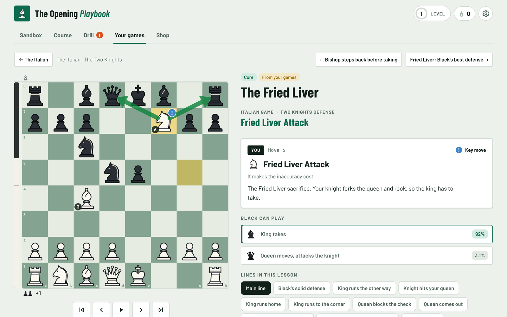
</picture>

</div>

The app reads your chess.com or Lichess games, works out which openings you play and where you leave the book, and turns that into a course. Units come in the order your games need them. You learn each line by playing it, drill it from memory, and practise against an opponent who answers the way club players do. It began as one player's course, written by hand from 149 blitz games, and the same thing is now built for anyone who connects an account.

<div align="center">

[Using it](#using-it-where-everything-is) · [The tour](#first-time-here-the-tour) · [Every move explained](#every-move-explained) · [Key moves](#key-moves-and-the-order-of-your-moves) · [Last 3 games](#your-last-three-games-review-and-drill) · [Features](#features-in-detail) · [The repertoires](#the-repertoires) · [How it was made](#how-it-was-made) · [For developers](#for-developers)

</div>

## What it does

<table>
<tr>
<td width="33%" valign="top"><a href="#course-one-path-through-both-books">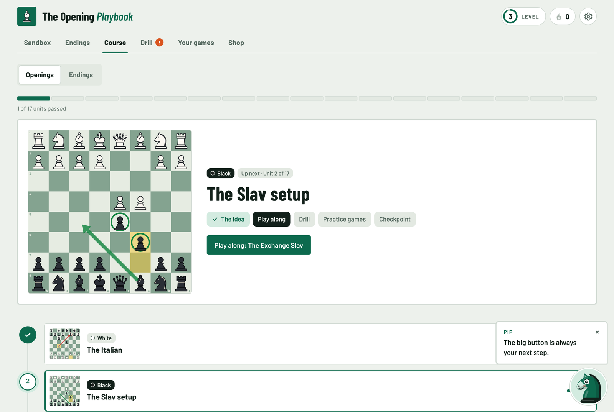</a><br><b>A course in your order</b><br>Units are sorted by how often you meet each opening and how you score in it. A checkpoint opens the next one.</td>
<td width="33%" valign="top"><a href="#course-one-path-through-both-books">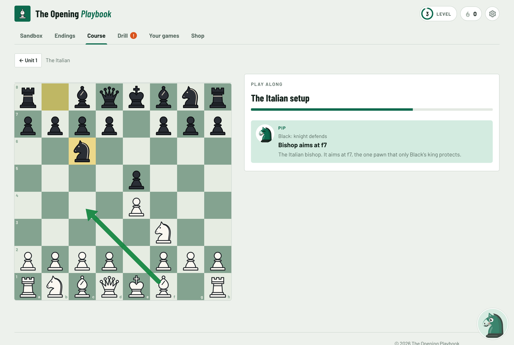</a><br><b>Learn by playing</b><br>Play along with the arrow, then from memory. A wrong move is met with the answer that punishes it.</td>
<td width="33%" valign="top"><a href="#key-moves-and-the-order-of-your-moves">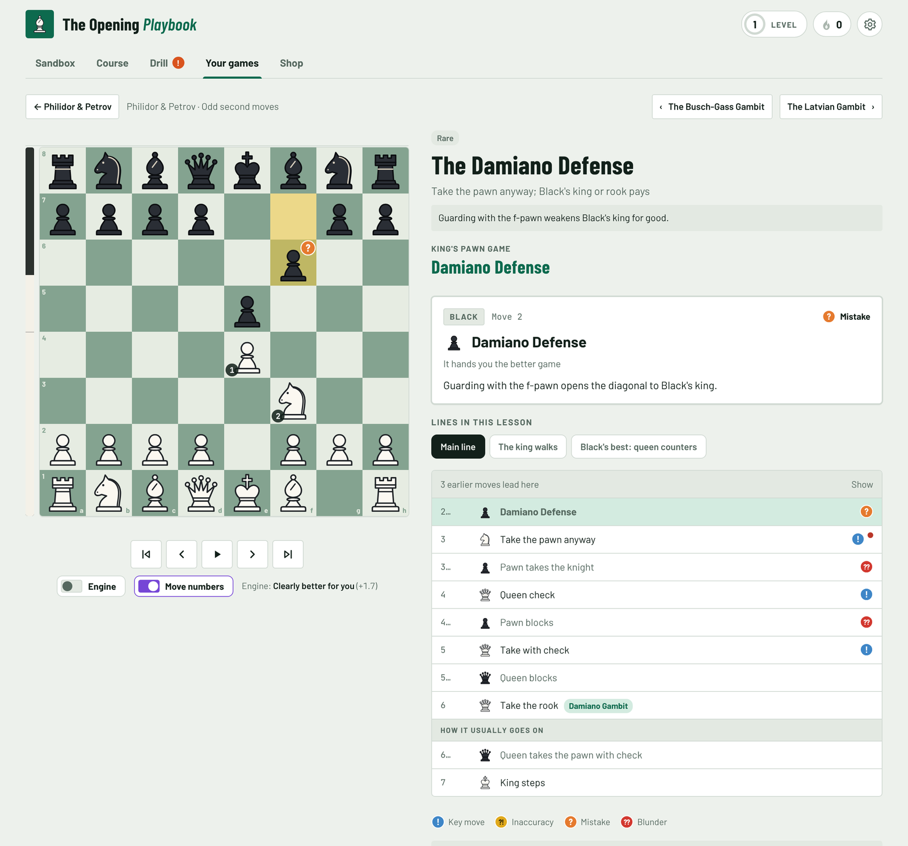</a><br><b>The moves that matter</b><br>!, ?!, ? and ?? on the board, the opening's real name above it, and your move numbers on the pieces.</td>
</tr>
<tr>
<td valign="top"><a href="#sandbox-play-your-book-against-a-realistic-opponent">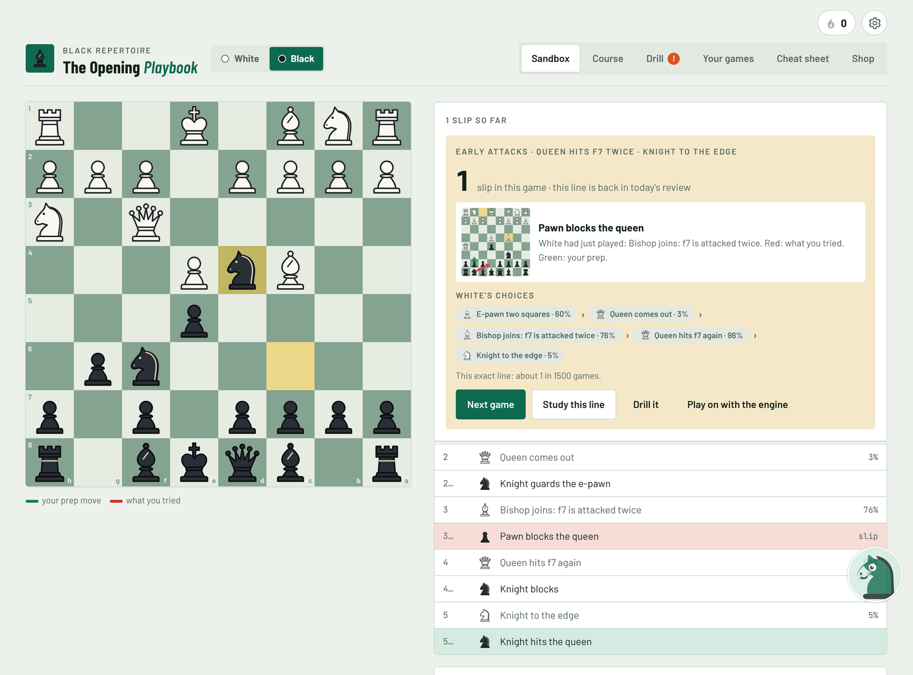</a><br><b>Practice games</b><br>An opponent that only plays lines from your book, as often as club players choose them. White and Black in turn.</td>
<td valign="top"><a href="#your-last-three-games-review-and-drill">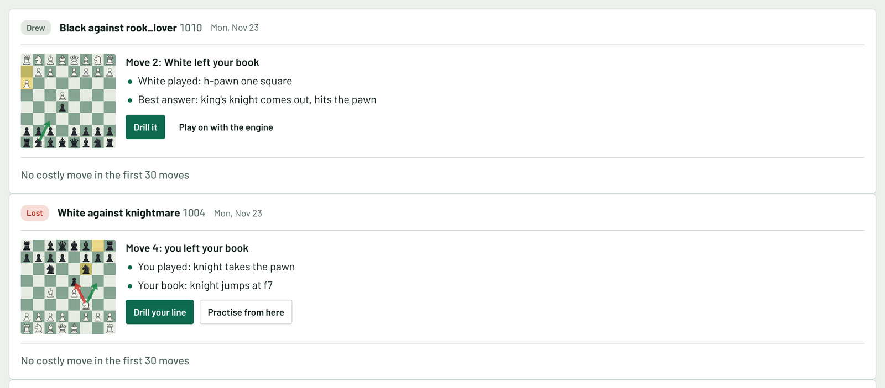</a><br><b>Your last three games</b><br>Where each one left the book and its first costly move, ready to drill.</td>
<td valign="top"><a href="#the-engine-and-what-to-do-when-the-line-ends">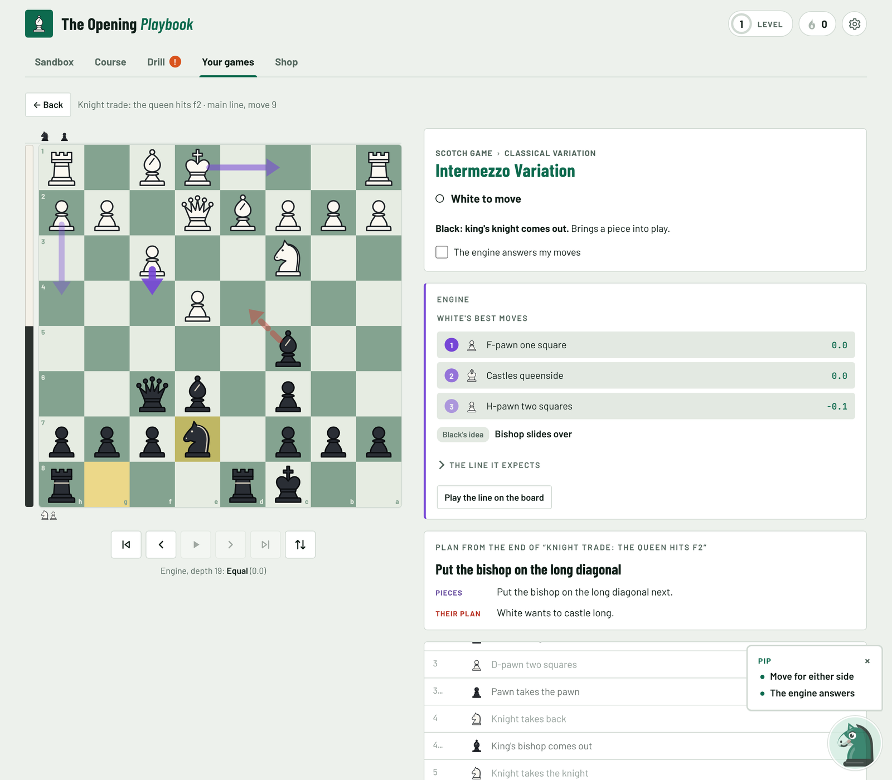</a><br><b>An engine that talks</b><br>Stockfish in the browser gives the best moves and the other side's idea in words, and plays on when a line ends.</td>
</tr>
</table>

> [!TIP]
> New here? Open the app and let the coach show you around. The tour takes about two minutes and can be fast-forwarded.

## Why it exists

Most opening courses are written for everyone: long lines in notation, chosen because they are best in theory, taught in an order that has nothing to do with what you will face. This one starts from **real games** and works outward.

| | |
|---|---|
| **The chapters come from the games** | Each book is split by what the opponent actually played, ordered by how often it happened, with the record next to it. |
| **The opponent plays like a real opponent** | Every opponent move carries the odds that a club player would choose it, from [Maia](https://maiachess.com), a network trained to predict human moves at a given rating. Drills, the Sandbox and every "how often" figure use them. |
| **Words and real names** | *Bishop aims at f7*, *Knight takes back*, *Queen breaks the pin*. An opening or a gambit that has a name is called by it, the way lichess.org gives it. |
| **Every move says why** | The board is read for each move on both sides: the piece it wins, the threat it makes or stops, the fork, the pin. A wrong move is answered with the reply that punishes it. |
| **Lines that don't stop early** | A line is played on past the point where the pieces are out, until the next move is no longer forced or hard to find, with the other side making the reply club players pick most. |
| **Checked by an engine, built for a human** | Every move was checked with Stockfish 17.1. Lines were chosen to be easy to remember, such as one setup against a whole family of move orders. |
| **One position, one move** | However a position is reached, the answer is the same. The build stops if two lines disagree, or if a label speaks of a pin, a guard or an attack that is not on the board. |
| **A line ends, the game doesn't** | Every line ends with a plan: where the king goes, which pawns move, what to aim at, what the other side wants. The engine takes over from there. |
| **The games feed back in** | Missed tactics become puzzles, the three newest games are reviewed as they come in, and every month ends with a recap. |

## Where it is going: a playbook for any player

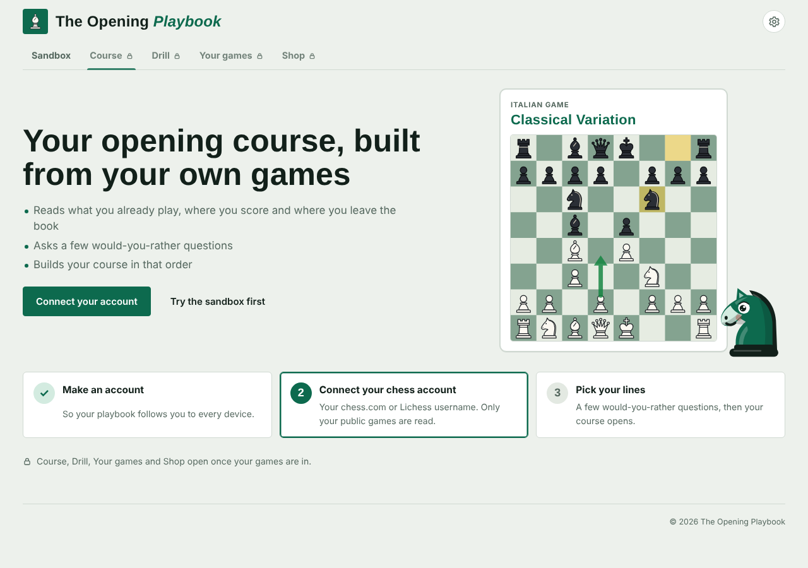

Everything above was built by hand for one player. The site now has the first version of the same thing for anyone:

1. **Welcome.** A new visitor sees the same tabs, with only the Sandbox open. The rest is locked until their games are in.
2. **Connect your account.** The sign-up form asks for a chess.com or Lichess username, and the games are read as soon as the account exists (a username can also be given later, or a PGN file dropped in). The page fetches the newest games itself from the sites' public APIs and leaves bullet out: it is too fast to show what someone knows. A repertoire needs 200 games that aren't bullet; with fewer, the page says to play some more first and remembers to check again. The app never shows these numbers: it talks about connecting an account, not about a count.
3. **The reading screen.** A script reads every game while the board plays through them: what the player opens with, what they meet, how each opening scores, which kinds of game they win (kings on the same side or opposite sides, queens on or off, short or long games), and the exact positions where they leave the playbook. It is rules and counting ([`app/analyze.js`](app/analyze.js)): no language model and no engine.
4. **Would you rather.** Where the player's own habit differs from what the library teaches, a card puts the two side by side with their record in each. Two more cards set the order of the course and how wide the drills go.
5. **Their playbook.** The course is reordered by their games, every chapter shows their own record, and Your games lists where they leave the book, each with a button into the lesson.

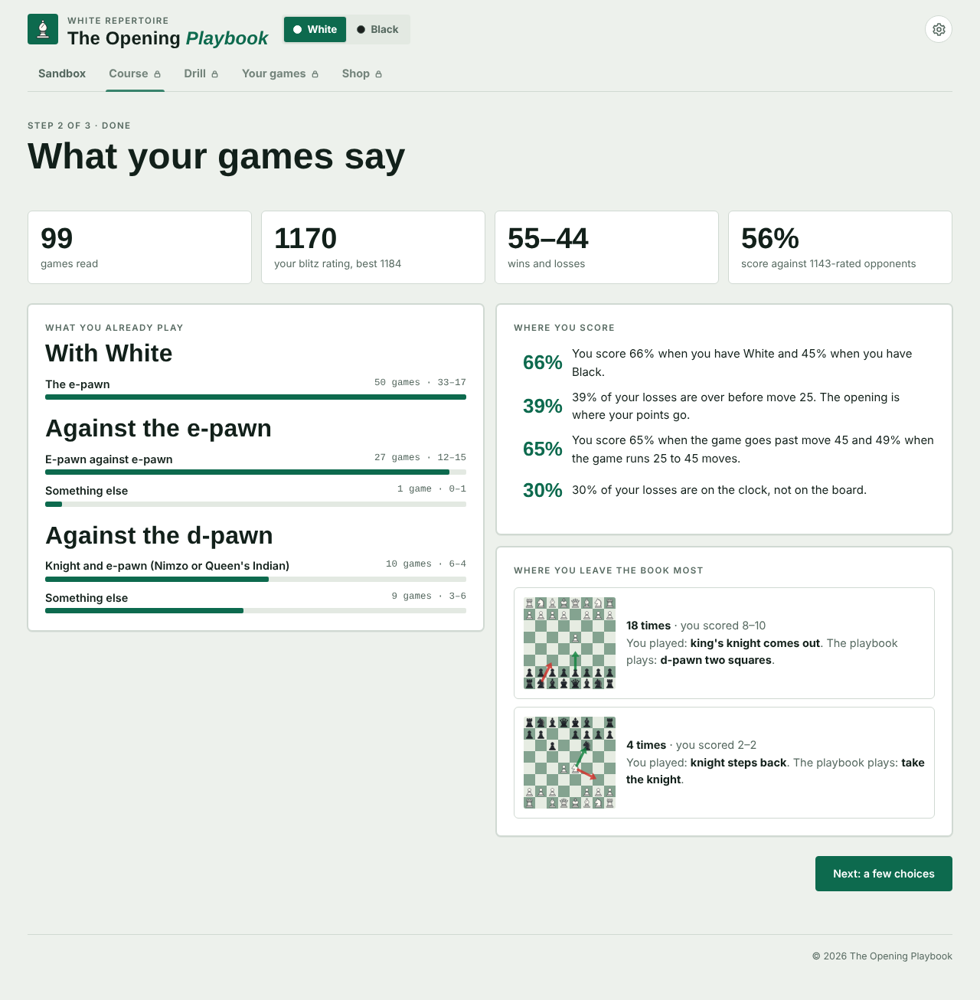

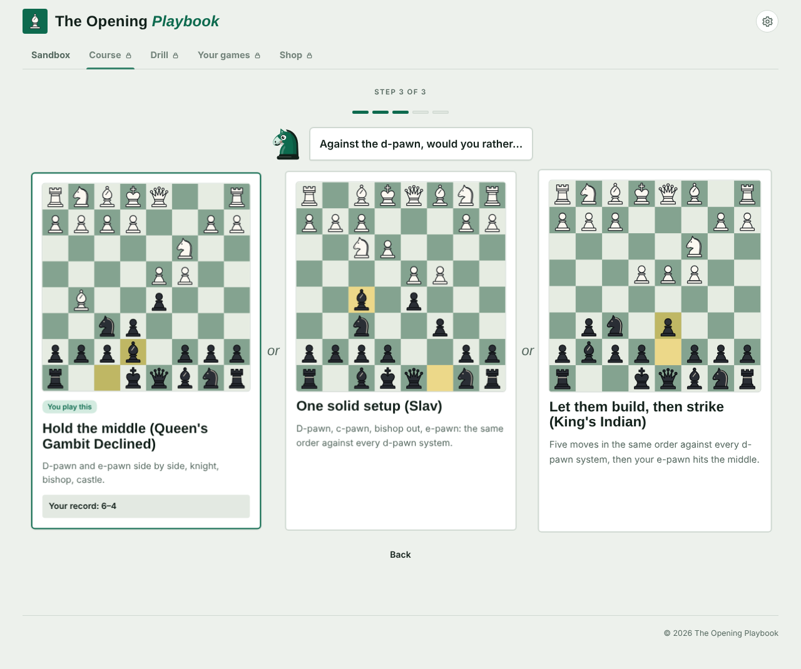

**What it cannot do yet.** The library is still short of some systems: it has the e-pawn, the London or the English as White; the e-pawn reply, the Caro-Kann, the Sicilian or the Scandinavian against the e-pawn; the Slav setup or the King's Indian against the d-pawn. A player who prefers something else is told that their system is still being written, and that part of their course waits. Each system is also one way to play its opening: the Kan setup for the Sicilian, the bishop-out line for the Caro-Kann, the center attack in the Italian. A choice between variations inside an opening (which Sicilian, which line against the Caro-Kann) is the next thing to be written, each variation as a pack of its own, followed by the French and the Queen's Gambit Declined. Puzzles from a player's own mistakes need the engine run over their games, which is not built yet.

A **coach**, one of three characters to pick from (Pip the knight, Rocco the rook, Dot the pawn), says the short things in a speech bubble at the bottom right: what a tab is for the first time it is opened, once a day what is worth knowing there (the first of today's five and why it comes first, the next unit and how far along it is, today's drops in the shop), the end of today's five with the streak, a new badge with its medal, a new monthly recap, why a section is locked. Tapping the coach brings back what is worth knowing on that tab. When a drill line ends with a slip, the coach's note in the drill panel says which move caught you, what you played instead, what the book says about that move and why the line's move is the move, and whether the same move has caught you before; when a checkpoint goes wrong, it names the lesson most of the misses came from and offers to play it along again. The coach talks in short bullets, never paragraphs, and it is the coach the player picks that leads the [tour](#first-time-here-the-tour) on the first visit. It never speaks during a drill, a practice game or a checkpoint, and it can be switched off in **Settings**, which also has light and dark mode, text size, five board colours, the letters on the board and the tour again. Settings are kept with the progress, so the coach and the look follow an account to every device. The system for each part of the repertoire is in Settings too, folded away at the bottom: switching one swaps whole course units, so it asks for the player's username first.

## At a glance

|                                   | White book                | Black book                       |
| --------------------------------- | ------------------------: | -------------------------------: |
| Games it is built from            | 76, all opened with 1.e4  | 73: 44 against 1.e4, 24 against 1.d4 |
| Record in those games             | 48–28                     | 37–35–1                          |
| Chapters (openings)               | 8                         | 9                                |
| Lessons                           | 82                        | 65                               |
| Lines you can drill               | 429                       | 549                              |
| Positions on those lines          | 5,319                     | 7,001                            |
| Positions with a written note     | 766                       | 716                              |
| Lessons with a written plan       | 76                        | 62                               |
| Lines that end with a plan        | 410                       | 538                              |
| Game reviews                      | 10                        | 11                               |
| Missed-shot puzzles               | 12                        | 13                               |
| Patterns across games             | –                         | 4                                |
| Cards at a glance                 | 47                        | 71                               |

The course on top of both books has **17 units**. Fourteen are opening units: 55 core lessons, 92 optional ones and 84 checkpoint positions. Three are skill units made of positions from my own games: 26 threats I walked into, 18 winning positions I let slip and 16 endings. Finishing the course opens a library of **11 deep dives**: the optional lessons in 27 parts, with 162 more checkpoint positions.

Those are the numbers for my own playbook. The library behind it also holds the systems other players can pick ([Systems](#systems)): with the London and the English for White and the Caro-Kann, the Sicilian, the Scandinavian and the King's Indian for Black, the books have 15 chapters, 129 lessons and 847 lines for White, 15 chapters, 112 lessons and 1090 lines for Black, and the course has 30 units and 22 deep dives.

## Using it: where everything is

Everything is reached from the header: five tabs (**Sandbox**, **Course**, **Drill**, **Your games**, **Shop**) and, in the corner, the level ring, the streak flame, **Settings** (the gear) and the account. There is no switch between White and Black: every tab holds both books, and the board turns to the colour of the line on it. The coach sits at the bottom right.

| To… | Go to | What happens |
| --- | --- | --- |
| practise White and Black in one sitting | **Sandbox** | With **Everything** picked, games come with White and with Black in turn. Pick a colour, or openings from either book, to narrow it. |
| learn the next thing | **Course** | The big button on the current unit always goes to the next step. |
| see the move to make, and why | **Play along**, a unit's second step | The move is a green arrow. The coach's card says what the other side just played, what it is after, and why the move is the move. |
| practise from memory | **Drill** | Today's five, or any line of either book under **Pick lines yourself**, an opening at a time. A slip shows the answer that punishes it, and a move of the line played too early is named as that. |
| see which moves matter in a line | a lesson, a drill or a Sandbox game | The other side's inaccuracies (**?!**), mistakes (**?**) and blunders (**??**) carry a mark on the board, and so does your **key move** (**!**): the answer that makes one cost. |
| learn the order of a setup | the numbers on your pieces in a lesson | Each piece carries the number of the move that put it there. A purple number is played at another turn than in the main line. **Move numbers** under the board turns them off. |
| try another move in a lesson | drag or tap any piece on the lesson's board | The line's own move steps on. A move your book answers opens that line. Anything else opens the explore board with the engine on. |
| drill what went wrong in a recent game | **Your games → Last 3 games** | Your three newest games: where each left your book and its first costly move. **Drill it** plays that spot. When your own move left the book, the coach says so and **Drill the line** starts the book's line at once. The website reads the games from your account; any copy takes a pasted game. |
| practise from one position | **Sandbox → Set up a position** (under the board), or **Practise from here** in a lesson | Practice games start there, and only the lines that go on from it come up. |
| keep playing when a line ends | **Play on with the engine**, or just move a piece | The button under the board when a drill line or a puzzle ends. A finished Sandbox game already has the engine on its board: step back through the game or move a piece to play on. In a lesson: **Play on from here** at the last move, or **Explore from here** at any move. |
| see who is ahead | the rows above and below any big board | The pieces each side has taken, with the lead in points on the side that is ahead. |
| see what the other side can play | a lesson, from **Your games** → an opening | Every position lists the other side's moves with how often club players choose them. Tap one to see the answer. |
| ask the engine | the **Engine** switch under a lesson's board | The three best moves as purple arrows, the other side's idea as a red dashed one, all in words. Off during drills, practice games and checkpoints. |
| play a whole game from the book | **Sandbox** | An opponent that only plays lines from the book, picked by how often club players choose them or by what you know least. |
| look back at the games | **Your games** | Openings, the last three games, missed shots, game reviews and the monthly recap, one at a time behind the switch at the top. Each part lists White's and then Black's. |
| see the level, the badges and the streak | the ring or the flame in the corner | Either opens the profile. The flame takes a new colour at 5, 10, 20, 30, 50 and 100 days. |
| dress the coach | **Shop** | Opens at level 5. The daily shop has six new pieces every day, crates hold the pieces it never sells, and what is yours is in the locker. |
| change the look, the sound or the coach, or see the tour again | **Settings** | Light or dark, text size, board colours, letters on the board, how pieces slide, sounds, the coach, **Take the tour again**. |
| switch a system, or start over | **Settings → Advanced settings** | The systems and **Reset account**. Each asks for your username first. |
| keep the progress on every device | the account button | On the website. The claude.ai copy keeps it with the claude.ai account by itself. |
| ask for a tip | tap the coach | What is worth knowing on the tab you are on. |

## First time here: the tour

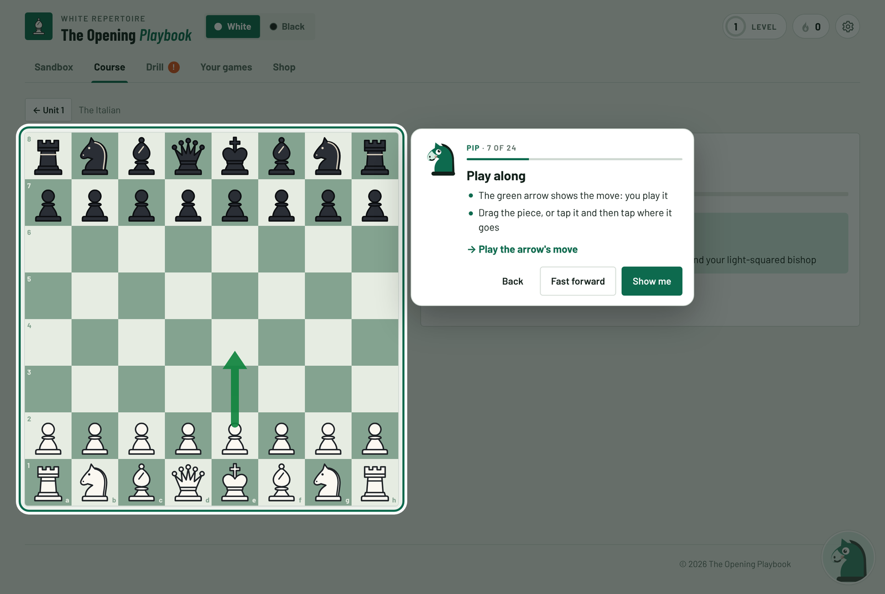

The first time the app opens, the coach shows the player around (a new player gets the tour as soon as their playbook is ready). It starts with the choice of coach, Pip the knight, Rocco the rook or Dot the pawn, and the one picked leads the rest and stays on as the player's coach. It takes about two minutes, one thing at a time, with the rest of the page dimmed:

- **The tabs.** What each one is for. The White openings and the Black defences are in every one of them.
- **The course.** What each tab is for, the button that always leads on, and the five steps of a unit.
- **Play along.** The player makes the move on the green arrow and sees what the coach's card says about it.
- **Drills.** Today's five. Then the coach plays a wrong move on purpose to show the answer that punishes it, and a second one to show the arrow that follows two misses.
- **Play on with the engine.** The player taps it at the end of the line and lands on the explore board: moves for both sides, the engine's best moves and the other side's threat.
- **Lessons.** The other side's answers with how often they come up, the move card with what each move does, the opening's name above it, the engine switch and the plan at the end of the line.
- **The rest.** Your games, the Sandbox (White and Black in turn, and every game ends with its plan), the level, the streak, the daily shop, Settings, the account and the coach.

The tour keeps up with the app: its test fails when a tab, a part of Your games, a setting or a listed feature isn't named in it, so a new feature comes with its step.

It can't be skipped, but it never has to be read: **Fast forward** plays it through by itself, the coach doing every tap, and **Show me** does one step's tap. **Back** goes back a step, and the arrow keys and Enter work too. Nothing done in the tour counts: no line is recorded and no points or streak days are given. It is taken once per player rather than once per device, since it is kept with the progress, and **Settings → Take the tour again** runs it from wherever the player is and comes back there. On a phone the card docks at the top or the bottom, away from what it points at.

## Every move explained

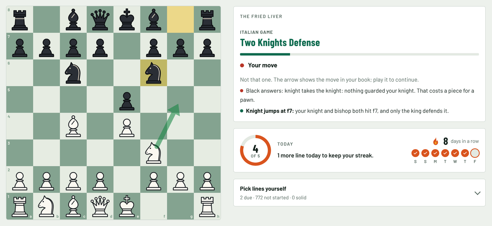

The written notes say why the important moves are played, but not every move has one, and a note written for the book's move can't answer the move the player tried instead. So the page also reads the board ([`app/ideas.js`](app/ideas.js)) and says what each move does, in the same plain words:

- **The move to make.** *Threatens to take Black's e-pawn.* *A fork: your knight hits Black's king and rook at once.* *Stops the mate on f7.* *Pins your knight: moving it would drop the queen.*
- **The other side's move.** Shown under it in drills and in Play along, so its idea is clear before the reply: *Guards Black's e-pawn from your knight.* *Threatens to take your queen.*
- **A wrong move.** In a drill, a Sandbox game or a practice game, the reply that punishes it is named with what it costs: *Black answers: knight takes the knight: nothing guarded your knight. That costs a piece for a pawn.* A second miss adds why the book's move is the move, and the coach's note at the end of the line says both again.
- **Everywhere else.** In a lesson the move card adds what the board shows under the note, leaving out what the note already says. The explore board says what the last move did. In a practice set, the opponent's punishing answer comes with the reason it works.

It is rules, not an engine and not a language model: what attacks what, captures counted piece by piece (a static exchange that leaves pinned pieces out), threats found by letting the other side move twice, a two-move look for checks that win something, pins along lines and guards taken away. It says at most two things, the most important first, and answers instantly. `node tests/ideas_check.js` runs it over every move in both books: about 85% of them get at least one line, and none of the lines uses notation.

## Key moves, and the order of your moves


A line is easier to remember when it is clear which moves in it matter. In every lesson the moves carry a mark where one is due:

- **The other side's moves** are judged by what they hand you. The engine's number before and after the move becomes a share of the point (a pawn matters less in a game that is already won), and a move that gives away 9% of it is an **inaccuracy**, 16% a **mistake**, 28% a **blunder**. A move that walks into a forced mate is a blunder whatever the share, and so is a move the book's own notes call one.
- **Your key move** is the answer that makes a mistake or a blunder cost: the knight sacrifice of the Fried Liver, the pawn you take anyway against the Damiano. A move of yours that the book shows on purpose as one to avoid reads as a mistake.

The signs are the ones every chess player reads: **!** for a key move, **?!** for an inaccuracy, **?** for a mistake, **??** for a blunder. The colours are of the same family as the big sites' (blue, amber, orange, red) without being their values. A mark shows in three places: as a badge on the board at the corner of the piece's square, with the word beside it for a moment (*Inaccuracy*, *Key move*); as a chip with one sentence on the move card (*It hands you the better game*, *It makes the mistake cost*); and as the sign in the list of moves, with a legend under it. Most moves have none: about one of the other side's moves in six, and one of yours in fifteen.

In a line drill and in a **Sandbox** game the marks come up as the moves are played. The other side's slip is marked when it lands, and the answer that punishes it gets its **!** on the piece that made it, which stays there while the reply is played. A checkpoint shows none: it asks for the move.

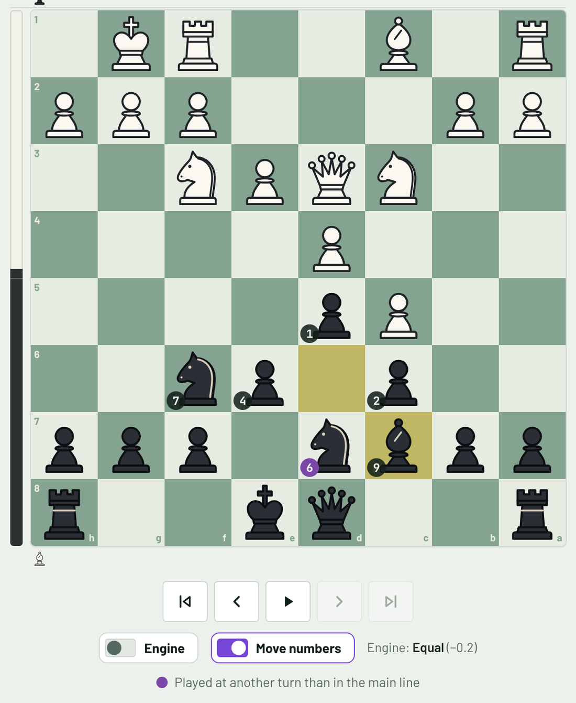

The order of a setup is shown on the board itself. In a lesson every piece of yours carries the number of the move that put it there, so the position reads as the order it was built in. The opening's main line is the order to know. When a line plays one of the same moves at another turn, which is where a setup gets mixed up, that piece's number is purple, with one line under the board saying so. **Move numbers** beside the engine switch turns them off, and the choice is kept with the settings on every device. An earlier version drew every move as a small diagram in a strip under the board; in use it was more to decode than the board, so it is gone.

A drill knows the difference too. A move that belongs to the line but is played before its turn is not just wrong: the panel says *The right move at the wrong moment. In this line it comes two moves later: something else has to happen first*, without saying which move is due, and the coach's note at the end says that the order slipped, not the move, with **See the order** leading to the lesson at that move.

## Your last three games: review and drill


A loss to something you have never seen is the best time to learn the answer. **Last 3 games**, in Your games, keeps your three newest games, reviewed: on the website they are read from your account when the app opens and every quarter of an hour (**Check now** reads at once), and any copy takes a pasted game. A new game comes in and the oldest goes; the coach says when a new one is waiting. When it was your own move that left the book, the coach says which move it was and what your book plays there, and the bubble's **Drill the line** starts the book's line at once. Until that line has been drilled clean, the Drill page leads with it and the coach brings it up there once a day. Each review answers two questions:

- **Where did it leave the book, and whose move was it?** When the opponent left it, the review names their move and what it is after, lists the replies your book does cover with how often they come up, and gives the engine's answer with its reason. **Drill it** plays that position on the drill board: the engine's answer and the moves after it, the other side's moves played for you. When you left it, the review shows what you played and what that allowed, your book's move and why; **Drill your line** plays the book's line from move one, and **Practise from here** opens the Sandbox at that position.
- **What was the first move that cost something?** The engine reads your moves from where the book ends to move 30 and names the first one that lost a pawn and a half or more, after a second, deeper look. The review shows what you played, what it allowed and the better move, and **Drill it** plays the better move and the engine's line on.

Drills here work like every other drill: a wrong move is answered with what punishes it, a second miss shows the arrow, and a clean run is kept with the review, on every device. The engine's part runs while the reviews are on screen, so it never takes the engine away from a lesson, and what it finds is kept, so it is worked out once.

## Features in detail

### Course: one path through both books


The course is the front page. Units alternate between White, Black and skills in the order that matters for my games: the Italian first (my main weapon, and only 5 wins in the last 12), then the Slav setup against the d-pawn (a third of my Black games), then threat-spotting. Every lesson unit has five steps:

1. **The idea.** A few boards with arrows and a bullet or two each.
2. **Play along.** Each core lesson played on the board: the move to make shows as a green arrow, and the coach's card says what the other side just played and what it is after, then why the arrow's move is the move. A wrong move just doesn't go, and nothing is counted. Then the same line once from memory.
3. **Drill.** Each main line played once from memory without a slip. A slip puts the same line in front again, ahead of the way back to the unit.
4. **Practice games.** Three clean sandbox games where the opponent only plays this unit's lines and picks the ones I know least.
5. **Checkpoint.** Six positions from the unit; five right on the first try opens the next unit.

The app is made for a player who would rather play than read, so the learning happens in the playing. One button on the course and unit pages always leads on: the line just played along with, from memory; then the next lesson to play along with; then the practice games and the checkpoint. A lesson counts as studied when its moves have been played along with, or stepped through to the end on its page (jumping to the last move doesn't count). Optional "go deeper" lessons sit under each unit, finished units come back through today's five, and every lesson stays reachable from its opening's page under Your games.


Three skill units sit between the opening units, each built from positions in my own games at the move where it went wrong:

- **Spot the threat.** My next move lost material. Any move that loses nothing counts, not only the engine's favourite. Play a losing move and the opponent's answer is played out on the board with the reason in words: what it costs, or, when the point is a few moves deep, the line move by move with a button that plays it out. **Show me the danger** draws the threat first, at the price of the first-try point.
- **Finish the job.** I was winning by a lot and my next move let it go, which is how 21 of my 91 losses happened. Find the move that keeps the win.
- **Endings.** Endings I reached level or better and then lost: back ranks, pawn endings and active rooks. Find the move that holds the result.

In a practice set, every position opens on the explore board with the engine as soon as it is answered, right or wrong, with the move I tried already on the board. In a checkpoint the engine waits until the end, and the reasons are still given in words.

### After the course: a library, picked for you

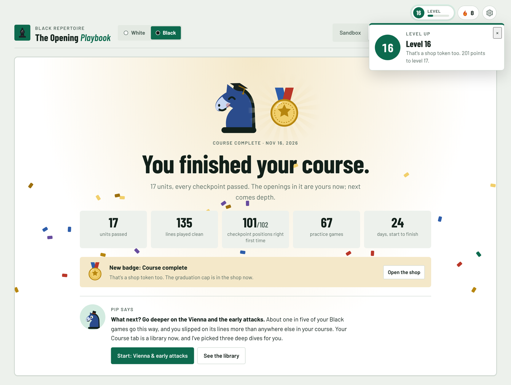

The last unit's checkpoint ends the course with a big moment: the coach in a graduation cap, a gold medal, five numbers from the course (units, lines played clean, checkpoint positions right first time, practice games, days from start to finish), the Course complete badge and its shop token. It shows once. The moment is stamped in the progress and reaches every device.

From then on the Course tab is a library, not a catalogue. The coach suggests three deep dives, picked from how the course went. The main factor is how often I meet each opening, weighed by where I slipped in drills and practice games, which checkpoint was weakest, and how those games went. Each card says why in one sentence. The rest stay folded away, and the first course's path is one click away.

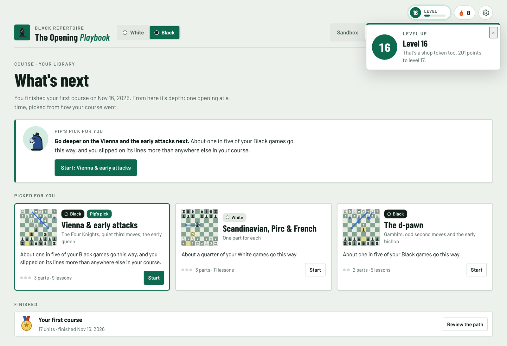

A deep dive takes one opening past the course. It is made of the lessons that opening's unit marks "go deeper", grouped into parts by idea. The Italian has four parts:

- Black's early sidesteps
- the pawn declined
- the main line where Black takes
- the traps behind the bishop move

Each part works like a unit:

- an idea board where the part's lines split, with blue arrows for the other side's tries
- one board per lesson with my answer in green
- the lessons
- a drill
- three practice games against that part's lines only
- a six-position checkpoint that opens the next part

Finishing a deep dive earns a badge, and three earn another.

### Your games and the openings: two books on one page

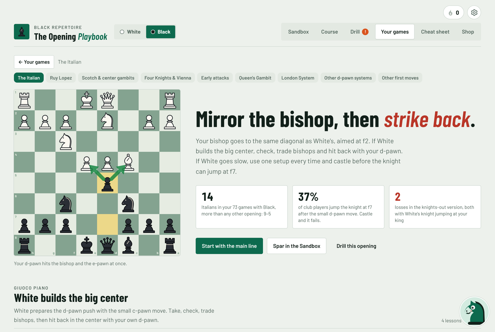

**Your games** opens on the openings, White's and then Black's: one tile per opening, with how often it came up, the record in it and how many of its lines you know. Each tile opens that opening's page (the chips at the top move between them), with every lesson in it and, one switch away, every decision in it at a glance. There is no separate Learn tab: the course is the way through the lessons, and the opening pages are where to look one up.

Nothing has to be switched to get from one book to the other. A tile, a line in the Drill list, a missed shot or a game review opens in its own book, the board turned to its colour, and each book remembers the page it was left on. A drill or a practice game under way keeps its colour too: leave it for a page of the other book and it is as it was when you come back. Every opening page starts with a board showing the key idea, the plan in one sentence, and three facts from the games. One example: *"37% of club players jump the knight at f7 after the small d-pawn move. Castle and it fails."* Lessons are grouped into parts and tagged **core**, **common** or **rare**, so the most frequent lines come first.

### Study: step through any line

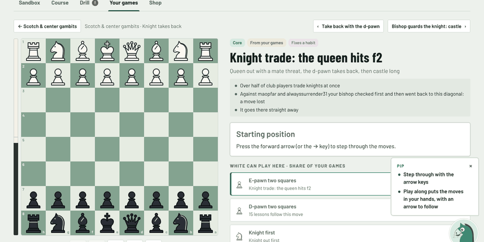

Each lesson is a board you step through with the buttons or the arrow keys. Above the move card is the opening's name for the position on the board, the one lichess.org uses, with the variation in large type and the names that lead to it in a small line above (*Italian Game › Two Knights Defense*, then **Traxler Counterattack**). When a move starts a named line, the name flashes, and in the list of moves that move carries the name as a tag: the variations are worth knowing by name, and the name is a hook to hang the moves on. Every move has its label, an optional note, what the board shows under **On the board** (a threat made or stopped, a piece won, a fork, a pin; see [Every move explained](#every-move-explained)), arrows and circles where they help, and the engine's verdict in words (*Equal*, *Better for White*) with the number beside it. Wherever the opponent has a choice, the alternatives are listed with how often players at this level pick them, and one click jumps into that branch.

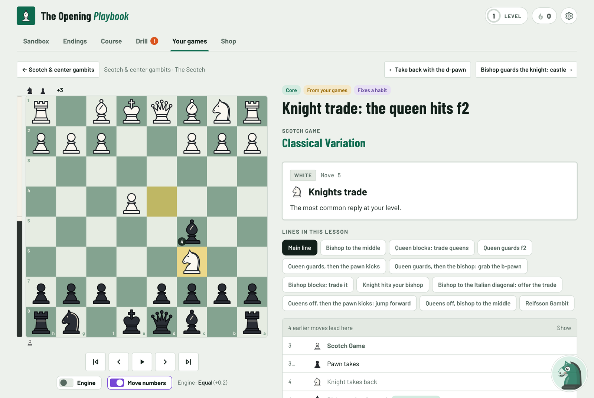

### The engine, and what to do when the line ends


A line in a book has to stop somewhere, and the position it stops in can still look dangerous. Two things pick up from there.

**A plan.** The last position of every line comes with a short card: where your king goes, which pawns to push, where the pieces belong, what to aim at, what the opponent wants and what to watch for. It shows at the end of a line in Study, after a clean drill and at the end of every practice game. The main lines' plans are written by hand and checked against Stockfish's continuation. A side line that ends where a main line ends shares its plan; every other line gets one read off the board and Stockfish's line from there (depth 18): the pieces still at home, castling now or once a piece is out, the pawn move the engine plays next and what it hits, the material and what it means for trades, a king that can't castle, a pawn with no neighbour, and the other side's next two moves in words. Lines that end in mate have none.

**The engine.** Stockfish runs in the browser. Switch it on under the board in Study, or press **Play on with the engine** when a drill or a puzzle ends. A finished Sandbox game needs no button: the engine is on its board the moment the game is over. It stays out of the way while you are being tested. The card shows:

- the three best moves for the side to move, in words, each with a purple arrow and its value. Numbers follow the usual convention whichever colour you play (plus: White is better, minus: Black is better); the words beside them are from your side;
- the other side's idea, found by asking the engine what they would play if it were their move again: a red dashed arrow, marked **Threat** when it wins something;
- the line it expects, as a row of plain-English moves that can be played out on the board.

**Play on from here** opens the explore board, where you move the pieces for both sides, or tick a box and the engine answers your moves. A line under the board says what the last move did. The board carries the whole game from move one: step back past the point where you came in all the way to the start, and a button brings you back to that point. A different move before it starts a new line from there.

### Drill: five lines a day

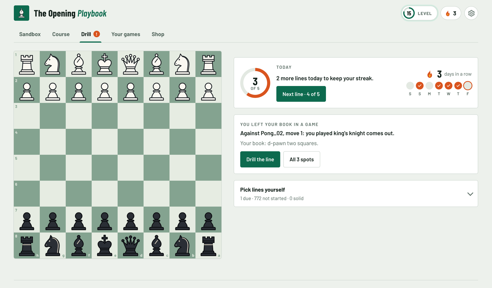

The Drill tab opens on **today's five**: five lines from move one, about a quarter of an hour. They come from both books, in this order: lines you slipped on, oldest first; lines whose moves have changed; lines that are due; new lines from lessons you have studied; then new lines in course order. Five different lines in a day keep the **streak** going (any line played to its end counts, in a unit's drill or a Sandbox game too). The tab carries a small **!** until today's five are done; there are no counts beside White and Black.

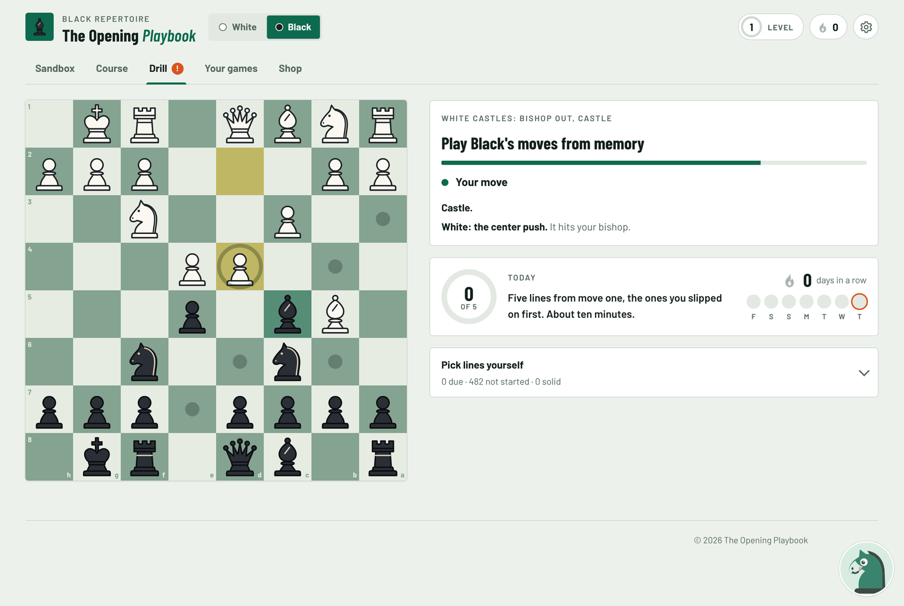

You play your side's moves from memory and the opponent's moves play themselves, each with its label and what it is after. You can drag or tap, and you castle by moving the king two squares or onto its rook. A wrong move is answered with the reply that punishes it and what that would cost, and gets a second try; a second miss shows the book's move as an arrow with the reason for it. When the line is over, the coach's note says what went wrong: the move that caught you and what you played instead, what the book says about that move when it knows it (otherwise the answer that punishes it), why the line's move is the move, how many times that same move has caught you, and a link to study it. A clean run gets a note only when it means something: the move that caught you last time held, every line of a lesson is now clean, or the line has reached full strength. Lines are scheduled in Leitner boxes: a clean run sends a line further out (1, 2, 4, 8, then 16 days), and a slip brings it back today. Under **Pick lines yourself** you can still filter by opening and by priority, and start each line either from move one or from the point where it branches off lines you already know.

The **flame** in the corner changes colour as the streak grows: orange to start, gold at 5 days, rose at 10, violet at 20, blue at 30, teal at 50 and white-hot at 100. The profile names the colour and the day the next one comes.

**Badges** sit in the profile (the flame in the top corner, or the account button): lines known without a slip, streaks, course units passed, lines at full strength and practice games. Locked ones are grey with how far along you are; a new one arrives as a medal in the coach's bubble.

**Levels** sit beside the flame, as a ring that fills toward the next level around the level number. Everything practised earns points: 10 for a line played without a slip (4 with one), 5 for a lesson studied, 5 for a practice game, 15 for a day with today's five done and 40 for a checkpoint passed. Each level asks for a little more than the last (45 points to level 2, then 60, 75, 90…). Points float up from the chip as they come in, and a new level drops a card from it; a level reached in the middle of a line waits until the line is over. The points are worked out from the progress itself, so every device shows the same level.

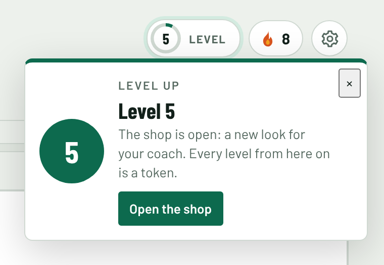

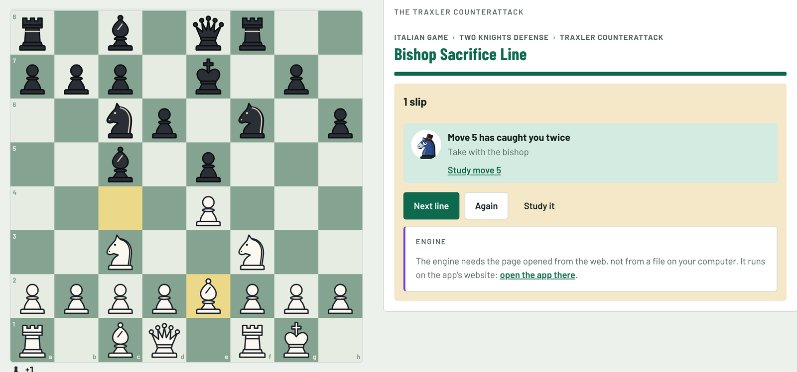

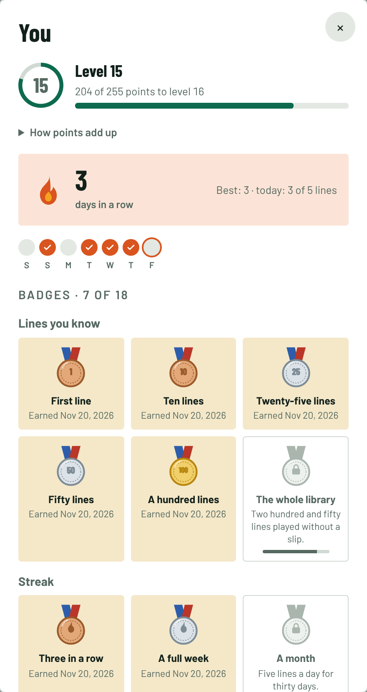

### Shop: a wardrobe for the coach

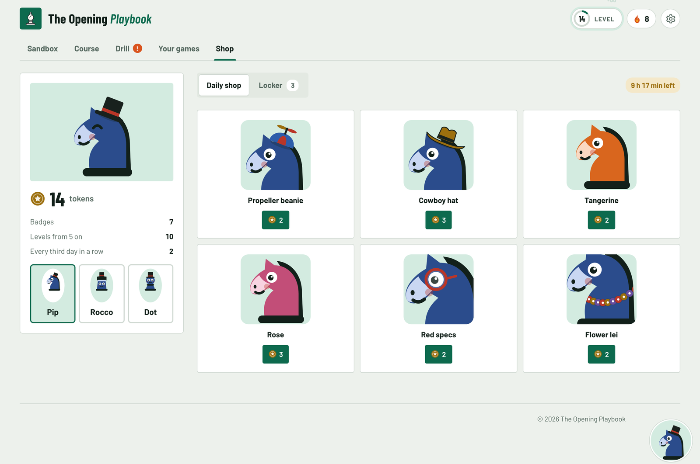

The wardrobe opens at **level 5**, about a week of drills in, and tokens come in from the start: one for each badge, one for every third day in a row and one for every level from 5 on. They are worked out from the progress itself, minus what has been bought, so every device shows the same number.

The shop has a **daily shop**: 6 pieces a day (two hats, two colours, one pair of glasses, one thing for the neck) out of 38, and a timer that counts down to midnight, when the shelf changes. The six are picked by the date, so every device shows the same shelf. Buying is a small moment: the card pops with confetti and a chime, the coach hops in the new piece, and the card stays on the shelf for the day with its button greyed to *Owned*. What is bought is in the **locker**, where everything owned can be worn or taken off; a piece already in the locker leaves the rotation. Six pieces need a badge first (the crown and the gold colour a month in a row, the wizard hat fifty lines, the graduation cap the whole course…): the locker lists them with how far along that badge is, and they join the shop's rotation once it is earned.

**Crates** are the third part of the switch. The collector's crate holds thirteen pieces the shelf never has: eight colours and five auras (a glow, embers, frost, a starfield and a supernova drawn behind the coach), in four rarities. A crate costs two tokens and gives one of them, never one already owned: common six times in ten, rare 27 in a hundred, epic one in ten, legendary three in a hundred, and the two legendary pieces (the Aurora colour, which shifts as you watch, and the Supernova) come from nowhere else. Opening one runs a reel of pieces past a marker, ticking as it slows, and then shows the piece in its rarity's colour, ready to wear.

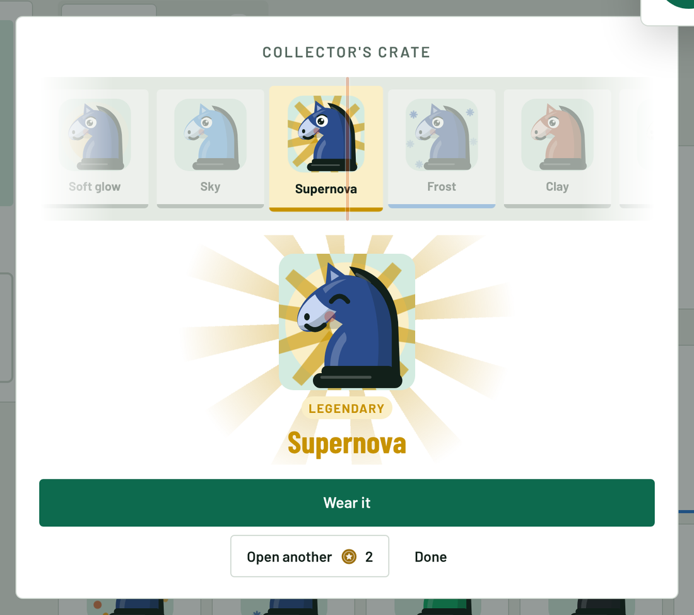

A card shows the piece by itself, up close; the whole outfit is on the coach beside the shelf. Each piece is fitted to each coach: a hat sits on its rim with a shadow under it and the picture makes room for it, and everything worn at the neck is drawn along the neck's own line (a scarf is that line as a band, a lei is beads on it, a tie hangs from a point of it). The knight is seen from the side, so what goes round its neck is cut to its outline and reads as worn, not stuck on. What the coach wears shows everywhere the coach does.

### Sandbox: play your book against a realistic opponent


The sandbox plays one branch of the book as a full game, and it plays both books. With **Everything** picked, games come with White and with Black in turn, the board turning each time, and the count of lines met runs over both books. The opponent only plays moves that are in your book, picked with one of three settings:

- **Like real games.** Each reply is weighted by how often club players choose it.
- **Even spread.** Every line in the book is equally likely.
- **My weak spots.** Lines you have never played or that are due count more, and solid ones count less.

Under **Everything** there is a row of openings for each colour. A tap on **White** or **Black** keeps that colour only, and the opening chips are a multi-select across both rows: pick the French with White and the Ruy Lopez with Black and the session mixes just those two. An opening's lines are the lines of its lessons, the odd move orders filed under it included.

To practise one position, **Set up a position**, under the board, turns it into a set-up board: play the moves for both sides (only moves in your book go, and the book's moves for the side to move are listed as buttons, the other side's with how often they are played), then **Practise from here**. A switch on the set-up panel says whose book the position is in. The arrows under the board and the arrow keys step back and forward through the moves you made, a tap on a move in the list jumps to it, and the heading says how many lines go on from the position on the board. Every game until you change it starts there, and only the lines that go on from it come up; the position sits under the board as a small picture with **Change the position** and **Start from move one** beside it. On the set-up board nothing slides: a move for either side, a step back and a step forward are there at once. **Practise from here** under a lesson's board does the same from the move on the board, and a review in Last 3 games does it from the move where you left your book.

A move that leaves the book is answered on the spot with the reply that punishes it, when there is one, and a second miss shows the book's move with its reason. The opening's name sits above the game and follows it move by move, and the marks come up on the board as the moves are played (see [Key moves](#key-moves-and-the-order-of-your-moves)). At the end you get a slip report and the plan from the last position, whichever line the game took. Each mistake is shown on a mini board (red for what you tried, green for the move in your book), along with the chain of the opponent's choices and their odds and how rare the exact line was (*"under 1 in 2,000 games"*). Any line you slipped on goes straight back into today's drill. No line comes twice in a row, whichever odds are set: the opponent steers the next game to another line, and only a position with a single line left repeats it. Changing the opening or the odds mid-game applies to the next game, with a button to start it right away, so the current game is never cut off.

A finished game stays on the board with the engine on it: the verdict in words and the number under the board, the engine's arrows on it, and buttons (or the arrow keys) to step back through the game. Move a piece for either side and the explore board opens with that move made. **Next game** leaves all of it behind.

Your own move lands the moment you let go of the piece, here and in every drill, checkpoint and on the explore board; only the other side's reply slides in. **What else Black could play here** folds away behind its arrow and stays the way you left it. The count beside the session numbers (*12 / 343 of your White lines met here*) is every line a game can end on with the openings picked, or from the position set up, counted from the book on the page.

### Your games: the record and the reviews

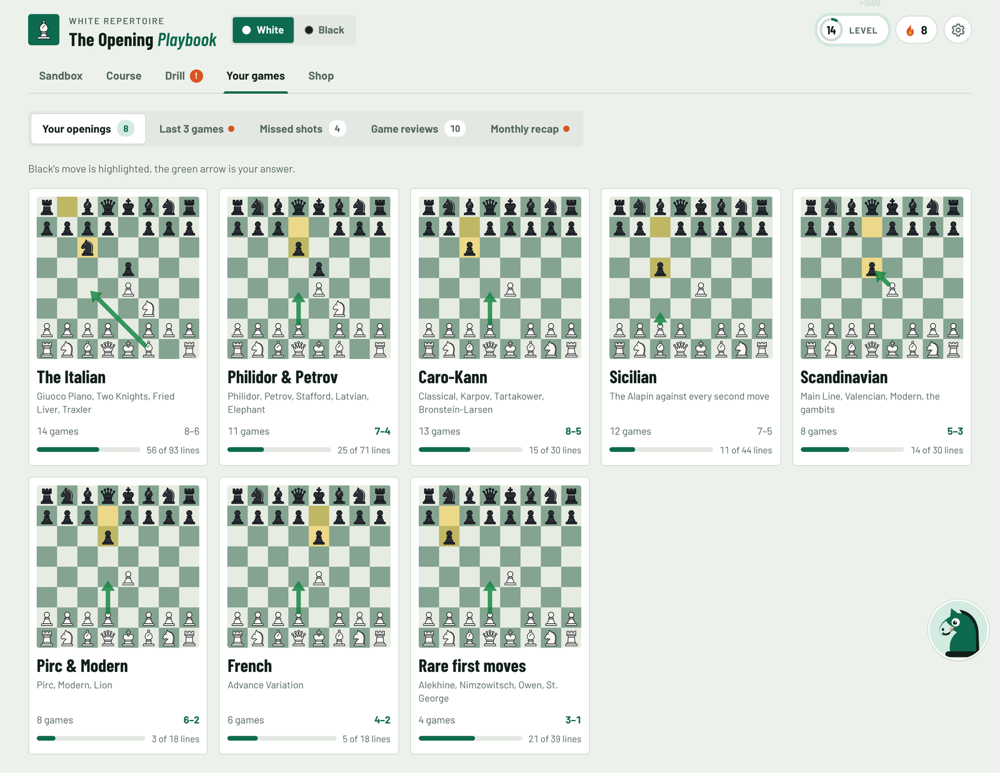

The page opens on one grid, the openings, and a switch above it brings up the other parts, so it never shows everything at once. Each opening is a tile in the old cheat-sheet look: the opponent's defining move highlighted, your answer as a green arrow, how many games it came up in, the record, and a bar for how many of its lines you can already play without a slip. **Missed shots** are four patterns that cost games, each opening a set of the real positions to practise. **Game reviews** are the most instructive games as a list; each opens at the key moment, with the story in plain words, the better continuation and the lesson that fixes the problem.

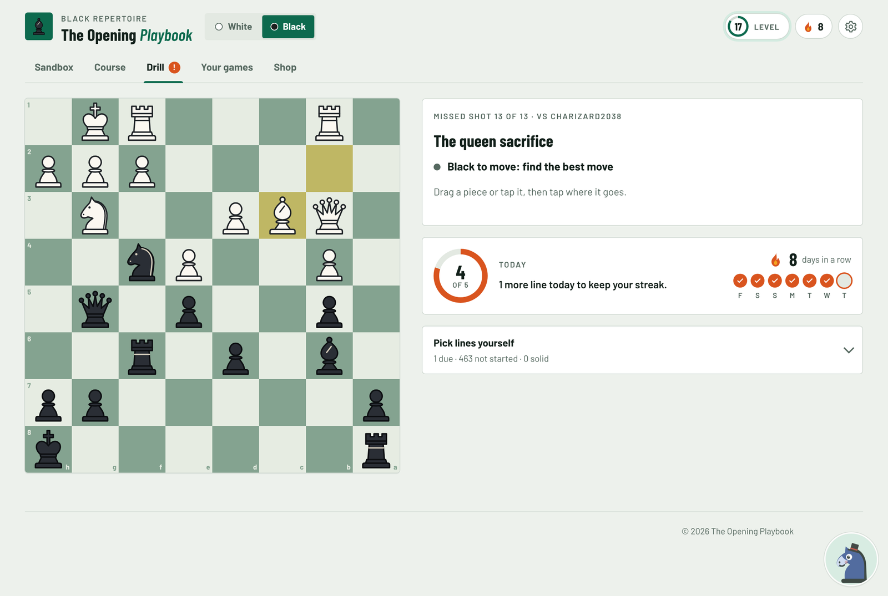

**Missed shots** are positions from the games where one move won and a different one was played. They were found by scanning every game with Stockfish and then picked by hand.

### Monthly recap: how the month went

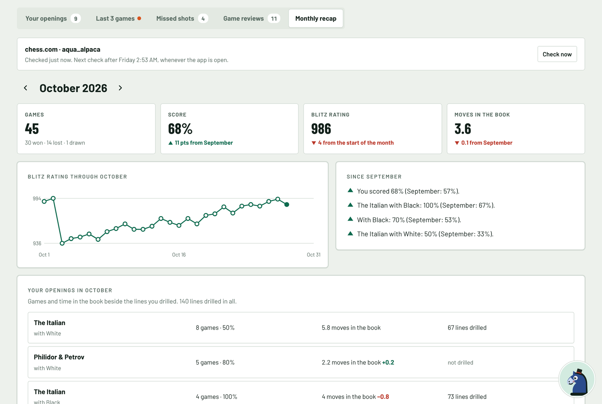

**Monthly recap**, the last part of Your games, reads the month's games straight from the chess.com account the playbook belongs to (a personal playbook uses the chess.com or Lichess account it was built from) and sets the month beside the one before: games and score, the rating at the end of the month and how far it moved, how many moves the games stayed in the book, and the rating through the month day by day. Below that come the changes that matter in plain sentences (the score, each colour, time in the book, how often you were the first to leave it, quick losses, losses on time, any opening whose score moved a lot), then each opening met that month with its games, its time in the book against the month before and the lines drilled from it that month, so practice and results sit side by side. Highlights (the best win and the game that stayed in the book longest, each linked to the game) and the position where you left the book most close the month, and a table puts the months next to each other.

The games are checked when the app opens and when Your games opens, at most every six hours (**Check now** reads them at once), and the strip at the top says when they were last read and when the next check is. The month before is read once more after it ends, so its recap is final. When a month is over, the coach says its recap is ready and the switch carries a dot until it is opened. Each month is a small summary kept with the progress, so it follows the account to every device. The claude.ai copy can't reach chess.com, so there the part points to the website, where the recaps are made.

### Each opening at a glance

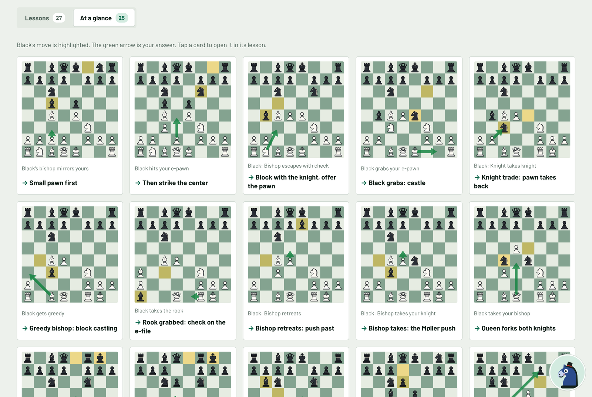

Every opening's page has a switch between its lessons and the opening **at a glance**: one card per decision, the opponent's move highlighted, your answer as the green arrow and the rule in a few words. Tap a card to open that position in its lesson. Together the cards are what used to be the cheat sheet, now kept with the opening they belong to.

### Material, movement and sound

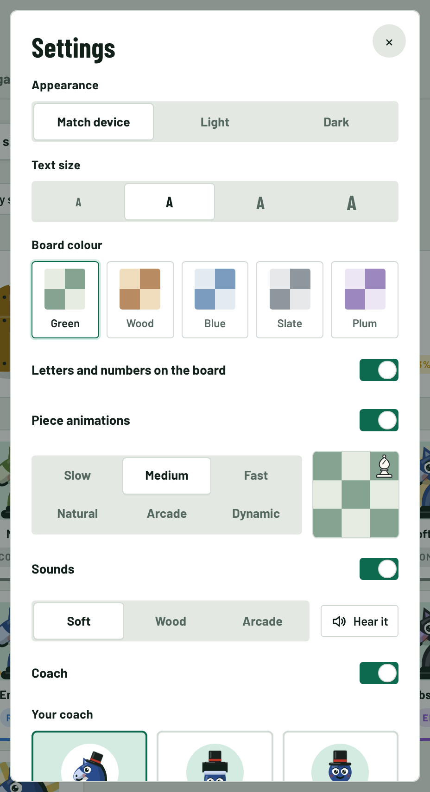

Two thin rows sit above and below every big board (a lesson, a drill, a Sandbox game, the explore board): the pieces each side has taken, and **+3** or whatever the lead is on the side that is ahead.

How a piece slides is a setting. **Piece animations** has six kinds: slow, medium (the default), fast, natural (a longer move takes longer), arcade (it runs past its square and settles back) and dynamic (the piece lifts as it travels). A small board beside them plays the one picked, and the switch turns sliding off. **Sounds** has a switch, three themes (wood, soft, arcade) and **Hear it**: a move, a capture, castling and a check each have their own, a wrong move in a drill buzzes, a clean line chimes, and the shop has its own for a buy and a crate. Every sound is made in the browser, so there are no files to load. Nobody is asked about either when they start: both come with a default and follow the player to every device.

**Advanced settings**, folded at the bottom of Settings, holds what shouldn't happen by accident: switching a system, and **Reset account**. Each asks for your username. A reset clears the lines, the streak, the badges, the level and the locker on every device, keeps the settings, and lands on the welcome screen with two choices: use the same chess account again, or link another.

### On a phone, in light or dark

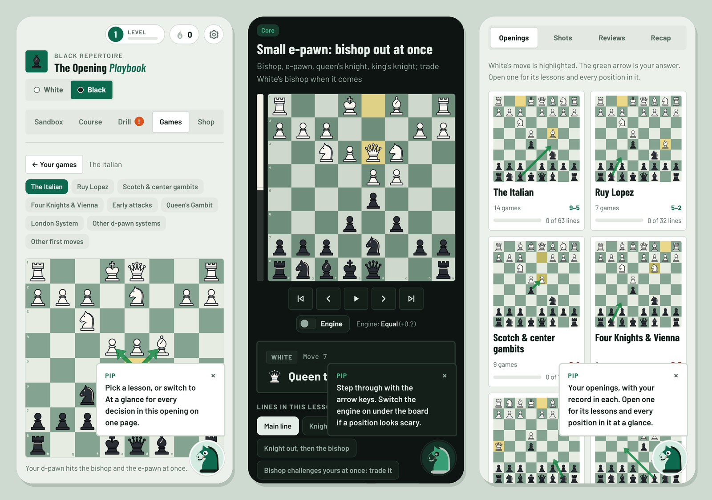

The layout collapses to one column on phones and follows the system's light or dark setting. The board, menus and drills all work by touch.

## The repertoires

### White: 1.e4, built around the Italian

| Chapter | When Black plays | Games | Record | The plan in one line |
| --- | --- | ---: | :---: | --- |
| **The Italian** | 1…e5 2…Nc6 | 14 | 8–6 | Bishop aimed at f7. Against …Bc5, play c3 and d4 (the Møller attack and four traps). Against the Two Knights, Ng5 (the Fried Liver and the main line). Rebuilt from my coach's study. |
| **Philidor & Petrov** | 1…e5 without …Nc6 | 11 | 7–4 | Take the center, then look at f7. Covers the copycat trap in the Petrov and the queen fork against the Philidor. |
| **Caro-Kann** | 1…c6 | 13 | 8–5 | Chase the bishop with the h-pawn, trade it off, castle long. If Black offers a knight trade, take it. |
| **Sicilian** | 1…c5 | 12 | 7–5 | The small c-pawn move, then d4. Whenever Black's knight is in reach of your d-pawn, push the pawn at it. |
| **Scandinavian** | 1…d5 | 8 | 5–3 | Develop with tempo against the queen. Every queen move is another move ahead. |
| **Pirc & Modern** | 1…d6, 1…g6 | 8 | 6–2 | Line up queen and bishop, castle long, trade the fianchetto bishop, push the h-pawn. |
| **French** | 1…e6 | 6 | 4–2 | Advance: lock the center and support the pawn chain from behind. |
| **Rare first moves** | 1…Nc6, 1…Nf6, 1…b6 | 4 | 3–1 | Take the whole center, develop and castle, with the one trick to know for each. |

### Black: 1…e5 against the e-pawn, one Slav setup against the d-pawn

| Chapter | When White plays | Games | Record | The plan in one line |
| --- | --- | ---: | :---: | --- |
| **The Italian** | 1.e4 e5 2.Nf3 Nc6 3.Bc4 | 14 | 9–5 | Giuoco Piano. Against c3 and d4: take, check, trade bishops, strike with …d5. Against the slow Italian, one setup every time, castling before the knight can jump at f7. |
| **Ruy Lopez** | 3.Bb5 | 7 | 5–2 | The knight hits the e-pawn, then the bishop goes to its Italian diagonal and you castle. Against the exchange, take back toward the center. |
| **Scotch & center gambits** | 2.d4 or 3.d4 | 9 | 3–6 | The bishop goes to c5 at once, as in the Italian. After a knight trade the queen comes to f6 with a threat on f2, the d-pawn takes back and you castle long. Against the Scotch Gambit the same bishop, then …d5; against the Danish and Göring, …d5 straight away; against the Center Game, kick the queen, pin and castle. |
| **Four Knights & Vienna** | 2.Nc3 or 3.Nc3 | 8 | 3–5 | Knights first, then the bishop to its usual diagonal: against the Spanish bishop that is the Ruy Lopez lesson, against the Italian bishop the Italian one. Against the Vienna bishop: knight out, …Bc5, …d6, and …h6 against the pin. Against the Vienna Gambit, leave the pawn, play …Bc5 and …d6, then the knight jumps at White's bishop. |
| **Early attacks** | 2.Qh5, 2.Qf3, 2.f4, 2.Bc4 | 6 | 3–3 | Against the queen: block f7, tuck the bishop beside the king, then castle or jump into the center. Against the King's Gambit, leave the pawn and play …Bc5, which stops White castling, then …d6, both knights out, and the knight jumps at White's bishop, the same move as against the Vienna Gambit. |
| **Queen's Gambit** | 1.d4 d5 2.c4 | 8 | 5–3 | The Slav: …c6, the light bishop out before …e6, trade it for White's, then always queen's knight, dark bishop to d6, castle. When White's bishop comes at your knight, the knight jumps to the middle and a queen check on the edge wins the bishop. |
| **London System** | 1.d4 d5 2.Bf4 | 5 | 2–3 | Copy the bishop, …e6, trade the light bishops, then offer the dark ones. The queen always takes back. |
| **Other d-pawn systems** | Colle, Torre, Veresov, Jobava, gambits | 11 | 5–5–1 | The same setup in the same order: bishop out before White's bishop and trade it. When White's queen takes back, …c6 comes before …e6, which shuts out a queen check that wins the b-pawn. When the knight is taken, take back with the e-pawn. |
| **Other first moves** | 1.c4, 1.Nf3, 1.g3, 1.e3 | 4 | 2–2 | …e5 against the c-pawn, and the Slav setup against 1.Nf3. |

72 of the 73 Black games fall into a chapter. The remaining one, an experiment with 1…b6, sits outside the book.

The named oddities are in both books too, each in the chapter where it belongs. For Black: the Halloween Gambit in the Four Knights; the Bongcloud, the Portuguese, the Alapin, the Tortoise, the Whale and Mengarini's Opening among White's second moves; the Kádas, the Ware, the Barnes, the Amar and the Sodium Attack among the first moves. For White: the Borg, the Barnes, the Ware, the Goldsmith, the Lemming, the Carr, the Hippopotamus and the Duras Gambit on move one, the Gunderam Defense and Gambit and five other odd second moves, and seven odd third moves in the Italian. 111 lines in all, drafted from the positions the books already answer, so a position that was known keeps its move.

**Gambits and replies that had no line.** The books already answered the gambits club players spring most (the Danish, the Göring, the Scotch Gambit, the King's Gambit, the Vienna Gambit, the Halloween, the Stafford, the Latvian, the Elephant, the Englund, the Smith-Morra, the Blackmar-Diemer, the Tennison, the Traxler). A scan of every book position against the Maia odds then found the replies that come up often and had nothing, and a second list added the named lines that are rare by the odds and cost a game the first time they are met. 166 side lines came out of it:

| Book | Named lines added | Frequent replies added |
| --- | --- | --- |
| **White** | In the Two Knights: the Fritz, the Ulvestad, the Kloss Gambit and the Colman. Elsewhere: the Philidor Gambit, the Albin-Blackburne, the Latvian's Greco and Fraser lines, the Maróczy Gambit in the Elephant, the Chiodini, the Portuguese and the Kloosterboer in the Scandinavian, the Anti-Alapin Gambit | 89, most of them in the Italian: the quiet third moves, five more answers in the Blackburne Shilling, the bishop that steps back, and the Two Knights worked through turn by turn (35 lines: every reply with real odds in the Fried Liver, the knight to the rim, the Traxler, the Fritz, the Ulvestad and the early queen and pawn moves) |
| **Black** | The Dubov Italian and the Walbrodt-Baird Gambit, the Pachman Wing Gambit, the Neumann in the Ponziani, the Relfsson in the Scotch, the Halasz-McDonnell, the Fyfe in the Vienna, the Walthoffen and the Rotlewi in the King's Gambit Declined, three more Blackmar-Diemer lines, the Slav's Diemer Gambit, the Williams in the Bird, the Pachman in the Nimzo-Larsen | 49: the Four Knights with the Italian bishop, the small d-pawn on move two, and the bishop moves a Caro-Kann, a Sicilian or a Scandinavian player meets every week |

### Systems

The library can hold more than one answer to the same question. A **slot** is one decision in a repertoire ("what do I play against the e-pawn?") and a **pack** is one answer to it. A player has one pack per slot, chosen in the would-you-rather cards or later in Settings. Some answers are a family with variations of their own: the Sicilian is one pick against the e-pawn, and **which Sicilian** (the Kan or the Dragon) is a second step, asked on its own card once the Sicilian is picked and shown as its own row in Advanced settings while the Sicilian is in play. Each variation is a pack like any other, and the page cuts both books down to the packs in play before anything else is built: chapters, course units, drills, the cheat sheet and the Sandbox all follow. Progress in the other pack is kept.

| Slot | Packs | |
| --- | --- | --- |
| White's first move | **Open with the e-pawn** (1.e4): the eight chapters above | the first system; 8 chapters |
| | **The London** (1.d4 and 2.Bf4): the setup, the queen raid on the b-pawn, Black's knight first, Black's bishop first, the Slav setup; the knight first (the fianchetto, the e-pawn, the d-pawn, the c-pawn at once); the other first moves (the e-pawn one square, the gambit, the c-pawn two squares, the fianchetto, sidelines) | 3 chapters, 18 lessons, 115 lines |
| | **The English** (1.c4): the King's English with the Reversed Dragon, the Smyslov and the Keres; the Symmetrical and the Anglo-Indian; Black's d-pawn at once (the Anglo-Scandinavian, the Agincourt, the Caro-Kann setup) and rare first moves | 3 chapters, 15 lessons, 194 lines |
| With the e-pawn, against the Sicilian | **The Alapin** (2.c3): the small c-pawn move against every second move | the first variation; in the eight chapters above |
| | **The Open Sicilian** (2.Nf3 and 3.d4): the Najdorf, the Dragon, the Classical and the Scheveningen; the Accelerated Dragon, the Sveshnikov and the e-pawn at your knight; the Kan and the Taimanov; the rare second moves | 14 lessons, 84 lines |
| Against the e-pawn | **Meet it head-on** (1…e5): Italian, Ruy Lopez, Scotch, Four Knights and Vienna, early attacks | the first system; 5 chapters |
| | **Caro-Kann** (1…c6): the push past, the pawn trade and the c-pawn attack, the main line, both knights, sidelines | 7 lessons, 73 lines |
| | **Sicilian: the Kan** (1…c5 with the small e-pawn and a-pawn moves): the open game, the early bishop, the small c-pawn and the pawn offer, sidelines | the first system; 1 chapters |
| | **Sicilian: the Dragon** (1…c5 with the bishop on the long diagonal): the Yugoslav Attack, the Classical, other sixth moves, the queen that takes back; the Moscow check, the Italian bishop, the small c-pawn; the early bishop, the Closed Sicilian, the Alapin, the d-pawn on move two, the f-pawn | 13 lessons, 132 lines |
| | **Scandinavian** (1…d5): the queen takes back and steps to the side, then one setup; the push past, the Tennison and Blackmar-Diemer gambits, quiet second moves | 10 lessons, 126 lines |
| Against the d-pawn | **The Slav setup** | the first system; 3 chapters |
| | **King's Indian** (1…Nf6 and 2…g6): the Classical, the Four Pawns Attack, the early bishop, the quiet setups; and the same five moves against the London, the Torre, the Colle, the Jobava and the Trompowsky | 2 chapters, 12 lessons, 136 lines |

The Caro-Kann is written as the Slav setup's twin: c-pawn one square, d-pawn two, light bishop out before the e-pawn moves. It reuses the Slav's rules where the positions are alike (after a pawn trade, both knights come out before the bishop; in the main line the queen's knight goes first). Two of its lines win a pawn against a move a third of club players make.

The London is a whole White repertoire on its own, since a player who picks it has no e-pawn lines left: one chapter for each of Black's three answers (the d-pawn, about half of club players; the king's knight, one in six; everything else). It is one setup in one order (below), with a trick ready for the usual tries: the knight that punishes the queen raid on the b-pawn while your c-pawn is at home, the queen check that wins the knight when Black jumps it at your queen, the queen that hits the b-pawn once Black's light bishop has gone to your knight, the c-pawn capture that wins Black's queen when it stands behind its bishop on your bishop's diagonal, and the one move that avoids the mate trap in the e-pawn gambit (a line that shows the trap is marked as a mistake and never drilled). Black's moves come from the Maia odds at club level; the house player has no games with it, so its chapters show no record. Opening the White book with the London in play, the Sandbox plays the d-pawn for you, and the course puts the three London units where the e-pawn units were.

The newest packs are each one setup in one order, like the London, and were drafted the same way ([`pipeline/draft.py`](pipeline/draft.py)): the other side's moves come from the Maia odds, yours from the setup's order wherever Stockfish accepts it, and the engine's move where it doesn't. Every place where the order changes has a note that says why.

| Pack | The order | Where it changes |
| --- | --- | --- |
| **Scandinavian** | Take back with the queen, step to the side when the knight hits her, then king's knight, c-pawn one square, light bishop out, e-pawn one square | The queen goes home early when a knight or a bishop is about to trap her on the edge. Against the push past, the bishop comes out first and the c-pawn goes two squares. |
| **Sicilian: the Dragon** | C-pawn two squares, take the d-pawn when it comes, then d-pawn one square, king's knight, g-pawn one square, bishop to the long diagonal, castle, queen's knight | When White leaves the f-pawn at home, the knight jumps at the bishop. Against the small c-pawn, and the gambit that offers it, the knight hits the e-pawn first. A queen that takes back in the middle is hit by the queen's knight, and a bishop check is blocked by the bishop. |
| **The Open Sicilian** | King's knight, d-pawn two squares, take back with the knight, queen's knight, f-pawn one square, bishop beside the queen, queen, castle long, then the g-pawn | When Black's e-pawn hits the knight in the middle it steps back toward the queenside, or jumps forward when the square in front is free. Against the Accelerated Dragon the bishop comes out before the f-pawn, to stop the d-pawn going two squares. When the knights are traded, the queen takes back. |
| **King's Indian** | Knight, g-pawn one square, bishop to the long diagonal, d-pawn one square, castle, then the e-pawn two squares | When White's queen's knight comes out in front of its own c-pawn, your d-pawn goes two squares to stop the e-pawn. With White's bishop at your knight, the queen's knight backs up the e-pawn first. |
| **English** | C-pawn two squares, queen's knight, g-pawn one square, bishop to the long diagonal, e-pawn two squares, king's knight tucked in behind it, castle, d-pawn one square | When Black's d-pawn comes two squares, take it; once the c-pawn is gone, the king's knight comes out in front of the f-pawn instead. Against the e-pawn one square the knight comes out first. When knight and bishop (or queen and bishop) aim at f2, the e-pawn goes one square. |

The chapter for White's other first moves is shared by every Black pack. A King's Indian player meets the English and the flank openings with the same e-pawn and d-pawn answers as everyone else; a fianchetto answer there would give one position two moves.

Inside the packs a player can hold together, one position still gets one move. Two packs of the same slot may answer a position differently, so the repeat check runs once for every combination of one pack per slot. The game analysis follows the same rule: a player's games are read against one pack per slot (the ones they picked, or before they pick, the ones their games fit), so a move that only another system plays still counts as leaving the book.

### One setup, one order

The Slav setup covers the Queen's Gambit, the London, the Colle and the other d-pawn systems, so it has to come out the same way every time. A drill should never ask for two different moves in one position, and it should never ask for the same moves in a different order without saying why. The order is:

1. **d-pawn** two squares.
2. **c-pawn** one square, as soon as something asks for it (the table below). Otherwise it waits.
3. **King's knight.**
4. **Light bishop** out to f5, then the **e-pawn** one square behind it. If White offers the light bishops, trade.
5. **Queen's knight** to d7.
6. **Dark bishop** to d6.
7. **Castle.** If White's e-pawn then pushes into the middle, take it and trade knights.

The places where the order changes, each with the reason the lesson gives:

| When | What changes | Why |
| --- | --- | --- |
| White's c-pawn attacks the d-pawn | …c6 on move two | It guards the d-pawn with a pawn and keeps the bishop's diagonal open. |
| White plays the small e-pawn move with no piece out | Bishop before the king's knight; the knight comes after …Nd7 | From home the queen still guards the edge square, so White's knight can't chase the bishop, and the knight on d7 blocks the queen check. |
| White trades the c-pawn for your d-pawn | Both knights before the bishop, and the queen's knight goes to c6 | With the c-pawns gone, White's queen can hit the b-pawn the moment the bishop leaves. The knight on c6 answers that by jumping to the edge at the queen. |
| White's queen has taken back on d3 after the bishop trade | …c6 before …e6 | Without it the queen checks on the queenside and wins the b-pawn. Club players find that check about one game in six. |
| London bishop on f4 | Dark bishop to d6 straight after …e6, and the queen takes back | Trading the London bishop is the point; taking back with a pawn loses a pawn in the c-pawn lines. |
| Both White knights out in the Queen's Gambit | Take the c-pawn and hold it with the b-pawn | The bishop can't come out safely yet, and White needs several moves to win the pawn back. |
| White's bishop comes at the king's knight | The knight jumps to the middle if that square is free | It hits the bishop, and the queen check on the edge wins it if White takes the knight. |
| White fianchettoes, or the c-pawn pushes past | Dark bishop one square shorter, to e7 | On d6 it would be hit by the pawn or stare at a guarded pawn. |

The London has its own order, the same against almost every Black setup:

1. **d-pawn** two squares.
2. **Dark bishop** out to f4, before the e-pawn moves and shuts it in.
3. **E-pawn** one square.
4. **King's knight.**
5. **C-pawn** one square.
6. **Queen's knight** to d2, beside the queen.
7. **Light bishop** to d3.
8. **Castle.**

The places where it changes:

| When | What changes | Why |
| --- | --- | --- |
| Black's dark bishop comes to d6, opposite yours | Bishop back to g3; if Black takes, the h-pawn takes back | It keeps the London bishop. After the trade the rook behind the h-pawn looks straight at Black's h-pawn. |
| Black's light bishop comes out to f5 | Light bishop to d3 at once, and the queen takes back | It is Black's best minor piece. With the queen on d3, a knight jump at her loses the knight to a queen check. |
| That bishop stays on f5 behind the e-pawn, or steps back to g6 | Take it, before the queen's knight goes to d2 | With the knight on d2 the queen no longer guards your bishop, and Black's bishop would take it for free. |
| Black's light bishop goes to g4, at your knight | C-pawn, then the queen to b3 | The bishop has left Black's b-pawn without a guard. |
| Black's queen comes to b6 at your b-pawn, your c-pawn already on c3 | Queen to b3, offering the trade; if Black's c-pawn chases her, to c2 | If Black trades, the a-pawn takes back toward the middle and the rook gets the a-file. |
| The same, with your c-pawn at home and Black's on c5 | Queen's knight to c3 | If the queen takes the b-pawn, the knight takes on d5, the rook chases her, and the knight check next to the king wins the corner rook. |
| The same, with Black's c-pawn on c6 | Queen to c1 | The knight trick doesn't work with that pawn guarding d5. |
| Black's c-pawn takes on d4 | The e-pawn takes back | It keeps a pawn in the middle and opens the e-file. |
| Black's queen stands behind its bishop on your bishop's diagonal | Take on c5 with the d-pawn | If the bishop takes back, your bishop takes the queen. Half of club players fall for it. |
| Black's rook goes behind the e-pawn | Knight to e5 before the castle | The knight takes the square before Black's e-pawn can push. |
| Black fianchettoes | Light bishop to e2, and h3 once Black's d-pawn moves | On d3 a pawn fork waits for it; h3 gives the London bishop a way back when the knight or the e-pawn comes at it. |
| Black's c-pawn goes two squares on move one, or straight after the knight | Push the d-pawn past it, then the queen's knight and the e-pawn | With the bishop out first, Black's queen would come at the b-pawn with gain of time. |

Three checks keep it that way ([`pipeline/lint_claims.py`](pipeline/lint_claims.py)), and the build stops when any of them finds something:

- **Repeats.** Every position where it is your move is collected across all lines of a book. If two move orders reach the same position and the book answers with different moves, that is an error.
- **Pins.** A label or note that speaks of a pin needs a real one on the board: a piece attacked by a bishop, rook or queen with its king or a more valuable piece right behind it. A bishop that comes at a knight while the e-pawn is still at home pins nothing, and the text may not say it does.
- **Guards and hits.** A label that says the move guards a piece, or hits one, is compared with the board: after the move, that piece must have a new guard or a new attacker.

## How it was made

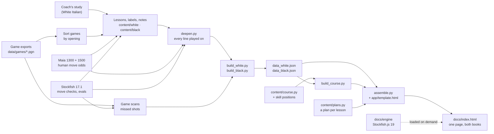

1. **The games.** PGN exports of my games live in [`data/games`](data/games). `black_games.py` collects the Black games and `black_chapters.py` sorts them by White's setup. The White build does the same by Black's reply.
2. **Your moves.** The White Italian chapter started from my coach's Lichess study and was rebuilt line by line. The other seven White chapters and the whole Black book were written from my games. The aim was sound lines that are easy to remember (one setup against many move orders, the same idea showing up across chapters), with every move checked by Stockfish.
3. **The opponent's moves.** The Maia 1300 and 1500 models are averaged to give the probability of every legal move in every position. [`pipeline/maia.py`](pipeline/maia.py) is a short NumPy implementation of the Leela Chess Zero network forward pass. It reads the Maia weight files directly, so it needs no lc0 binary, TensorFlow or GPU. While the books were being written, [`expand.py`](pipeline/expand.py) walked the tree and listed every opponent reply with at least a 10% chance whose line is reached in at least 0.4% of games, flagging any position the book had no answer for yet. [`check_black.py`](pipeline/check_black.py) checks every Black line for legality, the quality of your moves (Stockfish multi-PV), how realistic the opponent's moves are, and which common replies a line leaves uncovered.
4. **Words, not notation.** Hand-written labels and notes live in [`content/`](content), keyed by the move sequence that reaches each position: `n(path, label, text, tags, arrows, circles)`. Moves without a hand-written label get one from [`label2.py`](pipeline/label2.py), which describes what the move does in context: captures and recaptures, checks, pins, attacks on a bigger or loose piece, castling, pawn pushes. [`lint_notes.py`](pipeline/lint_notes.py) checks claims in the notes, such as pins or "a piece up", against the real positions.
5. **Game reviews.** [`scan_games.py`](pipeline/scan_games.py) evaluates every move of every game. [`find_shots.py`](pipeline/find_shots.py) keeps positions where the move played lost at least 1.8 pawns and a deeper multi-PV search shows one clearly best move, at least 1.5 pawns ahead of the next. The cleanest of these became the puzzles. The game stories and the cross-game patterns were written from the same scans.
6. **Lines played on.** A line as written often stops when the pieces are out, and that is where the questions start. [`deepen.py`](pipeline/deepen.py), a step of both builds, continues every line two moves at a time. The other side makes the reply club players pick most (Maia). Your side plays the move the book already has for that position, else a capture, check or clearly best move from Stockfish, else castling or a developing move the engine has within 0.3 of its best, else its best. A line goes on until it is 18 plies long and the next move is neither forced nor an only move, and never past 26. It never comes back to a position it has had: a check that takes nothing gives way to a capture that is as good, and when the other side's reply does bring a position back, the line returns to that turn and tries another move. A line that is already won, a line that shows a mistake on purpose, and a stem (a lesson on the first three moves that other lines go on from) stay as written. [`fill.py`](pipeline/fill.py) then looks for replies the book had no line for: any reply picked at least one time in ten that comes up in three games in a thousand, with a finer net for the Italian and for the Four Knights and Vienna, plus a list of named gambits that are rare by the odds and cost a game the first time they are met (the Fritz, the Ulvestad, the Portuguese, the Dubov Italian, the Blackmar-Diemer's side lines and others), and the Two Knights by hand, reply by reply, since the net doesn't read the lines it has just drafted. Each becomes a side line of the lesson it leaves, and the line it leaves is still played on. Where a pick misses the point, [`content/deepen_fixes.py`](content/deepen_fixes.py) fixes the move by hand for that position, and the build works the line out again by itself. The results are cached, so a rebuild needs no engine. `make check` reads the lines as built, and a move it flags is measured once more against the engine's own move at the same depth, so two searches that merely disagree no longer show up as a loss.
7. **Build.** [`build_white.py`](pipeline/build_white.py) and [`build_black.py`](pipeline/build_black.py) merge all lines into one tree per book ([`tree.py`](pipeline/tree.py)). They attach labels, notes, arrows, odds and evaluations, precompute the legal moves wherever you are to move, and write `data/build/data_*.json`. [`assemble.py`](pipeline/assemble.py) injects both books and the piece set into [`app/template.html`](app/template.html) and writes [`docs/index.html`](docs/index.html).
8. **The course.** [`content/course.py`](content/course.py) lists the units in order: required and optional lessons, the idea boards as move paths with arrows, and the checkpoint positions. `DEEP` in the same file groups each unit's optional lessons into deep dives: parts with a title, a line on why they matter and the words for their first board. The build places that board where the part's lessons split, adds one board per lesson at its own first new move, and picks six checkpoint positions from the part's lines. Every lesson goes in exactly one part, so the deep dives reuse moves already in the books. [`build_course.py`](pipeline/build_course.py) resolves every path against its book (a path that leaves the repertoire fails the build) and writes `data/build/data_course.json`. The skill positions come from a Stockfish scan of all 200 games. [`data/course_threats.json`](data/course_threats.json) holds moves that lost at least 20 points of win chance to a tactic, with the moves that would have held and the engine's answer to every other legal move. [`course_finish.json`](data/course_finish.json) and [`course_endings.json`](data/course_endings.json) use the same format. The first has positions where I had at least a 78% win chance and my move gave up 15 points or more; the second has endgame moves that cost 12 points or more. In both, a move counts as right when it stays within 7 points of the best one.
9. **Plans.** [`content/plans.py`](content/plans.py) has plans written by hand for the positions the lessons' main lines ended in, kept to six kinds of bullet: king, pawns, pieces, target, their plan, watch for. A main line the build has played on ends somewhere else now, so its end gets a plan read off the new last position like a side line's ([`plan_lines.py`](pipeline/plan_lines.py)), and the written plan shows in the lesson at the move it was written for. The list of moves has a divider there, *How it usually goes on*: before it is the opening to know, after it the likeliest game. `assemble.py` attaches them and checks them for notation.
10. **Checks.** `assemble.py` refuses to build a page in which one position gets two different answers, or a label claims a pin, a guard or an attack that is not there ([`lint_claims.py`](pipeline/lint_claims.py)). `make check` adds an engine pass over every Black line ([`check_black.py`](pipeline/check_black.py)) and a wording pass that compares notes with their positions ([`lint_notes.py`](pipeline/lint_notes.py)). The numbers in this README are checked too: [`lint_counts.py`](pipeline/lint_counts.py) works every quoted count out again from the built books, `assemble.py` runs it after writing the page and fails on a stale one, and `--write` puts them right. The page itself never quotes a count: what it shows is counted from the book it carries.
11. **Line versions.** Progress is stored per line. [`data/line_versions.json`](data/line_versions.json) keeps a fingerprint of every line's moves, and `assemble.py` raises a line's version when the moves change. The page then treats an older record of that line as due again and marks it **Changed**, so a rewritten line is never shown as mastered on the strength of moves it no longer has.
12. **Caches.** Every Stockfish and Maia result is cached in [`data/cache`](data/cache) and committed. That makes the build reproducible byte for byte with nothing but python-chess, in a few seconds and without any engine.

## For developers

The whole app is one HTML file built from plain Python and JavaScript. Each part below opens.

<details>
<summary><b>Under the hood</b> · one file, the board, the engine, progress and accounts</summary>

- **One file.** The app is one HTML file of about 8 MB (1.2 MB over the wire) with both books inline: plain HTML, CSS and JavaScript, with no framework or bundler. [chess.js](https://github.com/jhlywa/chess.js) is inlined for the explore board. The only scripts loaded from elsewhere are the engine, when you ask for it, and supabase-js, on the website when accounts are set up. Fonts come from Google Fonts (Barlow Condensed, Barlow, JetBrains Mono); offline, the app falls back to system fonts.
- **Board.** The board is SVG, drawn with an original piece set ([`app/pieces.py`](app/pieces.py)). It supports drag and tap input, legal-move hints, arrows, circles and a flipped view for Black. Legal moves are precomputed for every book position where you move, so lessons, drills and the sandbox need no chess library.
- **Engine.** [`docs/engine`](docs/engine) holds the lite single-threaded build of [Stockfish.js](https://github.com/nmrugg/stockfish.js) 19: a 28 KB script and a 1.8 MB WebAssembly file, fetched the first time the engine is switched on and run in a web worker. The page talks to it in plain UCI text. Each position gets two searches: a short one with the move handed to the other side (their idea), then the three best moves to depth 22 or seven seconds. Results are kept for the session, so stepping back and forth is instant. The engine's moves are put into words by a small JavaScript twin of `label2.py`. The single-threaded build needs no special server headers, so it runs on GitHub Pages; it can't start from a page opened as a file, and the card says so.
- **Explanations.** [`app/ideas.js`](app/ideas.js) reads a position with chess.js and a few rules (attack maps, a static exchange that leaves pinned pieces out, threats found with a null move, a two-move look for forcing checks) and returns at most two plain-English lines for a move: `Ideas.of` for what a move does, `Ideas.punish` for the best answer to a move off the book, `Ideas.reply` for why a known answer works. It has no DOM, so `tests/ideas_check.js` runs it under Node over every book move. The page calls it when a move is shown, never ahead of time.
- **Last three games.** `Review` in [`app/product.js`](app/product.js) reads the newest games through the recap's reader, walks each through the lines in play to find where it left the book, and asks the in-browser engine for an answer line (each move at depth 13) and for the first costly move (every position at depth 10, a candidate checked again at depth 14). The reviews live in the progress record and merge game by game. Drill it is its own drill kind on the drill board: a start position and a list of moves, played with chess.js.
- **Opening names.** [`pipeline/names.py`](pipeline/names.py) reads lichess's list (a name for each position, keyed by the position rather than the moves, so a transposition gets the same name) and the page carries it as one table of about 150 KB: a hash of each position, its family and its variation. A position is named after the last named position on the way to it, the way lichess names a game, so the explore board and the reviews name positions the book never reaches. The renames in [`content/opening_names.py`](content/opening_names.py) are applied at the end of both book builds and checked: every path and id in it must be in the book.
- **Plans for every line.** [`pipeline/plan_lines.py`](pipeline/plan_lines.py) gives each line that isn't a main line its plan: one written in `content/plans.py`, the plan of a main line that ends on the same position, or one read off the board from Stockfish's line (depth 18, cached by position by `plan_pv.py`). Each bullet states something the board or that line shows, and the assembly checks every plan for notation like the written ones.
- **The tour.** `Tour` in [`app/product.js`](app/product.js) is a list of steps, each naming what to light up, what to set up first (a view, a guided line, a drill started with `tour: true` so nothing is recorded), what to say and, on some steps, a tap to wait for. A dimmed SVG layer with a hole lets clicks through only where the step asks for one. Taking the tour is stamped in the progress record (the earliest stamp wins on merge) and in the browser, so it starts once per player.
- **Two books, one engine.** `loadBook()` swaps every index (nodes, lines, lessons, chapters, whose move is whose, board orientation), and `useSide()` calls it whenever something of the other book is opened: there is no switch for it. A drill or a practice game carries its colour (`D.side`), so `render()` puts the right book back when its tab is opened again. Pages that show both books at once (Your games, the Drill list) read the other one through `withBook()`. Line ids never collide between the books (the build checks this), so one progress store holds both.
- **Who is looking.** The page shows one of three things ([`app/product.js`](app/product.js)): the hand-built playbook (the personal build, and any account that had progress before personal playbooks existed), the welcome state for a player without games, or a personal playbook. The profile from the analysis is saved with the progress record, so it follows the account. For anyone but the house player, sentences about my own games are removed from the lesson notes when the page starts.
- **Progress and accounts.** Progress is always saved in the browser first. On the website, an account (email and password through [Supabase](https://supabase.com)) keeps a copy in the cloud, so the same progress shows up on every device. Sync pulls and merges on sign-in, on load and whenever the tab comes back into view: the newest record wins for each drill line and puzzle (for a line whose moves have changed, the record made on the current moves wins over a newer one made on the old moves), course steps keep the best result, the days of the streak add up across devices, badges keep the date they were first earned, bought items stay bought, each month's recap keeps its newest summary, and each setting and each worn item takes its newest value on its own (a board colour changed on the phone never undoes a coach picked on the laptop). Every save reads the account's copy first and merges, so two devices never write over each other, and a field the page doesn't know is carried along untouched. The claude.ai copy does the same through its own database, and hears the other devices while it is open. The project URL and publishable key live in [`app/site.json`](app/site.json), the tables and row-level security in [`supabase/schema.sql`](supabase/schema.sql). When the page runs as a Claude artifact, it syncs to the artifact's own per-user storage instead.
- **Reminder emails.** Off unless the player turns them on (a box at sign-up, a switch in the profile). A Supabase Edge Function ([`supabase/functions/nudge`](supabase/functions/nudge)) runs every hour and sends at most one email a week: in the player's early evening, when today's five are not done, either because a streak of three days or more ends at midnight or because lines they slipped on have waited three days. Every email has a link that turns them off. Setup is under [Reminder emails](#for-developers).
- **Deep links.** `#course` and `#unit.<unit-id>` open the course and a unit (a unit brings its own book). `#sandbox`, `#drill`, `#games`, `#shop`, `#learn.<chapter>` (an opening's page) and `#line.<line-id>` open the matching view; an old `#cheat` link opens an opening's page at a glance. Add a `b.` prefix for the Black book, for example [`#b.learn.london`](https://vladapl21.github.io/chess-opening-playbook/#b.learn.london) or [`#b.line.bs-classical`](https://vladapl21.github.io/chess-opening-playbook/#b.line.bs-classical).

<details>
<summary><b>Data model</b></summary>

Each book is one JSON object. Its `nodes` form a tree of positions, and everything else points into it by index.

| Key | What it holds |
| --- | --- |
| `nodes` | The move tree (fields below) |
| `lines` | A named path through the tree: `{id, lesson, title, main, n: [node indexes]}` |
| `lessons` | `{id, part, title, sub, why, pri: core/common/rare, outcome, lines, plan}` |
| `parts`, `chapters` | Grouping, chapter text, hero boards, facts and per-chapter game stats |
| `games` | Reviews: opponent, ratings, result, date, story, key moments, replay lines |
| `puzzles` | Missed shots: game, position, accepted answers, title, note |
| `cheat` | The cards at a glance on each opening's page: the position, your move, the rule in a few words, the lesson |
| `insights` | Patterns across games, each linked to a puzzle or a moment in a game |
| `legal` | Legal moves (UCI) for every position where you are to move |
| `stats` | Totals behind the headings: games, wins, losses, first moves |

| Node field | Meaning |
| --- | --- |
| `p`, `k` | Parent index and children |
| `u`, `pc`, `w` | Move in UCI, the piece that moved, whether White made it |
| `f` | Position after the move (FEN board field) |
| `l`, `t` | Plain-English label and note |
| `a`, `c` | Arrows and circled squares, e.g. `c4f7r` = red arrow from c4 to f7 |
| `e` | Stockfish evaluation in centipawns, from White's side |
| `q` | Probability that the opponent plays this move at this level |
| `g` | Tags: `key`, `trap`, `warn`, `mistake`, `best`, `game`, … |
| `cap`, `chk`, `mate`, `x`, `ep` | Capture, check, mate, castling rook move, en passant |

</details>

<details>
<summary><b>Drill scheduling and sandbox odds</b></summary>

**Drill.** Each line sits in a Leitner box. A clean run moves it up one box and a slip drops it to box 0.

| Box | 0 | 1 | 2 | 3 | 4 | 5 |
| --- | :-: | :-: | :-: | :-: | :-: | :-: |
| Comes back after | same day | 1 day | 2 days | 4 days | 8 days | 16 days |

**Sandbox.** At each opponent turn, the move is drawn from the replies in your book with these weights:

| Setting | Weight of a reply |
| --- | --- |
| Like real games | its human probability `q` |
| Even spread | the number of book lines behind it |
| My weak spots | the sum of "need" over the lines behind it (never played 3, due 2.5, solid 0.35, otherwise 1), times √`q` |

The rarity line in the report is the product of `q` along the opponent's moves: *"this exact line: about 1 in N games."*

</details>

</details>

<details>
<summary><b>Repository layout</b> · where each file lives</summary>

```
app/
  template.html            the whole app: markup, styles and script for both books
  pieces.py                the original SVG piece set
  site.json                Supabase project URL and publishable key for the website build
  analyze.js               game analysis for a personal playbook: PGN in, profile out; rules and counting only
  ideas.js                 what a move does, read from the board: threats, forks, pins, captures; the answer to a wrong move
  product.js, product.css  welcome, locked sections, bringing games in, the reading screen, findings, choices, the coach, the tour, the last three games
  vendor/chess.js          chess.js 0.10.3 (BSD-2-Clause), inlined into the page for the explore board
supabase/
  schema.sql               accounts: profiles and progress tables, row-level security
  nudge.sql                reminder emails: the log table and the hourly schedule
  functions/nudge/         the reminder-email function: index.ts (Deno), pick.js (who gets which email), titles.json
content/
  course.py                the course: units, idea boards, checkpoint positions; the deep dives (DEEP)
  plans.py                 the plans written by hand: each lesson's main line (W, B) and side lines (LW, LB)
  opening_names.py         real names in place of move descriptions: labels, lesson and line titles, parts
  white/                   White book: lessons, labels and notes, chapter text, game reviews; london.py and english.py,
                           the London and English packs; odd.py, odd first, second and third moves; wfill.py, the side
                           lines fill.py drafted
  black/                   Black book: bcontent (lessons), bnotes + bnotes2 (labels, notes, arrows),
                           bmeta (chapters, game reviews, puzzles, cheat sheet, insights); bcaro, bsicilian, bscandi and
                           bkid, the packs; bodd, odd first and second moves; bfill, the side lines fill.py drafted
  deepen_fixes.py          moves fixed by hand in the lines the build plays on
pipeline/
  build_white.py           build the White book    -> data/build/data_white.json
  build_black.py           build the Black book    -> data/build/data_black.json
  build_course.py          build the course        -> data/build/data_course.json
  plan_pv.py, plan_lines.py
                           Stockfish's line from every line end (cached); a plan for every line -> data/line_plans.json
  names.py                 the opening names: every book position's, the curated renames, the page's lookup table
  assemble.py              inject the books, the course, the plans and the names into the template -> docs/index.html
  tree.py, label2.py       move tree; context-aware plain-English labels
  maia.py, expand.py       human move odds (Maia, NumPy only) and the coverage walk
  human_odds.py, sf.py     command-line helpers: Maia odds and Stockfish top moves for any line
  deepen.py                plays every line on past the point where the pieces are out (part of both builds)
  fill.py                  drafts side lines for frequent replies and named gambits the book had no line for
  draft.py                 drafts a pack's lines: the other side by the Maia odds, yours from a setup's order where the
                           engine accepts it; writes the lessons, the titles and the named lines (not part of the build)
  drafts/                  the scripts that drafted the Scandinavian, the King's Indian, the English and the odd lines:
                           each one's order, hand-fixed moves, lessons and notes; run one to rewrite its module
  eng.py                   Stockfish wrapper
  black_games.py, black_chapters.py, scan_games.py, find_shots.py
                           game import, sorting by opening, engine scans, missed shots
  explain_skills.py        the reason for every wrong move in the skill units: the engine's line, cut where the loss is on the board
  check_black.py, check_white.py, lint_notes.py
                           engine and wording checks (check_white.py: the White packs after the first, or any named lesson)
  lint_claims.py           one position, one move; pins, guards and attacks in the text must be on the board
  lint_counts.py           every count the README quotes, against the built books (--write puts them right)
  paths.py, common.py      paths, environment variables, shared imports
data/
  games/                   PGN exports of my games
  cache/                   Stockfish and Maia results, so builds need no engine
  openings/                opening names from lichess-org/chess-openings (CC0), unchanged
  line_plans.json          the plan for every line that isn't a main line: its own, a main line's, or read off the board
  black_*.json             Black games, per-move scans, candidate shots
  line_versions.json       a fingerprint of every line's moves; a line's version goes up when they change
  course_threats.json, course_finish.json, course_endings.json
                           skill-unit positions from all 200 games, with the engine's answers
  build/                   data_white.json, data_black.json, data_course.json, playbook.html
docs/
  index.html               the built app, served by GitHub Pages
  engine/                  Stockfish.js 19 (GPL-3.0): the script, the WebAssembly file and the license
  img/                     the images in this README
tests/
  e2e_white.py, e2e_black.py, e2e_sandbox_switch.py, e2e_course.py, e2e_accounts.py, e2e_engine.py,
  e2e_versions.py, e2e_shell.py, e2e_onboarding.py, e2e_skills.py, e2e_packs.py, e2e_daily.py,
  e2e_shop.py, e2e_artifact_sync.py, e2e_library.py, e2e_recap.py, e2e_tour.py, e2e_review.py, e2e_marks.py
                           end-to-end browser tests (Playwright)
  analyze_check.js         the analysis run under Node on data/games, checked against known facts
  ideas_check.js           the move explainer on known positions, then over every move of both books
  nudge_check.mjs          the reminder-email rules on made-up progress records
  serve.py                 serves the built page over local HTTP for the engine test and screenshots
  fake_supabase.js         stand-in for supabase-js so account tests run offline
  readme_shots.py          regenerates docs/img
```

</details>

<details>
<summary><b>Build it yourself</b> · the tools and the five build steps</summary>

The built app is committed, so [`docs/index.html`](docs/index.html) opens straight from disk. Everything works that way except the engine, which needs the page served over HTTP: run `python3 -m http.server` inside `docs/` and open `http://localhost:8000`. To rebuild the app:

```bash
git clone https://github.com/vladapl21/chess-opening-playbook.git
cd chess-opening-playbook
python3 -m pip install -r requirements.txt     # python-chess (+ numpy for Maia)
make build                                     # or run the four scripts below
```

```bash
python3 pipeline/build_white.py
python3 pipeline/build_black.py
python3 pipeline/build_course.py
python3 pipeline/assemble.py
```

With the committed caches the rebuilt files are byte-identical to the ones in the repo.

</details>

<details>
<summary><b>Changing the books</b> · adding a line, a lesson or a system</summary>

Edit the files in [`content/`](content) and rebuild. Positions that are not in the cache yet need the engines, which are not part of this repository:

| Variable | Points to | Default |
| --- | --- | --- |
| `STOCKFISH` | a [Stockfish](https://stockfishchess.org/download/) binary (17.1 was used) | `stockfish` on your `PATH` |
| `MAIA_WEIGHTS` | a folder with `maia-1300.pb.gz` and `maia-1500.pb.gz` from [CSSLab/maia-chess](https://github.com/CSSLab/maia-chess) | `vendor/maia` |
| `LCZERO_TRAINING` | a checkout of [LeelaChessZero/lczero-training](https://github.com/LeelaChessZero/lczero-training) (for `tf/policy_index.py`) | `vendor/lczero-training` |

One way to set them up (`vendor/` is ignored by git). Stockfish's own download of its networks may be blocked; the two files are also in the [networks repository](https://github.com/official-stockfish/networks), and the build checks them by name:

```bash
mkdir -p vendor && cd vendor
git clone --depth 1 --branch sf_17.1 https://github.com/official-stockfish/Stockfish stockfish-src
(cd stockfish-src/src && for n in nn-1c0000000000.nnue nn-37f18f62d772.nnue; do
   curl -sSfLo $n https://raw.githubusercontent.com/official-stockfish/networks/master/$n; done && make -j build ARCH=x86-64-avx2)
git clone --depth 1 --filter=blob:none --sparse https://github.com/CSSLab/maia-chess && (cd maia-chess && git sparse-checkout set maia_weights)
git clone --depth 1 https://github.com/LeelaChessZero/lczero-training
cd .. && export STOCKFISH=$PWD/vendor/stockfish-src/src/stockfish MAIA_WEIGHTS=$PWD/vendor/maia-chess/maia_weights LCZERO_TRAINING=$PWD/vendor/lczero-training
```

Some useful commands while writing:

```bash
python3 pipeline/human_odds.py "e4 e5 Nf3 Nc6 Bc4"     # what club players play here, with odds
python3 pipeline/sf.py -d 18 "e4 e5 Nf3 Nc6 Bc4 Bc5"   # Stockfish's top three moves
python3 pipeline/check_black.py 16 bi-main,bs-classical  # check lessons (or all, without ids)
python3 pipeline/check_white.py 16 ld-setup,ln-kid      # the same for White: the later packs, or any lesson named
python3 pipeline/lint_notes.py                         # notes that contradict their position
python3 pipeline/lint_claims.py                        # same position, different move; pins, guards, attacks not on the board
python3 pipeline/lint_counts.py --write                # the counts this README quotes, put right after the books change
python3 pipeline/drafts/english.py                     # redraft a pack from its order, fixed moves and notes (needs the engines)
```

</details>

<details>
<summary><b>Reminder emails</b> · what has to be set up outside this repository</summary>

The reminder emails need three things outside this repository: the Supabase CLI, an email service with an API (the function uses [Resend](https://resend.com)), and a domain that service may send from. Until they are set up, the switch in the profile is stored and nothing is sent.

```bash
supabase functions deploy nudge --no-verify-jwt     # the cron call and the unsubscribe links carry their own secret
supabase secrets set RESEND_API_KEY=… NUDGE_FROM="Pip <pip@your-domain>" NUDGE_SECRET=<a long random string> SITE_URL=https://vladapl21.github.io/chess-opening-playbook/
```

Then put the project ref and the same secret into [`supabase/nudge.sql`](supabase/nudge.sql) and run it in the SQL editor: it adds the table that logs what was sent and the hourly schedule. To see who would get which email without sending anything, post `{"dry": true}` to the function with the `x-nudge-secret` header. The rules themselves are in [`pick.js`](supabase/functions/nudge/pick.js) and checked by `node tests/nudge_check.mjs`.

</details>

<details>
<summary><b>Tests</b> · what each suite covers</summary>

```bash
python3 -m pip install -r requirements-dev.txt
python3 -m playwright install chromium
make test
```

The tests drive the real page in Chromium. Run them one at a time, as `make test` does: they are timing-sensitive on a small machine. Screenshots land in `tests/out/`, and `make shots` regenerates the images in this README.

| Suite | What it covers |
| --- | --- |
| `e2e_white.py`, `e2e_black.py` | Every chapter in both books, lessons stepped through, drills played by dragging and tapping (correct moves, slips, castling), every puzzle solved, sandbox games across every opening and odds setting, deep links, both books on Your games with a tile, a shot and a review each opening in its own book, and the phone layout in light and dark mode with nothing scrolling sideways. |
| `e2e_sandbox_switch.py` | Everything plays White and Black in turn with the board turned to match, and counts the lines of both books; a colour, an opening, and openings from both books at once; every line of an opening's lessons can come up. Changing the Sandbox opening in the middle of a game never blocks a move. A position set up by hand (by the board and by the move buttons, a move not in the book refused, a move taken back) and practised: every game goes through it. **Practise from here** in a lesson does the same. A game that ends on a side line ends with that line's plan. Your own move lands at once and the reply slides; the set-up board never slides; the fold-out of the other side's moves keeps its state; the start position sits under the board; the count of lines met equals the lines a game can end on. |
| `e2e_marks.py` | The marks on known positions in both books (the Borg, the Damiano and its answer, the Fried Liver, the Grob, the Bongcloud, the Jerome Gambit, and openings that get none), how many moves get one, the chip, badge, sign and legend in a lesson, the four signs and their colours in both themes, the marks coming up on the board during a drill and a Sandbox game with the word beside them, the key move's badge staying through the reply, and none in a checkpoint; the opening's name with its trail and the tags on the moves that start a named line; the move numbers on the pieces (on from the start, kept with the settings, purple where a line plays a move at another turn), the lesson board taking moves for either side (the line's move, another book line, or the explore board with the engine), one engine readout, a drill that names a move played before its turn, and a phone in dark mode. |
| `e2e_course.py` | The first units the way a person would: the idea boards, a lesson played along with the arrows (a wrong move that doesn't count), the same line from memory with a slip (Again leads) and then clean (the next lesson leads), a checkpoint with a deliberate miss, practice games against a unit's lines, and a threat set where wrong moves get played out and punished. |
| `e2e_skills.py` | The skill units: Show me the danger, any move that loses nothing accepted, the reason for a wrong move in words (a longer trick move by move, playable on the board), the engine after each answer in a practice set but not in a checkpoint, and engine numbers from White's side with the words from yours. |
| `e2e_engine.py` | The real engine over local HTTP: the switch in Study, three different best moves with their arrows, the plan at the end of a line, moves for both sides on the explore board by tap and by drag, the engine answering, its line played out, a reload that keeps the position, and the note when the page is opened as a file. |
| `e2e_accounts.py` | Two browsers against a fake Supabase server as two devices on one account: sign-up carrying local progress along, sync both ways, an outage and recovery, a second account on the same device, the email confirmation, password reset and expired-link flows, and a new player signed up with a chess username whose games are read once, straight after. Settings, the streak, badges, worn items, the level, the tour and the last three games' reviews reach the other device, even when both change things at once or an older page writes a smaller copy. |
| `e2e_artifact_sync.py` | The same for the claude.ai copy, with a stand-in for its database shared by two browser contexts. |
| `e2e_versions.py` | The claims check on boards with a known answer; a record made before a line changed comes back as due and marked Changed, a clean run on the new moves replaces it, and two devices merge to the newer version. |
| `e2e_shell.py` | The tab order, no colour switch and both books under every tab (the Sandbox's two rows, the Drill list an opening at a time, a Black line loading its own book and keeping it across tabs), Settings, and the header from a small phone to a wide monitor with the level, streak, settings and account showing: nothing overlaps a tab and nothing scrolls sideways. Skipping to the end of a lesson doesn't count as studying it. |
| `e2e_onboarding.py` | A new visitor from the welcome screen to a personal playbook, with the games in `data/games` fetched through a stand-in for chess.com (first too few of them, then again) and as a PGN file on a phone. A card with four systems sits side by side on a wide screen and stacks on a phone. |
| `e2e_packs.py` | Systems: with nothing chosen the playbook is what it always was; the Caro-Kann chosen in Settings swaps the chapters, course units, drills, cards and Sandbox, keeps the other system's progress and switches back; a new player who plays it is offered it; the London does the same for White; the Scandinavian, the King's Indian and the English switch in and out the same way, with their main lines drilled clean. |
| `e2e_daily.py` | Today's five across both books, a streak, badges with the coach's medal held back until a line is over, settings from another device, the explore board stepped back to move one, and the coach's notes: the move that caught you, a known mistake named as one, the same move counted when it catches you again, and the note when it holds. |
| `e2e_shop.py` | The levels climbed line by line (the points floating up, a card for each level, one held back while a line is played) until level 5 opens the wardrobe; buying and wearing; the tokens adding up; the daily shop: six pieces by kind and a timer, the same shelf all day and a new one the next, a bought piece in the locker and out of the rotation, and a badge's piece waiting in the locker until the badge is earned. The fit: every hat on every coach inside its picture with a shadow under its rim, what goes round the knight's neck cut to its outline, a card showing the piece by itself, and the cards' buttons on one line. |
| `e2e_recap.py` | chess.com stubbed with three months of the house account's games: the first check reads all three, past months come out final, the month sits beside the one before, the chart has a tip for each day, Check now reads only what can still change, a failed check saves nothing, the coach says when a finished month is new and opens it, and the claude.ai copy points to the website instead. |
| `e2e_library.py` | The course finished through its last checkpoint and the big moment (shown once, with the badge kept quiet); the library: the coach's pick, reasons that change when the course record changes, the path of the first course; a deep dive part by part: the boards and their words, a practice game limited to the part, checkpoints that open the next part, a finished deep dive with its badge, each page's link after a reload, and the phone layout in dark mode. |
| `e2e_tour.py` | The tour starts by itself with the coach the player picks; there is no way to close it (Escape explains why, clicks outside the light do nothing); the tabs step with no colour switch; Play along's move by hand and with Show me; Back; Fast forward to the end through Play along, a punished slip, the arrow, the explore board and a lesson's other answers; no progress left behind; the stamp in the record and on the device; no second start after a reload; the replay from Settings ending where it began; and the card on screen at phone width in dark mode with nothing scrolling sideways. The tour names every tab, every part of Your games, every setting and every feature on its list, so a new one fails here until the tour speaks of it. |
| `e2e_review.py` | chess.com stubbed with the house account's newest games and the real engine over local HTTP: the first check keeps the newest three; a game where White leaves the Black book on move two gets the engine's answer, one where the player leaves the White book gets the book's move and why, and one where the queen goes on move seven gets the first costly move; each is drilled (a wrong move punished, the arrow after two, a clean run kept); the reviews after a reload; a new game pushing the oldest out; a pasted game and the question of which side; the coach's word about a game that left the book, with the drill on its button, the Drill page's pointer and the once-a-day reminder until the book's line is drilled clean; the Sandbox from the position; a phone in dark mode. |
| `ideas_check.js` | The move explainer under Node: known positions (a threat, a guard, the aim at f7, a mate threat made and stopped, a pin, a trade, a recapture that wins nothing, a fork, castling, the answers that punish a wrong move), then every move of both books, with no notation in any line. |
| `analyze_check.js` | The game analysis on `data/games`, checked against known facts; a King's Indian player's games are read against that system, and again at once when another is picked. |
| `nudge_check.mjs` | The reminder-email rules on made-up progress records. |
| `pipeline/lint_counts.py` | Not a browser test: every count this README quotes (the table at the top, the course and library totals, the systems) worked out again from the built books. `assemble.py` runs it and fails on a stale number; `--write` puts them right. |

</details>

## Credits

- **[Stockfish](https://stockfishchess.org)** 17.1 produced every evaluation and move check in the books (GPL-3.0; not included).
- **[Stockfish.js](https://github.com/nmrugg/stockfish.js)** 19 by Nathan Rugg and Chess.com, a WebAssembly port of Stockfish, is the engine in the app (GPL-3.0; unchanged release files in [`docs/engine`](docs/engine) with their license and a link to the source).
- **[chess.js](https://github.com/jhlywa/chess.js)** 0.10.3 by Jeff Hlywa supplies the rules on the explore board (BSD-2-Clause; inlined with its notice).
- **[lichess-org/chess-openings](https://github.com/lichess-org/chess-openings)** supplies the opening names: the name of every position, in the book or off it (CC0; unchanged in [`data/openings`](data/openings)).
- **[Maia Chess](https://maiachess.com)** by the University of Toronto's Computational Social Science Lab supplied the human move odds. See McIlroy-Young, Sen, Kleinberg and Anderson, *Aligning Superhuman AI with Human Behavior: Chess as a Model System*, KDD 2020. Weights are not included.
- **[lczero-training](https://github.com/LeelaChessZero/lczero-training)** provided the policy index used to read Maia's output.
- **[python-chess](https://github.com/niklasf/python-chess)** by Niklas Fiekas handles move generation, PGN parsing and engine communication in the pipeline (GPL-3.0).
- **The Italian chapter** of the White book is rebuilt from a Lichess study by my coach, Aleks_Ra (2022).
- **Fonts:** Barlow Condensed, Barlow and JetBrains Mono (SIL Open Font License), served by Google Fonts.
- **Games:** my own games on chess.com. Opponents appear under their public usernames.

## License

The code and the written content are released under the [MIT License](LICENSE). Stockfish, Maia, lczero-training and python-chess keep their own licenses. The two engine files in [`docs/engine`](docs/engine) are Stockfish.js under the GPL-3.0; the app runs them as a separate program in a web worker and talks to them over the UCI text protocol. chess.js keeps its BSD-2-Clause license.
